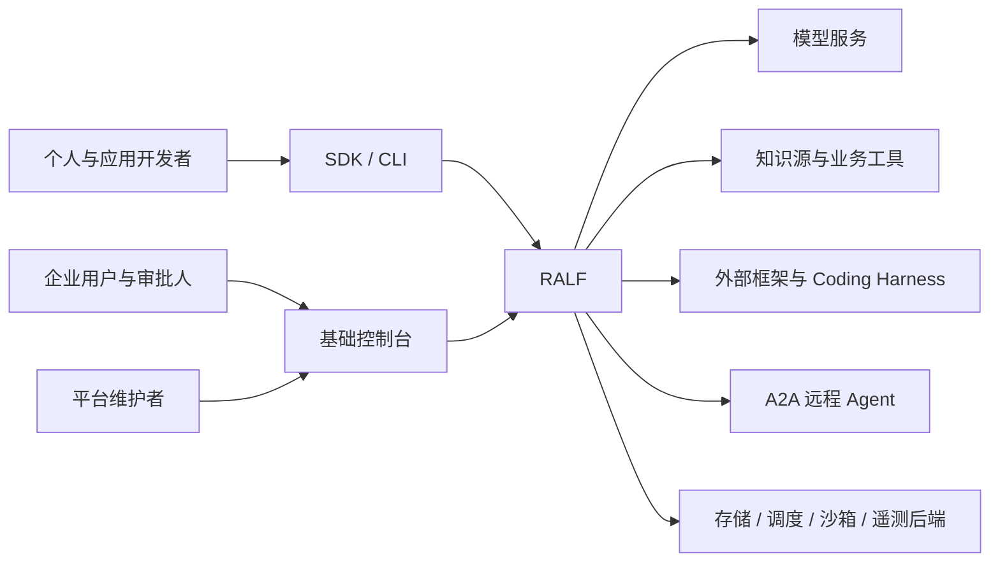
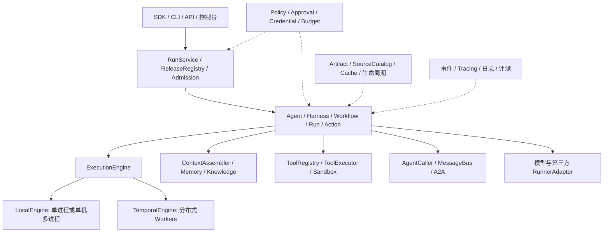

# RALF 开源 Agent 平台架构设计

版本：0.3（通用框架目标与分层验收修订；文档版本独立于产品版本）

日期：2026-10-06（Asia/Shanghai）

状态：完整架构目标；当前已交付的 v0.1 开发增量及剩余工作见 [实现状态](../docs/implementation-status.md)，不宣称以下能力已全部实现。
2026-10-06 实现更新：dev8 已交付结构化 ExecutionEngine、知识上下文与纯召回规划端口、显式适配器注册、JSON/TOML 装配及原 profile 恢复，见 [运行装配指南](../docs/runtime-assembly.md)。默认 local-4／执行 Schema v1 保留；配置版本解析不等于 Worker 版本路由、热迁移或分布式调度。Workflow 当前仍为固定顺序步骤。
dev9 模型增量增加生成参数、能力预检、完整 SSE、原生 Anthropic/Gemini 文本及 DeepSeek 非思考 preset，见 [模型指南](../docs/model-adapters.md)。流片段不成为执行事实，工具仍在完整响应采纳后派发；线上模型兼容、质量、Gemini 签名工具、多模态与模型路由尚未验收或实现。
读者：项目维护者、SDK 开发者、架构师与企业实施团队。  
项目名称：Ralf-Agent；RALF 表示 Reliable Agent Lifecycle Framework。仓库：[RalfNick/ralf-agent](https://github.com/RalfNick/ralf-agent)。

## 1. 项目定位与已确定决策

RALF 提供 Python 优先的通用 Agent 框架，包含可组合 Harness、单／多 Agent、静态／动态工作流、模型、工具、上下文、记忆、RAG 与可靠执行运行时。个人使用默认组件直接运行；企业通过同一套定义接入远程数据、持久调度、权限、审批、隔离和可观测性。

每层基础能力必须同时交付公共行为契约、可运行默认实现、独立替换入口和共同验收，让开发者通过配置、组件注入和流程组合快速实现业务。同一份 Agent／Workflow 定义在不同运行模式下保持明确的执行、授权、恢复与审计语义；审批及效果核验贯穿整个框架。适配器公开能力差异，通过测试验证兼容程度。项目价值通过实际采用成本、任务成功率、成本、延迟、人工介入与恢复结果证明。

用户明确的完整目标、逐层默认／适配矩阵、三种静态编排、动态 Plan、多 Agent 和 AgentScope 对标要求见[通用框架能力与扩展验收](viewpoints/framework-capabilities.md)。该文细化目标和建设顺序；当前 dev9 的顺序 Workflow、已交付组件与剩余缺口仍按实现清单公开。

本文描述完整企业架构目标。v0.1／v0.2 是逐步验证核心契约的工程预览，v1.0 是完成企业验收的首个正式版本；接口预留、内部验证和已支持能力分别标识。review 对团队规模的假设不作为删减企业目标的依据，建设范围按第 15 节分期。

| 决策 | 首个正式版本 v1.0 的目标选择 |
| --- | --- |
| 主语言与许可证 | Python 优先；SDK、运行时、治理和自部署基础能力全部 Apache-2.0 |
| 核心架构 | 自主 Agent、Harness、Workflow、Run／Action 语义，复用成熟基础设施 |
| 产品交付 | SDK、CLI、自部署 API 服务、基础控制台 |
| 默认执行 | 单进程 asyncio＋SQLite，无需外部调度服务 |
| 单机并行 | 单 Coordinator＋多 Process Worker |
| 分布式执行 | 默认 Temporal，支持多主机 Workers；执行引擎接口可扩展 |
| 编排 | 顺序 Pipeline、静态 Graph、流式数据编排、动态 Plan／受控重规划，共用计划与执行契约 |
| Agent 类型 | General、Search／RAG、PlanAndExecute、Coding 能力包，共用运行时与治理契约 |
| 多 Agent | 子任务调用、消息／事件；远程通过 A2A |
| 企业部署 | 单企业私有化、多工作区；公网多租户后置 |
| 业务模板 | 企业知识库；Oncall 自动诊断，生产变更经人工批准 |
| 后端替换 | 模型、记忆、知识、向量、工具、消息、执行组件分别可替换；配置替换＋显式迁移，已有运行保留原后端和版本完成 |
| 正式版边界 | 不交付持续群聊平台、拖拽编排、公共插件市场或运行中热迁移 |

## 2. 参考项目与设计取舍

以下是截至本次设计讨论核对的参考，不构成性能优越性或全面兼容的声明。

| 参考 | 借鉴内容 | RALF 的选择 |
| --- | --- | --- |
| [LangChain／LangGraph](https://www.langchain.com/oss-overview) | 快捷 Agent API 到可定制工作流的渐进层次 | 简单入口和高级编排共用领域契约 |
| [AutoGen](https://github.com/microsoft/autogen)／[Microsoft Agent Framework](https://learn.microsoft.com/en-us/agent-framework/overview/) | 消息、协作模式、Harness 与 Workflow 分层 | 多 Agent 策略下沉同一 Run／Action 体系；新项目同时参考其当前后继框架 |
| [AgentScope](https://github.com/agentscope-ai/agentscope) | Python Agent、工具、协作和部署体验 | 借鉴少量清晰抽象，以跨后端行为测试验证兼容 |
| [Codex App Server](https://learn.chatgpt.com/docs/app-server) | Thread／Turn、事件、恢复与审批接口 | 通过正式接口接入 Coding Harness |
| [Claude Agent SDK](https://code.claude.com/docs/en/agent-sdk/overview) | Sessions、上下文、Hooks、Skills 与工具控制 | 可选 Harness 后端；独立声明能力与运行条款 |
| [DeepSeek Harness](https://github.com/deepseek-ai/deepseek-harness/blob/master/docs/architecture.md) | 插件生命周期、能力边界与事件体系 | 借鉴插件式扩展，自主定义稳定公共契约 |
| [AweGen 参考资料](https://bytedance.larkoffice.com/docx/H7rAd2RbKo6OiFxI0PBcZsyanxf) | Core／Chat／Ext、Actor、SAEP 与 Oncall 思路 | 保留分层与事件设计，明确持久执行及治理边界 |

第三方产品的运行时与适配器分开管理。RALF 开源自己的适配器，不把 Claude Code 等产品视为可任意复制的开源内核；各外部依赖保留自身许可与使用条件。[Claude Code 许可](https://github.com/anthropics/claude-code/blob/main/LICENSE.md)

## 3. 系统边界与分层

### 3.1 系统上下文

### 3.2 逻辑组件

上图表示逻辑依赖，不要求每个模块独立部署。采用模块化代码组织；企业部署分离 API／控制台、执行 Workers、沙箱和基础设施。个人模式直接在 SDK 进程使用内核。

### 3.3 核心职责

| 层 | 职责 | 不承担的职责 |
| --- | --- | --- |
| Agent／AgentSpec | 定义目标、输入输出、模型、指令、工具、记忆策略及执行限制 | 不自带第二套持久调度器 |
| 原生 Harness | 纯同步装配请求、解释完整模型响应与提出决策；异步规划／摘要等交由受管理执行阶段 | 不直接执行 I/O、批准工具、提交运行状态或调度重试；外部完整 Harness 由 Runner 适配 |
| Workflow | 解释依赖、分支、并行、受限循环、等待与计划提案 | 不在确定性解释器中直接执行外部 I/O |
| ExecutionEngine | 唯一提交 Run／Action 状态转换，序列化计划与调度，处理命令、等待、取消和恢复 | 不把对话记忆作为执行状态 |
| ToolExecutor | 接收引擎已授权并记录意图的执行请求，执行一个 Attempt 或查询其效果，返回观察证据 | 不批准工具、不预留预算、不提交 Run 或调度重试 |
| Adapters | 外部模型、工具、框架、完整 Harness、远程 Agent | 不虚构外部实现缺失的恢复或拦截能力 |
| Governance | 身份、资源授权、审批、凭据、预算与审计 | 不接受模型输出作为授权依据 |
| Data／Observability | 数据、产物、来源、生命周期与遥测 | 遥测不作为执行恢复的权威来源 |

原生循环的编程边界为 Harness 提案 → Engine 采纳并提交 → Executor 执行 → Engine 采纳结果。可恢复步骤和外部委派分别遵循 [Action 恢复契约](specs/action-recovery-contract.md)与 [Runner 能力契约](specs/runner-capability-contract.md)。

dev6／local-4 已提供 `Harness`／`NativeHarness` 和 `ToolExecutor`／`PythonToolExecutor` 可替换端口。LocalEngine 在独立接收事务保存完整模型响应或效果观察，再提交决策／结果；内核保留当前授权、审批、预算和状态权威。此实现只覆盖原生 Agent 与顺序 Workflow；Workspace、Skills、Coding Runner 和分布式能力仍按后续阶段交付。具体 DTO、阶段和验证边界见[执行组件指南](../docs/execution-components.md)。

## 4. 领域对象、请求与状态契约

### 4.1 公共对象

| 对象 | 最低职责 |
| --- | --- |
| AgentSpec | Agent 输入输出、指令、模型、工具、记忆策略、Runner 与能力要求 |
| WorkflowSpec | 类型化节点、依赖、分支、合并、循环界限与结果验收 |
| PlanRevision | 已接受的计划版本、变更来源、变更理由与校验结果 |
| ReleaseManifest | 固定上述定义、工具、Skill、Policy、执行器及依赖摘要 |
| RunRequest | 输入引用、已验证身份、工作区、请求幂等键、预算、截止时间、发布版本 |
| RunHandle | 状态、事件、结果、补充输入、审批提交与取消入口 |
| Action | 稳定逻辑身份、执行器、参数摘要、效果类型、尝试及结果 |
| TaskResult | 完成状态、结构化数据、证据与产物、失败或部分结果 |
| RunEvent | Run／Action／父子关系、事件序号、类型、时间与 Trace 关联 |
| ArtifactRef | 产物身份、版本、摘要、访问范围、来源与保留策略 |
| CapabilityDescriptor | 支持的输入输出、流式、取消、恢复、拦截、隔离及持久性能力 |

Agent 和 Workflow 使用统一提交入口。Session 表示会话连续性；Run 表示一次有固定版本、身份、预算及终态的执行。传输对象可序列化，跨进程不传活对象或任意可执行闭包。

### 4.2 请求幂等与并发控制

- 提交幂等键限定在工作区和调用身份内。同键同请求返回原 Run；同键不同内容返回冲突，不创建第二个 Run。
- 审批、输入回复、计划变更和取消具有稳定控制请求 ID。重复提交不重复产生效果。
- 审批、输入回复和计划变更绑定待处理对象摘要或预期版本，冲突显式返回。取消针对逻辑 Run 的当前非终态停止意图，不要求客户端预期版本；已终结时返回 too_late／already_terminal，不覆盖终态。
- 命令回执分开 record_state=durably_recorded 与 apply_state=pending／applied／rejected；accepted 等具体传输回执不能代替引擎已生效证据。Temporal 控制存储中的审批决定与 Outbox 提交不等于 Workflow 已消费。
- submit 返回表示请求已可靠记录并进入交接；运行结果通过 RunHandle 或事件获取。status 明确投影版本与滞后，需要判定命令生效时读取引擎事实或命令回执。

精确返回保证、并发冲突及各引擎实现见 [Run 命令与状态契约](specs/run-command-contract.md)。

### 4.3 状态机

Run 公开状态包括 queued、running、waiting_input、waiting_approval、waiting_auth、waiting_reconciliation、cancelling、cancelled、succeeded、failed。等待具有待处理对象与截止时间，不能只以一段文本表达。

成功、失败与取消是终态，不直接重新打开。显式重试创建带原 Run 引用的新运行；引擎崩溃后的恢复继续原逻辑 Run。存在未知写效果时，先核验再决定是否允许新的重试。

取消与成功的竞争按引擎串行应用命令／提交终态的顺序裁定，不按 HTTP 请求时间或客户端时间裁定。取消已 recorded 时仍可能晚于成功提交；cancelled 也不表示外部业务效果已回滚。

Action 区分待调度、执行中、已确认结果、失败、取消与 outcome_unknown。取消请求、运行取消生效与外部效果核对分开记录。

### 4.4 事件订阅

状态相关事件具有稳定事件 ID 和逻辑 Run 内单调序号，并在各引擎权威提交边界可靠保存；展示投影可延迟。订阅允许重复投递，客户端按事件 ID／序号去重，支持游标恢复、分页和背压。游标超出保留范围时明确返回快照及续订位置，不把断线解释为任务完成，也不重新提交任务。Token 流与诊断遥测可采用独立保留策略，不能用于恢复业务执行。

## 5. Agent、Harness 与工作流

### 5.1 原生 Agent 与 Harness

General、Search／RAG、PlanAndExecute、Coding 优先作为能力包与配置组合，共用运行时与治理契约。简单 Agent 使用原生决策／工具循环；PlanAndExecute 组合受管理规划与验证阶段。Coding 增加文件、代码、测试和 Workspace 能力，并可选择外部 Coding Harness。

原生 Harness 消费上下文、工具目录及相关制品，纯同步地准备请求和解释响应；上下文检索、Skills 加载、Workspace 与产物 I/O 由相应受管理组件完成。Skill 是按需加载的说明制品，不能自动授予工具权限。外部完整 Harness 的内部能力通过 Runner 声明。

原生执行以模型 Action、工具 Action、持久人工等待和子 Run 作为恢复边界，不能把整个 Agent 循环封装成唯一的大 Action。模型调用前保存必要的 ContextSnapshot／Manifest；引擎采纳模型响应时，一并提交响应引用、稳定的拟执行 Action 清单及参数摘要，之后才允许工具调度。

重放复用已采纳响应、上下文和 Action，不重新询问模型来替换已采纳决策。模型请求已发出但响应尚未采纳时，可以按策略重新发起决策尝试，记录潜在重复成本和未知用量；该窗口还不能触发工具效果。新一轮决策、显式重规划和历史重放分别记录。

持久等待不占住 Worker，恢复原等待对象；子任务保留子 Run 身份及结果引用，不因父任务恢复重复创建。完整外部 Harness 的内部步骤按其能力声明处理，不能自动成为 RALF 可逐步恢复的状态。具体提交和崩溃窗口见 [Action 恢复契约](specs/action-recovery-contract.md)。

### 5.2 编排统一结构

静态编排通过 Python Builder 或声明配置形成类型化任务结构：Pipeline 顺序传递完整结果，Graph 表达依赖／条件／并行／合并／受限循环，Stream Workflow 逐条传递数据。编译、校验和解释分离，共用计划、节点及执行契约。普通依赖图必须可校验；循环通过显式上限和预算表达。数据流具有独立通道、背压、消费位置、检查点及 Sink 效果协议；模型 token 流和 Run 事件订阅分别验收，见[编排详细要求](viewpoints/framework-capabilities.md#4-三种静态编排与动态-plan)。

动态 Planner 作为受管理步骤提交计划提案。确定性校验器检查执行器注册、输入输出类型、依赖、权限、预算和能力，接受后记录 PlanRevision。执行后由 Verifier 给出完成或受限重规划证据；规划次数、期限和预算有上限。重放使用已记录的计划结果，不重新询问模型。纯 RecallPlanner 只负责召回查询，不等于动态任务规划器。

默认使用单 Agent；显式 auto 模式先路由，再根据任务需要生成协作计划。动态、静态、默认模板使用同一个解释器。

计划修订与节点调度由同一 Engine 权威串行裁定，通过 revision／CAS 防止计划检查后旧节点被并发发出。运行中变更只修改尚未调度节点；修改已采纳的待执行 Action 需要显式修订记录。已完成操作及效果不可删除，已发出的写操作不可通过换 Action ID 重新执行。参数、工具版本或目标变化使对应操作审批失效；无关分支变更不自动使全部审批失效。

### 5.3 结果、分支与并行合并

- 默认必需节点失败导致相应分支失败；可选节点需显式声明，失败产生部分结果，不被隐瞒成完整成功。
- 默认合并按预定义依赖收集全部必需结果；first-success、quorum 等特殊策略由 WorkflowSpec 显式选择。
- 并行 Agent 默认不共享可变上下文；传递结构化结果与授权产物引用。
- 浏览器 Session、Coding Workspace 和有状态工具默认持有独占资源租约，串行操作。同一资源的租约获取、续约、释放及过期恢复可审计；只有声明相互隔离的副本时才允许并行，存储 CAS 不能替代执行环境互斥。
- 多个节点写同一业务状态必须声明 reducer、版本检查或串行化策略，冲突不使用默认最后写入覆盖。
- 任务完成需要满足输出 Schema 和业务验收；模型生成“已完成”文本不等于验收通过。需要 Verifier 的模板记录证据与失败原因。

### 5.4 原生步骤与外部委派

ManagedStepRunner 暴露 RALF 可提交、恢复和治理的 Action 边界；DelegatedRunner 将任务交给外部 Runtime，保存外部句柄并观察其状态。两者共享入口和结果格式，治理／恢复保证由各自契约决定。

能力声明分开表达 session_continue、checkpoint_recovery、node_restart、等待持久性、事件可见性、工具拦截范围、取消受理／停止证据、用量上界和状态可迁移性。看到工具事件不表示能在所有内部工具路径执行前拦截；继续 Session 不表示恢复中断步骤。严格治理、预算或恢复要求不匹配时，启动前限制场景或拒绝，不静默降为弱保证。

例如 LangGraph 的 interrupt 恢复会从所属节点起点重新执行，节点中断前的代码需要考虑重复执行；适配时不能等同于原生 Action 结果重用。[LangGraph interrupts](https://docs.langchain.com/oss/python/langgraph/interrupts) 完整矩阵和适配验收见 [Runner 能力契约](specs/runner-capability-contract.md)。

## 6. 记忆、知识与上下文治理

### 6.1 可替换接口

| 接口 | 职责 | 默认及分期实现 |
| --- | --- | --- |
| SessionStore | 短期消息、摘要、追加序号、版本与清理 | v0.1 SQLite；企业目标 PostgreSQL、Redis |
| LongTermMemoryStore | 长期事实、来源、版本、有效期、范围与删除 | v0.1 SQLite 显式事实；企业目标 PostgreSQL、Redis |
| VectorIndex | 向量写入、过滤检索、删除；返回记录 ID、版本与分数 | 本地内存／SQLite；企业默认 pgvector，Qdrant 独立扩展 |
| EmbeddingProvider | 批量编码，声明模型版本与维度 | 模型服务及用户实现 |
| MemoryPolicy | 上下文选择、提取、写入、召回、压缩与遗忘 | 内置策略及用户实现 |
| KnowledgeConnector／Retriever | 数据接入、解析、更新、检索与重排 | 文件接入、通用连接接口及扩展包 |

MemoryService 组合接口，允许 Redis 会话＋PostgreSQL 长期事实＋Qdrant 索引等配置。同一后端可实现多个接口，职责仍然分开；向量后端若兼任记录存储，必须满足记录读取、权限、版本和删除契约。

默认使用 SQLite 短期／长期记忆，不配置 Embedding 也能运行。长期记忆默认接受显式提交；自动提取通过 MemoryPolicy 启用。企业默认 PostgreSQL＋pgvector，Redis、Qdrant 等作为独立可选扩展。

预览阶段先用默认实现验证接口，新增后端须通过共同契约测试才列为已支持。用户可以自行实现接口并配置注入；尚未验证的扩展声明 experimental，不因接口存在承诺全部后端已可互换。

dev7／local-4 已提供可选 `MemoryRecallPolicy`、同步／异步分页召回与事实有效性端口；内存／SQLite 原生实现限制候选数和返回字符，Legacy 桥明确保留全量读取。知识权威存储、Retriever、EmbeddingProvider 与 VectorIndex 分离，默认中英文词法检索，真实 cosine 向量索引显式配置。Engine 保存引用和实际请求快照，在真正派发模型前检查原来源；已收到响应直接采纳。默认 dev6 Manifest 保持兼容，只有启用新组件才增加身份。当前不包含企业 SourceCatalog／ACL、外部连接器或自动语义记忆；索引重建、旧 blob 写入、最终会话 revision 读取仍可能 O(n)。实现与额度边界见 [召回与 RAG 教程](../docs/recall-and-rag.md)。

执行计划、审批、工具效果和恢复日志属于可靠运行、控制与效果体系，分别遵循第 9.2 节的权威划分；不能通过替换 SessionStore 改变这些记录的权威来源。

### 6.2 数据范围与并发

范围由已验证身份生成，区分企业、工作区、用户、Agent、Session 及共享范围。消息或模型自报的范围不能作为授权依据。

同一 Session 默认串行写；并发修改使用 revision／CAS 显式处理冲突。过期记录读取即失效。后端声明 TTL、持久性及并发能力，不能默认认为内存、Redis、SQL 与向量后端保证相同。[Redis 事务](https://redis.io/docs/latest/develop/using-commands/transactions/)

### 6.3 来源与知识同步

SourceCatalog 为外部内容记录来源 ID、版本、授权引用、有效性及派生关系，供记忆、索引、缓存和产物使用。连接器支持幂等导入、增量更新及删除／撤权事件；正式版文件接入支持明确的所有者和工作区范围。

原始知识和事实保存在权威存储，向量索引是可重建的检索数据。检索前注入权限过滤，装配前重新检查原记录版本、来源及有效期。[Qdrant 过滤](https://qdrant.tech/documentation/search/filtering/)

来源修改、撤权或删除使依赖索引、记忆和缓存失效。权威记录先失效，再通过持久任务更新派生数据；版本校验防止旧索引任务复活已删记录。

新读取及新的模型上下文注入不得继续使用已失效来源。已经发送至外部模型的内容无法通过平台撤权追回；历史快照和审计记录采用独立授权、保留与脱敏规则，不自动作为当前可复用知识。

### 6.4 长期记忆确认与冲突

模型提取产生 WriteProposal，记录候选类型、内容、来源、作用域、目标版本及理由。候选不是已确认事实。

个人明确偏好可按策略直接接受；模型推断的结论需经规则、工具证据或业务确认后接受。事实更新使用预期版本，冲突选择显式替换、并存或拒绝，不静默覆盖。来源失效后的候选不可继续接受。

自动提取、冲突裁决和记忆写入通过受管理 Action 执行，保留提案、确认者与版本。复杂自动质量评分和记忆衰减后置。

### 6.5 ContextAssembler

ContextAssembler 从 Session、长期记忆、知识、工具结果和用户输入装配每次模型调用的上下文。Local 中由 Engine 调用可替换 ContextBuilder，再交给纯 Harness 准备请求；最终实际请求快照与额度由内核验收。知识检索和自动压缩属于尚未交付的上下文能力。

装配处理 Token 预算、优先级、去重、摘要和大内容卸载。输出 ContextManifest，记录采用的来源版本、授权范围、内容引用／摘要、选择与丢弃原因、使用策略和预算。

需要运行恢复的上下文同时保存必要快照，Manifest 不替代实际恢复数据。运行定义固定不表示授权固定：后续注入重新验证当前权限，失效时按模板中明确的失败或降级策略处理。

输入具有来源和信任标签。文档、检索、工具返回、子 Agent 消息作为外部证据，不能修改权限、生成审批、安装插件或注入凭据。执行边界由 PolicyGate 与沙箱约束，不能依赖模型识别恶意内容。

## 7. 工具、沙箱与插件

### 7.1 工具接口

| 接口 | 职责 |
| --- | --- |
| ToolRegistry | 注册、查询、发现、版本管理和注销；保存 Schema、来源、效果与所需权限 |
| ToolProvider | 适配 Python handler、HTTP、CLI、MCP 等调用来源 |
| Engine 工具网关 | 参数校验、权限、预算、审批、截止时间、取消、效果意图、证据接收与结果采纳；截止时间仍属后续实现 |
| ToolExecutor | 执行固定 DispatchEnvelope 或查询原效果，返回规范化 EffectObservation；Python 默认实现复核工具 Manifest |
| SandboxProvider | 创建、运行、终止和释放环境，落实文件／网络／进程／资源限制 |

提供 Python 注册 API、装饰器、配置注册和插件入口。注册只保存描述；下载、Python import、启动 CLI／MCP 服务属于执行激活动作。运行固定工具版本，后续注册变更影响新运行。

CLI 默认使用固定 executable 与 Schema 映射的 argv，不经过 shell。ShellTool 单独声明权限。MCP 本地服务通过执行环境管理生命周期，远程服务单独配置目标、授权与协议版本。

InvocationContext 由平台生成，包含可信身份、范围、Run／Action、截止时间、Trace、取消状态、执行 epoch、幂等键与凭据引用。模型只能提供业务参数。

### 7.2 插件激活与扩展生命周期

扩展通过独立 Python 包入口注册，声明配置 Schema、固定版本、来源、摘要、依赖、信任级别、权限、执行方式和能力。生命周期为配置校验、解析、激活、健康检查、停止接受新工作、排空及释放。

PluginActivationPolicy 在加载可执行内容前验证发布清单与授权。可信插件可在宿主进程使用；不可信代码进入受限 Worker／沙箱。内容变化重新验证，不因模型请求自动安装或提升权限。

v0.1 只允许明确配置的可信本地 Python handler；v0.2 根据 CLI／MCP 和 Coding 场景加入进程／受限容器执行，企业正式版完成隔离验收。工具环境隔离和多 Worker 调度是两个独立能力：单进程 Engine 也能调用隔离工具，多进程本身不等于安全隔离。API 进程不执行不可信用户代码。

## 8. 多 Agent 调用与消息

### 8.1 分离调用与投递

AgentCaller.call／submit 创建子 Run，返回任务句柄，管理输入回复、结果、超时及取消。调用继承收窄后的身份、预算和截止时间，子 Agent 不提高父任务权限。

MessageBus.send／publish／subscribe 投递任务消息或业务事件。消息具有稳定 ID、发送者、目的地、关联 Run、有效期与 Trace。接受成功不等于处理完成。

默认进程内 Bus，扩展提供 Redis Streams、RabbitMQ。进程内传递的耐久性来自引擎的可靠接收与交接记录，不把内存队列当作持久化日志。

### 8.2 可靠交接与背压

入站 Bridge 使用稳定消息 ID／Inbox 去重，可靠保存任务启动或控制消息交接后 ack。Outbox 可靠发布；重复投递不重复执行已确认控制请求。Broker 不拥有 Workflow 状态。

Temporal 控制消息使用 Signal／Update。投递记录与 Workflow 消费分别可观测；接收到 Signal 不能在 UI 上直接等同于审批已执行。

同一目的地或会话需要的顺序由明确策略保障；不承诺跨 Broker 全局顺序。Bridge 限制 prefetch、未确认消息和并发，满载暂停消费。过期、不可处理及重试耗尽消息进入明确失败／死信流程。[RabbitMQ 确认机制](https://www.rabbitmq.com/docs/confirms)

### 8.3 A2A

A2A Client／Server 适配任务、消息、产物、等待输入、等待授权与取消。远程任务句柄持久记录；断线先读取任务状态，再恢复观察，不盲目重复提交。

远程 Agent 声明支持的能力，不能把等待输入／授权映射为普通成功文本。取消请求不保证撤销外部效果。协议版本显式声明并锁定适配器支持范围；当前规范作为实现参考，旧版兼容由单独适配层承担。[A2A 规范](https://a2a-protocol.org/latest/specification/)

## 9. 执行引擎与状态一致性

### 9.1 ExecutionEngine

接口覆盖 submit、status、events、send_input、approval、cancel 与 recover。共用领域内核解释 Agent／Workflow 结构，并通过标准 ActionExecutor 执行模型、工具、记忆和外部调用。

Local 与 Temporal 分别实现同一份 [Run 命令契约](specs/run-command-contract.md)和 [Action 恢复契约](specs/action-recovery-contract.md)，不假设持久化和调度代码可直接复用。v0.1 建立最小 Temporal 内部验证样例，提前检验命令交接、审批等待、取消竞争及效果未知；完整 Temporal 后端随企业阶段交付。

| 模式 | 状态与调度 | 执行策略 |
| --- | --- | --- |
| Local 单进程 | LocalEngine＋SQLite 执行日志 | asyncio；并发受显式额度约束 |
| Local 多进程 | 一个 Coordinator 持有状态与执行日志 | Process Workers 经 IPC 执行已注册 Action |
| 企业分布式 | Temporal Workflow／History 为执行权威 | Temporal Task Queue＋Workers，多主机部署 |

Local 多进程 Worker 不直接写执行日志，不继承数据库连接或活 Agent 对象。默认 SQLite 数据写入由 Coordinator／本地数据服务处理；Worker 经 IPC 获取数据或返回结果。Coordinator 可重启恢复，不承诺多 Coordinator 自动接管。[SQLite WAL](https://www.sqlite.org/wal.html)

Temporal Workers 使用其原生调度、重试与租约机制，不在其外套另一套通用 Worker 分发池。共同的是 ActionExecutor 与领域契约，不强行共享引擎内部 Worker 管理实现。

Coding Harness、浏览器或有状态工具可声明执行器绑定要求；缺少恢复能力时不承诺迁移到任意 Worker。

### 9.2 每类记录的唯一权威

| 事实 | Local 权威 | Temporal 模式权威 |
| --- | --- | --- |
| 执行计划、步骤、等待、重试与运行终态 | Coordinator 的 SQLite 执行日志 | Temporal Workflow／History |
| 发布定义、当前授权和审批决定 | 本地控制存储 | PostgreSQL 控制存储 |
| 工具外部效果记录 | Coordinator 的效果日志 | PostgreSQL EffectJournal |
| 预算预留与用量结算 | SQLite 控制存储的 BudgetStore／UsageLedger | PostgreSQL 的 BudgetStore／UsageLedger |
| 平台资源归属与租约 | Coordinator 的资源记录 | PostgreSQL 资源记录；经受控交接与执行器关联 |
| 会话、长期事实、原始知识 | 所选记忆／知识记录后端 | 所选记忆／知识记录后端 |
| 产物内容与来源元数据 | 本地内容存储与元数据 | 对象内容存储与元数据 |
| 消息投递回执 | Bus／Bridge 交接记录 | Bus／Bridge 交接记录 |
| Run 查询与控制台展示 | 可重建投影 | PostgreSQL 可重建投影 |

同一个 PostgreSQL 实例可容纳不同业务存储，但拥有同实例不改变职责。Temporal 模式下 PostgreSQL Run 投影不能用于恢复或驱动第二套调度。业务消息、Token 流和 OTel 数据不是运行历史。

平台租约记录执行资格；外部执行器仍提供实际停止、状态隔离和接管证据。仅有租约过期或数据库 epoch 变化不能证明旧浏览器、进程或远端调用已停止。

### 9.3 跨存储衔接

不假设任意后端支持共同事务。先提交各自权威记录，再通过事务 Outbox、稳定 ID、版本检查及重试核验更新派生记录。

审批决定与 Outbox 在同一控制存储事务提交；Workflow 按审批／决定 ID 去重，并验证对应待执行操作。产物先形成不可变内容，再提交元数据引用；未被提交引用的内容进入延迟孤儿清理。

索引、缓存和展示投影允许可观测的短暂延迟；执行前的授权、审批和效果检查必须达到所需一致性，依赖不可用时阻止新写操作。

### 9.4 Temporal 确定性与逻辑身份

模型、检索、数据库、工具和 Harness I/O 在 Activities 中，Workflow 只解释已记录计划与结果。固定内核、IR、AgentSpec、执行器及适配器版本，动态计划重放不重新调用模型。

业务重试只由 Engine 决策；Temporal 执行器将该策略映射到 Activity／Workflow 的明确重试配置，不能同时再套应用业务重试循环。外部 Runtime 的内部重试作为独立声明的委派能力，未知内部效果不触发整个任务的盲目重启。

逻辑 Run ID 与 Temporal Run ID 分开。Continue-As-New 保留逻辑身份、预算、Action 身份和必要去重信息；幂等键不能使用 Activity attempt 或新历史段 ID。

## 10. 治理、安全与副作用

### 10.1 身份、策略与凭据

企业接入 OIDC，工作区角色与资源授权组合。个人模式使用明确的本地所有者身份。PolicyGate 在模型能力选择、上下文读取、工具执行、产物访问及远程委派边界强制执行，普通 Hook 不可跳过。

CredentialBroker 在调用边界解析 secret_ref，并绑定已验证主体、工作区、目标 audience、scope、有效期与 Run／Action。子 Agent 使用收窄的 DelegationGrant；模型、队列、事件与日志不保存可用凭据。

不能把用户 bearer token 原样转发到任意 MCP／A2A 服务。AUTH_REQUIRED 只表示等待授权，不代表已经获得授权范围。[MCP 安全指南](https://modelcontextprotocol.io/docs/2026-07-28/tutorials/security/security_best_practices)

### 10.2 HITL

支持审批、补充输入、授权等待及效果核验，状态持久化。审批绑定逻辑 Run／Action、工具版本、规范化参数、目标资源、操作相关上下文摘要及有效期。实际副作用前重查当前权限与审批；操作内容变化重新判定，无关 PlanRevision 变化不自动撤销全部审批。

无人值守模式不能把等待审批当作默认允许；按配置停泊或拒绝。Oncall 生产写操作默认人工批准。

### 10.3 效果分类

ToolSpec 声明只读、幂等写、可核验写、不可核验写，以及核验／补偿能力。EffectJournal 先保存意图，再记录外部回执与结果。

逻辑 Run＋Action 形成跨重试稳定效果身份。结果已知时重用确认结果；外部可能已提交而内部未确认时进入 outcome_unknown，按同幂等键恢复、核验或人工处理，不盲重试。

补偿由业务工具明确定义，取消不自动等于回滚。审批、恢复与补偿都保留审计。

### 10.4 取消、撤权与过期执行

区分取消已接受与取消已生效。取消先阻止新调度与后续动作，并处理正在运行的执行器／沙箱。

使用 execution_epoch／执行授权标识限制过期 Worker 对平台状态、后续调用和产物发布的提交资格。晚到结果保留审计，不覆盖当前状态。该防护只能约束受控提交；已发送远程请求需要下游幂等、撤销或核验支持。

资源记录所有者、执行器句柄与有效租约；重启检查孤儿进程、沙箱和未确认操作。重新调度前处理旧执行可能仍在运行的窗口。

### 10.5 Hooks 与策略边界

提供版本化生命周期 Hook，用于上下文扩展、遥测和业务集成。工具实际执行经过参数校验、当前授权、预算、审批、凭据解析、效果意图记录、受控执行和结果记录。

若 Hook 修改参数，必须回到参数校验与策略判断；不能在审批后修改目标再直接执行。关键授权和效果记录属于强制路径，不作为可任意移除的普通插件。

## 11. 容量、预算、错误与降级

### 11.1 准入和公平性

AdmissionController 在接受请求前检查发布可解析、执行器能力、凭据条件、输入大小、预算与工作区容量。拒绝、限流或有截止时间的排队明确可见，不能无限积压已接受任务。

限制活跃 Run、子任务深度／fan-out、Worker 并发、模型供应商并发和消息消费。Oncall、交互请求及后台索引配置独立容量，防止后台工作占满实时任务资源。

单机使用受限队列与执行槽位；Temporal 模式使用其队列／Worker 配置及入口配额，不新增 PostgreSQL 工作流调度器。队列年龄、排队超时、供应商限流和拒绝率可观测。

### 11.2 Budget 与 UsageLedger

共享预算覆盖 Run 及子 Run 的模型用量、工具成本、步骤、并发和时间。BudgetStore 对同一预算账户执行原子预留，防止两个并行动作同时通过余额检查；稳定预留 ID 绑定 Action 下的真实 Attempt。每次实际尝试分别预留和记账，同一 Attempt 重复交接去重。子 Run 分配与并行动作共用该额度，不能各自重复计算可用余额。

明确回执按稳定调用身份去重、结算并释放未消费额度。outcome_unknown 或未知用量保留可能消费的财务预留，核验后再结算；超时不自动全额退回。执行并发槽和财务预留独立，槽位释放必须确认旧执行已停止或被隔离，不能把超时同时当作零消费和已停止。

UsageLedger 区分预估、已确认与未知用量，外部 Harness 缺失用量不能按零处理。严格预算需要对应执行器提供限额与用量能力，能力不足时拒绝该模式；价格或计费策略版本保存在结算记录中。

### 11.3 统一错误与截止时间

错误分类至少包含输入／配置错误、认证／授权失败、能力缺失、临时限流／网络故障、业务失败、超时／取消与效果未知。错误保留关联身份与安全诊断信息，不向用户暴露凭据或内部原始堆栈。

Run deadline 约束子任务与 Action deadline。运行内错误由 Engine 决定重试；Adapter 单次尝试可处理明确的协议协商，但不隐式从头重跑业务请求。防止 SDK、工具和 Engine 分别叠加业务重试。

仅临时故障按效果契约重试。认证、配置和不支持能力明确失败；不确定写结果进入核验。队列等待、模型、工具和外部 Harness 都显式设置超时策略。

### 11.4 降级

AgentSpec 明确哪些依赖必需、哪些允许降级。知识索引、长期记忆或模型后端失败时不得静默生成貌似完整的答案，结果标记缺失能力及证据范围。

权限、审批或效果日志不可用时阻止新写动作。备用模型必须满足当前模型／工具契约与数据授权，切换形成记录；自动替换知识源及复杂熔断编排后置。

## 12. 缓存、保留与运行运维

### 12.1 CachePolicy

分开模型前缀缓存、检索缓存和只读工具结果缓存；正式版不默认启用语义答案缓存。CacheStore 是独立可替换接口，不兼任执行状态。

应用缓存键包含请求内容摘要、具体生产者身份、授权范围、来源版本、策略版本、模型配置和 Prompt／Tool Schema 摘要。检索缓存额外区分查询、检索参数、过滤条件及检索器／重排器版本；只读工具缓存区分工具身份／版本、规范化参数和目标资源；模型结果缓存区分实际装配输入与生成配置。命中后仍检查当前授权与来源有效性；TTL 不能替代撤权／删除失效。写工具不得通过缓存跳过实际效果处理。

### 12.2 生命周期和清理

DataPolicy 分别管理会话、记忆、知识、索引、缓存、运行历史、审批、消息去重、产物、日志及沙箱的保留。去重记录至少覆盖允许的重投递期限，清理后拒绝过期交接而不是再次执行。

Janitor 只清理已结束且没有有效引用、租约或恢复需求的资源。运行、审批及父子任务的引用需要计入；清理幂等、可审计，活跃等待不可被统一 TTL 删除。

索引可以重建，执行历史与效果记录不可被向量索引替代。删除／撤权先改变当前可用性；历史审计保存、访问及正文擦除依据独立 DataPolicy 执行。

### 12.3 健康、排空与维护

服务分别报告进程存活、接受新任务能力、依赖健康、Worker 容量和后台积压。依赖故障不统一伪装成服务健康。

停止或升级时先停止接收新任务，再排空或持久停泊正在执行的工作，释放执行环境。控制台提供未知效果、死信、卡住运行及孤儿资源的核验与恢复入口，操作经过授权并记录。

### 12.4 备份恢复

企业恢复设计覆盖 PostgreSQL 控制／效果记录、Temporal 持久化与产物内容，记录备份恢复点、版本和密钥依赖。不能只恢复一个数据库就假设任务与业务事实一致。

恢复后进入维护状态，暂停外部写执行；检查运行投影、审批交接、效果日志和产物引用，核验恢复点后可能已经发生的外部操作，再由授权人员恢复运行。知识索引重建不能驱动未知写操作重跑。

企业正式版需要一次可重复的真实恢复演练。跨地域自动容灾、统一跨存储时间点恢复和零停机迁移后置。

## 13. 发布、兼容与开发体验

### 13.1 不可变发布

ReleaseManifest 固定 Agent、Workflow、Skill、Tool、Policy、内核／IR 兼容范围、适配器版本及依赖摘要。开发可使用别名，执行时解析为具体版本。升级不覆盖旧制品。

配置支持程序化注入、JSON／TOML 声明及版本化 Profile；YAML 可由独立加载器扩展。目标提供本地、单机多进程、企业配置组合。配置检查输出依赖、能力和权限问题；连接参数通过凭据引用提供。

后端切换只影响新运行。记忆迁移提供导出、导入、校验和索引重建；活跃 Session 的迁移需要停止写入并检查版本。已有 Run 保留原执行后端，不承诺 SQLite 历史直接导入 Temporal。

### 13.2 Worker 与数据库升级

企业采用版本化 Worker 部署，旧 Run 使用其固定兼容版本，直到完成或在已验证的边界显式迁移。新 Worker 不直接接管不兼容旧历史；Continue-As-New 的升级保留逻辑身份及去重／预算状态。

部署前验证历史重放和协议兼容。数据库 Schema 与事件 Schema 分别版本化，先执行兼容扩展，旧读写端退出后再删除旧字段；升级失败有明确回退与维护策略。[Temporal Worker Versioning](https://docs.temporal.io/production-deployment/worker-deployments/worker-versioning)

### 13.3 适配器开发与验收

提供模板、配置 Schema、生命周期示例、模拟工具和 AdapterContractSuite。通用 SDK 先用静态图、自定义节点与工具／数据后端替换验证组合边界；Codex App Server 验证首个真实 DelegatedRunner，范围为隔离 Coding 任务，逐项验证 session_continue、等待、取消和产物等能力。AgentScope、LangGraph、Claude Agent SDK 与 DeepSeek Harness 按独立生态适配交付，分别通过真实契约测试后发布。

外部框架或 Harness 是受管理执行单元；内部工具治理能否接管由实际适配能力决定。未满足治理要求时限制可用工具／场景或明确拒绝，不能靠统一接口隐藏差异。

适配器发行版固定上游版本及环境，在能力矩阵列明已验证、受限制、不支持和待验证。平台架构目标不构成所有外部工具路径均可受控的承诺；约束见 [Runner 能力契约](specs/runner-capability-contract.md)。

### 13.4 评测与发布门禁

EvalSuite 从 v0.1 建立原生单 Agent 基线，固定数据集、评分器、模板和环境版本，比较候选与基线，导出机器可读结果。评估任务完成、正确工具及参数选择、停止条件、上下文压缩后的关键事实保留、证据质量、恢复结果、人工介入、成本与延迟。v0.1 验证默认上下文截断／装配；启用摘要压缩时增加事实保留对照，不能等企业控制台完成后才开始质量评测。

动态规划、多 Agent 或外部 Runner 与同一任务上的原生单 Agent 基线比较，记录实际模型版本、采样配置与多次运行分布；确定性业务评分优先，LLM judge 作为辅助。不预先宣称更高成功率或更低成本，评价阈值随模板明确发布。

确定性权限、效果与恢复测试是硬性门禁，不能被 LLM judge 的评分覆盖。发布关联评测报告；不满足场景阈值时不进入正式版本。

开发工具提供静态校验、能力预检、模拟执行、事件诊断与历史重放检查。诊断重放默认消费已记录结果，不重新触发生产写工具；真实重新执行需要明确新 Run 和效果策略。

## 14. 可观测性与审计

业务事件、Tracing、日志、指标和 UsageLedger 分工明确。通过逻辑 Run、Action、子任务、消息和外部句柄关联完整链路，OpenTelemetry 作为可替换导出体系。

记录准入拒绝、队列等待、模型调用、检索、工具、审批、计划变更、预算、重试、核验、取消和清理。追踪缺失或导出失败不改变运行状态；审计／效果等必要记录失败按治理策略阻止关键动作。

默认记录身份引用、来源版本、摘要和决策。原始正文、Prompt、工具输出按 DataPolicy 控制采集、访问、脱敏及保留；凭据不进入日志或 Trace。[OTel 敏感数据处理](https://opentelemetry.io/docs/security/handling-sensitive-data/)

控制台区分运行事实与可延迟投影，显示能力缺失、降级、未知用量、待核验效果及控制请求消费状态。

## 15. 交付配置与建设顺序

### 15.1 配置组合

| 配置 | 默认组件 |
| --- | --- |
| 个人本地 | LocalEngine、进程内执行／Bus、SQLite 控制与记忆、本地产物；按需启用向量检索 |
| 单机多进程 | LocalEngine、单 Coordinator、Process Workers；记忆、Bus 与沙箱可独立选择 |
| 企业私有化 | Temporal、PostgreSQL、pgvector、S3 兼容产物、隔离 Workers、OIDC、多工作区 |

这些配置是完整产品的部署目标，支持状态随发行版公开。PostgreSQL／pgvector 为企业默认验证组合；Redis 会话／长期记忆、Qdrant、Redis Streams 和 RabbitMQ 逐项作为独立扩展交付，不强制成为核心安装依赖。预览阶段不承诺同时维护全部组合。

### 15.2 业务模板

知识库：文档导入与更新 → 权限索引 → 检索 → 来源有效性检查 → 引用回答 → 反馈评测。

Oncall：告警／问题 → 知识与运行证据 → 诊断 → 变更方案 → 人工审批 → 工具执行 → 结果核验 → 复盘。连接具体企业工具通过工具接口，生产写权限由部署者明确配置。

基础控制台覆盖发布／配置、运行、事件、计划变更、审批、知识、工作区权限与用量。CLI 和 API 支持对应核心能力，企业界面不使用另一套执行引擎。

v0.1 先实现缩小的 Oncall 样例：读取工单 → 提出方案 → 持久审批 → 调用测试业务 API → 核验结果。测试 API 通过可信 Python Tool 调用；无需真实生产系统即可验证效果记录、停止和恢复。知识库完整模板及生产 Oncall 接入在企业阶段完成。

### 15.3 阶段

| 阶段 | 交付目标 |
| --- | --- |
| M1／v0.1：核心预览 | Python SDK＋CLI、一个原生 Harness、Local 单进程＋SQLite、一个满足工具调用契约的模型 Provider、可信 Python Tools、顺序 Workflow、基础 Session／显式长期事实；持久审批、Action 恢复、效果日志、原子预算、不可变发布引用与单 Agent 评测贯穿。内部最小 Temporal 样例验证相同契约，不列为生产支持 |
| M2a／v0.2：通用 SDK 预览 | 统一计划与静态图／Pipeline、自定义节点、分支／并行、便利工具入口及 HTTP／CLI／MCP、默认数据链路与首批替换后端；每项能力提供默认实现、starter、替换示例与共同契约套件 |
| M2b：通用 SDK 扩展 | 动态 Plan／Verifier／受控重规划、ChildRun／多 Agent 团队、流式数据编排、Token 上下文与可选摘要／提炼、Redis／PostgreSQL／向量适配、首个 Codex DelegatedRunner；与本地恢复协议一起验收 |
| M2c：企业候选 | Local 单 Coordinator 多进程、完整 Temporal 后端、PostgreSQL 控制／效果日志、可靠消息与 A2A；独立验证多模式执行权威、资源隔离及迁移，数据适配不等于分布式调度 |
| M3／v1.0：企业正式可用 | 自部署 API、基础控制台、OIDC、多工作区、知识库／Oncall、版本化部署、保留清理、恢复演练、场景评测与发布门禁、自部署文档；此前三个执行模式满足正式场景的共同契约 |

M1 退出条件是小任务闭环及故障窗口、质量基线通过；M2a／M2b 先验收通用 SDK 的组合能力、默认实现及替换成本，M2c 验证企业执行与部署。M3 验收完成后发布首个正式可用版本。预览接口可按验证结果修订；v1.0 稳定公共契约采用版本和弃用策略，后端实现不靠未经验证的兼容声明进入发布清单。

通用 SDK 与 M1 验收可分别形成可验证增量，未完成门槛继续公开；不把本地编排和团队能力推迟到完整 Temporal 之后，也不以新增功能宣布 M1 已验收。预算／权限／恢复保证贯穿每项能力。详细依赖与下一增量见[G1–G6 建设顺序](viewpoints/framework-capabilities.md#8-建设顺序与里程碑)。架构 review 的逐项取舍记录见 [review 合并说明](review-resolution.md)。

## 16. 验收与故障场景

以下覆盖完整架构目标；每个发行版只声明已交付实现，但必须通过对应通用契约。尚未交付的后端与适配器不计为本阶段完成，不使用文档接口替代验证。

### 16.1 通用契约

- 同一 Agent／Workflow 在 Local 单进程、多进程和 Temporal 通过共同运行契约；模式差异在能力矩阵中可见。
- 重复提交、控制请求重放、事件断线续传、游标过期和状态冲突正确处理。
- 动态计划不扩大授权、突破预算、修改已发出操作或重复已确认效果。
- 必需节点失败、可选节点部分成功和并行合并冲突满足声明策略。
- 计划修改与调度竞争、审批参数变化、预算并发预留、取消与成功竞争按唯一引擎权威裁定；独占资源不会被两个活跃执行同时使用。

### 16.2 记忆与数据

- SQLite、PostgreSQL、Redis 覆盖并发写、过期、授权、导入导出及删除。
- pgvector／Qdrant 覆盖索引延迟、版本变化、Embedding 重建、删除及旧任务重投递。
- 来源修改／撤权／删除后，旧缓存、索引和记忆不能进入新的模型上下文；历史访问按独立策略控制。
- WriteProposal 候选不冒充已确认事实，冲突不静默覆盖，恢复快照与 Manifest 可以对应。

### 16.3 工具与安全

- Python、CLI、HTTP、MCP 调用共用授权／审批／效果路径；参数变化重新判断。
- 恶意文档或工具结果要求新增权限、安装插件或读取凭据时，执行边界拒绝越权动作。
- 插件摘要变化重新激活校验；不可信代码不能进入主进程；沙箱拒绝越界并清理后代进程。
- 子 Agent 不能使用父级更宽凭据；过期 Worker 不能发起后续受控动作或覆盖当前状态。

### 16.4 恢复与消息窗口

- 工具调用前、外部提交后、效果日志写入后、Activity 回复前崩溃，分别遵循效果契约。
- 审批已提交但通知未到，通知已接受但 Outbox 未确认，以及重复／过期审批正确处理。
- 重复、乱序、断线、消息重投递、死信与消费过载不重复产生已确认的业务效果。
- Coordinator 崩溃后旧进程仍执行，以及 Activity 超时后旧 Worker 晚到结果，进入正确核验与提交防护。
- 等待审批／已有预算消费／历史效果时 Continue-As-New，不改变幂等身份或丢失去重状态。
- 已采纳模型响应后崩溃，恢复复用同一响应、参数及 Action 身份；未采纳响应的重试记录未知模型成本，不触发此前未提交工具。
- 外部 Runner 区分会话继续、节点重启和检查点恢复；能力不足的严格治理任务在启动前拒绝。取消受理和已停止分别有证据。

### 16.5 发布与运维

- 旧 Run 在版本升级后继续完成；不兼容制品、Schema 或能力在执行前拒绝。
- 过载可控拒绝或有期限排队；Oncall 不被后台索引挤占全部容量；重复结算不重复扣预算。
- 清理不破坏活跃审批、运行恢复与消息去重；排空关闭不遗留无主沙箱。
- 完成 PostgreSQL／Temporal／产物的实际恢复演练，恢复后先核验效果再启用生产写。
- CLI、API、控制台完成知识库与 Oncall 闭环，评测报告和权限／恢复测试形成发布证据。

### 16.6 M1 闭环与质量基线

- 同一工单样例在等待审批时终止进程，重启后保留原等待对象，重复审批只执行一次业务操作。
- 在业务 API 已接受请求而 Tool 结果尚未提交时终止进程，依据下游幂等键或查询核验；不可核验写进入人工处理，不重复调用。
- 在模型响应采纳后、工具 dispatch 前终止进程，恢复不重问模型或换参数；审批内容、预算预留和效果身份保持一致。
- 报告样例集任务完成率、工具及参数选择、拒绝／停止、上下文事实保留、人工介入、Token／费用、延迟及未知用量。基础可靠性测试与 AI 质量评测分别呈现。
- 最小 Temporal 样例复用命令／恢复契约测试，用差异修订内核；未通过验证前不宣称可替代 Local 用于生产。

具体任务与评分、独立响应／回执崩溃窗口、Temporal 探针、LangGraph 对等比较及首次采用证据，见 [M1 验收方案](../docs/m1-acceptance.md)。其中样本数和数值阈值为执行前待冻结的候选目标。离线流程成功、首用教程补齐或包版本升级，都不替代真实模型与后端契约验收；当前仍为 M1 本地核心预览。

## 17. 首个正式版本之后的独立设计

公网多租户运营、持续群聊与长期邮箱、拖拽编排、公共插件市场、任意运行热迁移、语义答案缓存、学习型记忆、多模态高级压缩、复杂公平调度、跨地域自动容灾和自动业务回滚后置。

这些方向可以扩展既有接口，但不能在正式版中以“架构支持”替代行为实现与验收。

## 18. 关键决策索引

| 决策 | 约束位置 |
| --- | --- |
| 自主语义、复用基础设施、Apache-2.0 | [定位与决策](#1-项目定位与已确定决策) |
| 简单入口与高级编排同核 | [Agent 与工作流](#5-agentharness-与工作流) |
| 会话／长期事实／索引与执行状态分离 | [记忆与上下文](#6-记忆知识与上下文治理) |
| 注册、激活、授权与隔离分开 | [工具与插件](#7-工具沙箱与插件) |
| 调用、消息与 A2A 分开 | [多 Agent 通信](#8-多-agent-调用与消息) |
| 每类事实唯一权威，消息队列不成为第二调度器 | [执行与一致性](#9-执行引擎与状态一致性) |
| 外部效果核验、取消不等于回滚 | [治理与副作用](#10-治理安全与副作用) |
| 不静默降级、不叠加业务重试 | [容量与故障策略](#11-容量预算错误与降级) |
| 恢复先维护核验，生命周期独立 | [数据与运维](#12-缓存保留与运行运维) |
| 不可变发布、固定兼容 Worker、后端显式迁移 | [发布与兼容](#13-发布兼容与开发体验) |
| 命令回执、取消竞争、投影及事件续传 | [Run 命令与状态契约](specs/run-command-contract.md) |
| 原生决策采纳、Action 身份、未知效果及并发资源 | [Action 恢复契约](specs/action-recovery-contract.md) |
| 外部 Runtime 的恢复、治理、取消及用量能力 | [Runner 能力契约](specs/runner-capability-contract.md) |
| review 建议与分期取舍 | [review 合并说明](review-resolution.md) |

## 19. 参考资料

- [LangChain OSS 分层](https://www.langchain.com/oss-overview)与[LangGraph 持久化](https://docs.langchain.com/oss/python/langgraph/persistence)。
- [Microsoft Agent Framework](https://learn.microsoft.com/en-us/agent-framework/overview/)与[AutoGen](https://github.com/microsoft/autogen)。
- [AgentScope](https://github.com/agentscope-ai/agentscope)。
- [Codex App Server](https://learn.chatgpt.com/docs/app-server)。
- [Claude Agent SDK](https://code.claude.com/docs/en/agent-sdk/overview)与[安全部署](https://code.claude.com/docs/en/agent-sdk/secure-deployment)。
- [DeepSeek Harness 架构](https://github.com/deepseek-ai/deepseek-harness/blob/master/docs/architecture.md)与[子 Agent 系统](https://github.com/deepseek-ai/deepseek-harness/blob/master/docs/subsystems/subagent.md)。
- [A2A 规范](https://a2a-protocol.org/latest/specification/)与[MCP 规范](https://modelcontextprotocol.io/specification/2026-07-28)。
- [Temporal Workflow 约束](https://docs.temporal.io/workflow-definition)、[消息](https://docs.temporal.io/develop/python/workflows/message-passing)与[Worker Versioning](https://docs.temporal.io/production-deployment/worker-deployments/worker-versioning)。
- [Redis 事务](https://redis.io/docs/latest/develop/using-commands/transactions/)、[SQLite WAL](https://www.sqlite.org/wal.html)、[Qdrant 过滤](https://qdrant.tech/documentation/search/filtering/)与[RabbitMQ 确认](https://www.rabbitmq.com/docs/confirms)。
- [OTel 敏感数据处理](https://opentelemetry.io/docs/security/handling-sensitive-data/)。
- [用户提供的 AweGen 参考文档](https://bytedance.larkoffice.com/docx/H7rAd2RbKo6OiFxI0PBcZsyanxf)。
- [用户提供的架构 review](https://chatgpt.com/space/page_6ac325daccd4819190f4ac1ef3fa90f2)；合并取舍见 [review 合并说明](review-resolution.md)。
- [LangGraph interrupt 恢复语义](https://docs.langchain.com/oss/python/langgraph/interrupts)。
