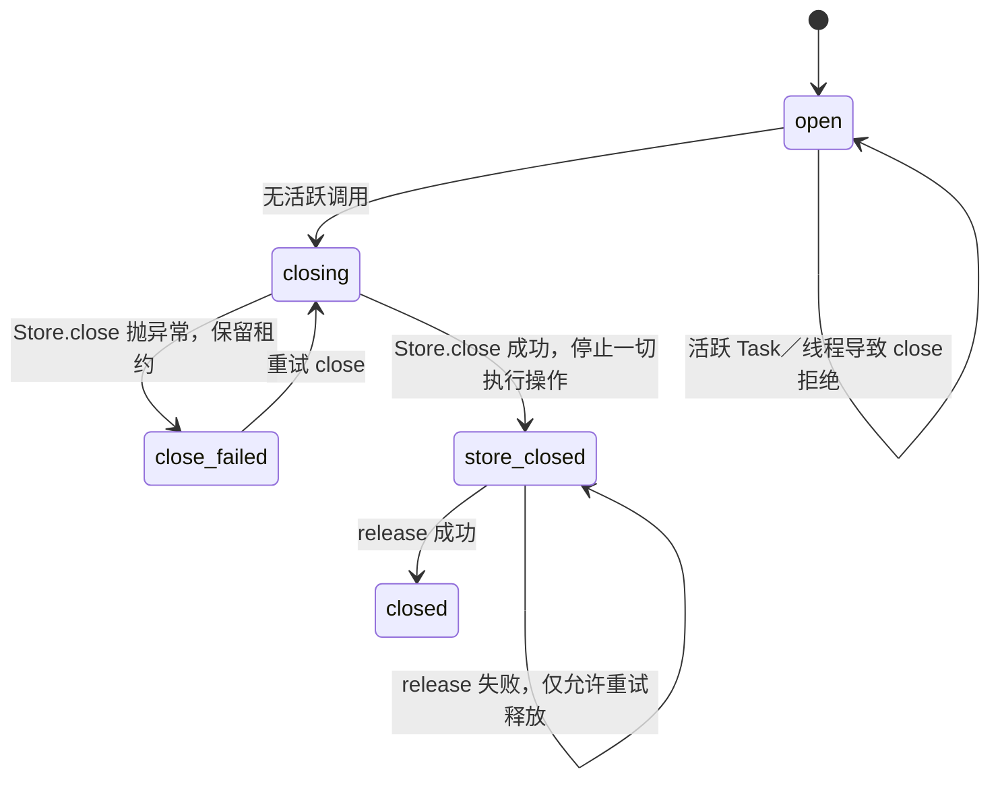

# Ralf-Agent 授权与关闭 Review

日期：2026-10-05；基线：`f494bbc`／dev3，原 213 项测试通过；修复：dev4。此增量保留 `local-3` 内核、执行 Schema v1 与 dev3 命令摘要，合法 dev3 Run／回执兼容。范围为用户提供的 1 个 P1、2 个 P2 及同类线程记忆问题。

## 1. 发现与处理

| 优先级 | 已复现问题 | 处理及验证 |
| --- | --- | --- |
| P1 | contextmanager／asynccontextmanager 只返回对象，拒绝 body 未执行，写工具仍成功 | policy 定义为同步 Callable[..., None]；唯一允许返回值为 None，拒绝抛 AuthorizationDenied。任何非 None 都在工具派发意图前报 ValidationError，不进入返回对象。14 项测试包括直接／间接上下文管理器、False／0／其他数据及合法允许／拒绝 |
| P2 | 取消全部 Task 后 to_thread 的 handler 继续运行，Task 清理却允许交出 Coordinator | ThreadExecutionTracker 在提交前登记，在锁内区分 pending／running；取消只撤回 pending，running 只能在真实 worker finally 清除。close、同 Run drive 与 cancel 都检查真实调用；退出旧循环不影响归属。实际线程、排队取消及启动竞态测试验证无第二执行者 |
| P2 | Store.close 抛异常后 finally 释放租约，旧 Engine 仍可写 | 显式 open → closing → close_failed／store_closed → closed。存储失败保留租约、禁止 Engine 操作，只允许 close 重试；存储成功后才释放，释放失败不重复 close Store；成功关闭的 Engine 操作均提前返回类型化错误 |

根复核还确认 ThreadedMemoryAdapter 存在与工具相同的线程窗口，因此通过每个 guarded 调用继承的 Tracker／Run ContextVar 纳入框架归属，真实 read／append 在线程和事件循环取消后仍阻止租约释放。`wait_for_threads()` 支持等待实际同步调用退出；取消等待不能消除归属。

独立复核检查 None 白名单、close 状态机、线程 token 与取消启动竞争、ContextVar 传播及同 Run 恢复，未发现新的可复现阻断问题。专项测试包含真实有效审批／未知效果对象，避免仅因错误命令参数出现假阳性。

## 2. 生命周期边界

关闭成功或失败后都不能重新使用原 Engine 接收命令；独立只读观察可以使用 CLI status／events。等待线程退出不是 EffectReceipt／ResultCommit，不会凭空确认外部写入。全局取消丢失了回执时继续保留执行日志，并在后续恢复中把遗失 Attempt 归为未知。

使用者自己的后台线程／直接 to_thread 调用不自动纳入框架追踪。SDK 管理的同步 handler、reconciler 与线程记忆桥接覆盖此契约；自定义异步适配器仍须履行实际完成和取消协议。无法响应超时的线程不能被 asyncio 强制停止，需要协作退出或后续隔离进程能力。

## 3. 仍未交付的架构门槛

本轮没有增加执行后端或并行策略。纯 Harness 提案／受控 ToolExecutor、模型回复与 DecisionCommit、效果回执与 ResultCommit 的独立持久窗口、容量限制、分页 Recall／事务索引及 Temporal Workflow／History 权威继续遵循[上一轮架构门槛](2026-10-05-reliability-boundaries.md)。真实线程归属修复不能替代这些能力的验收。

完整测试与构建证据见[实现进展](../../docs/implementation-progress.md)；服务停止顺序、policy 与适配器责任见[扩展指南](../../docs/extending.md)。
