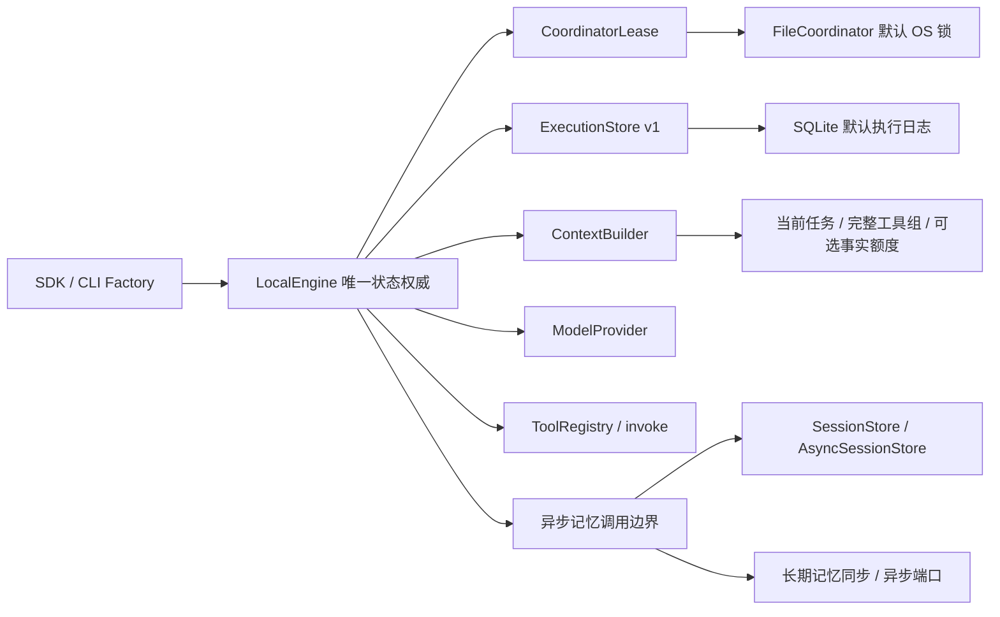

# Ralf-Agent 架构与实现 Review

版本：0.1.0.dev2；日期：2026-10-05；作者：Ralf-Agent 项目 Review。范围：从本地提交 `68b31e6` 对照总设计及三个运行契约，检查当前实现、适配接入、进程恢复与用户路径。

## 1. 总体判断

作为 M1 核心预览，领域方向符合预期：Agent／Workflow 使用同一 Engine；执行日志独立于记忆；工具在决策采纳后执行；审批、效果和预算持久保存。原实现尚不足以作为稳定扩展基础，主要是组件实际可变、SQLite 内部耦合、同步远程记忆和 CLI 固定 Demo 配置。本轮已针对这些现有行为补接口和修复。

它仍不是完成的企业平台。NativeHarness／ToolExecutor 尚未独立成完整执行策略端口；Workflow 只有顺序步骤。Temporal、Codex、MCP／CLI 沙箱、MQ／A2A、向量检索、OIDC／资源权限和控制台继续按已约定阶段交付。

## 2. 发现与处理

| 优先级 | 已复现问题 | 本轮处理 |
| --- | --- | --- |
| P1 | 排队 drive 将仍活跃的调用误判为遗失 Attempt，晚到异常将 cancelled 重开为 waiting_reconciliation | 获得锁后再次检查活跃调用；所有晚到异常保留终态 |
| P1 | 人工与自动核验竞争，晚到结果覆盖已采纳结果、重复工具消息 | ResultCommit 只采纳一次；晚到证据单独记录事件 |
| P1 | Provider 实际 model 可变但缓存 identity 不变；异步上下文等待期间变更配置仍可发出新请求 | 动态请求配置 identity、派发前及采纳前复核 |
| P1 | policy 能修改 Registry 内部嵌套配置，原审批对应目标与实际配置不一致 | Registry 描述返回独立副本，授权后复核固定发布 |
| P1 | 数据库 symlink 别名可取得第二份 Coordinator 锁 | 先解析数据库真实路径再生成锁路径；真实 symlink 排他测试 |
| P2 | 原成本为 1 的未知 Attempt 被当前工具成本 2 结算；删除 handler 后无法人工核验 | 按 Run Manifest 固定历史成本，不依赖当前 handler |
| P2 | 独立 SQLite 内存实例共享 backend_id，线程桥接换后端却仍保留旧身份 | 独立内存身份；桥接 identity 动态来自实际后端 |
| P2 | 同步远程记忆阻塞整个 event loop；后端异常泄漏为原始异常 | 原生异步记忆 Protocol、显式线程桥接、稳定错误码 |
| P2 | 异步最终读取期间已取消，返回后仍发出新的 Session 写 | 保存前重读取消／终态；已开始保存继续保留调用归属 |
| P2 | Engine 直接读取 SQLite conn/path 和表，替换执行存储无法运行 | ExecutionStore／CoordinatorLease，活跃 Session／未知效果查询下沉存储端口 |
| P2 | 可选旧事实超过额度导致新任务失败，Manifest 记录未选入事实 | 先保护当前任务和完整工具组，再按额度选事实；记录真实选入版本 |
| P2 | 自建 SDK Agent 无法通过固定 Demo CLI 恢复；status 会创建数据库 | 工厂恢复入口、只读观察、分页参数、版本查询 |
| P2 | 错误 Schema／limit／同步 Provider 在执行后才报错，部分被当成未知调用 | 配置与 Provider 提交前校验，未接收 Run 不占预算 |
| P2 | CAS 失败仍修改调用者 revision；构造校验失败可能残留租约 | 成功才更新 revision；已取得租约在构造失败时释放 |

前四项由独立审查和最小复现确认；端口整合后又审查异步等待、路径别名及组件替换，相关回归已经加入永久测试。证据使用真实 SQLite、真实进程退出、可控异步等待和独立线程，未调用付费模型或生产系统。

## 3. 实际组件边界

CoordinatorLease 只表达排他归属，ExecutionStore 只保存事实及原子事务，ContextBuilder 只装配决策输入，Provider 只返回模型回复。调度、审批采纳、预算预留和最终结果仍由一个 Engine 裁定。租约端口不等于自动故障接管；异步记忆端口不等于已经交付 Redis 或向量数据库。

## 4. 后续优先级

1. 完整模型回复与 DecisionCommit、独立 EffectReceipt 与 ResultCommit 分阶段持久；扩展全部崩溃窗口和错误分类／重试所有者测试。
2. 引入有预算及分页的记忆召回查询，补 MemoryPolicy／VectorIndex／SourceCatalog 的版本与来源授权契约；当前全量读取和聚合 Run 扫描不适合企业规模。
3. 分离原生 Harness 提案与受控 ToolExecutor，并以真实 CLI／MCP Provider 验证生命周期、取消和沙箱，再推进并行／多进程。
4. 用同一审批、取消、未知效果案例完成 Temporal 内部探针；分布式执行权威由 Workflow／History 实现。
5. 建立真实模型任务质量、停止条件和上下文事实保留基线。离线回归只证明运行流程，不证明 AI 任务质量。

固定发布从 `local-1` 升为 `local-2`。当前没有自动运行迁移；已有 Run 的恢复需原版本及组件。支持边界、生命周期与具体接入方法见 [实现状态](../../docs/implementation-status.md)及[扩展指南](../../docs/extending.md)。

## 5. 验证

- Python 3.12.7：全套 141 个测试通过；Ruff、格式、依赖一致性与 Git 空白检查通过。CI 配置的其他 Python 版本尚未在本机运行。
- 标准隔离构建生成 dev2 wheel／sdist；在仓库目录外使用安装后的包完成审批、重启恢复，实际业务效果仍为一次。
- 自建配置模块从 SDK 提交，经 CLI 工厂在另一进程恢复并查询成功；入口和 CLI 使用同一工具模块身份。
- 三组离线回归通过，文档本地链接验证通过；未运行真实模型质量评测或企业后端验收。
