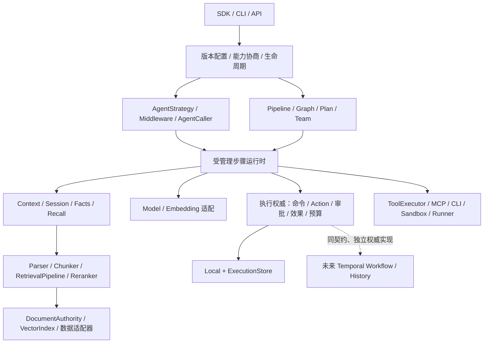

# dev12 架构与框架能力对齐审查

版本：1；日期：2026-10-06（Asia/Shanghai）；作者：Codex 架构审查。
审查基线：`0.1.0.dev12`，Git `2de767c36ae3aff8309c4484184936e60ace6f87`。
读者：项目维护者、应用开发者、适配器贡献者。
状态：基线审查与后续修复记录；F1–F3 的修复证据见第 9 节，本文不宣布 M1 完成或竞品能力对齐。

## 1. 结论与比较范围

**RALF 的分层方向合理，已有多个可实际替换的公共端口，但当前仍是可靠本地执行内核加一部分通用 SDK。它尚未达到 AgentScope 的完整应用覆盖，也未达到 LangChain + LangGraph 的通用集成与编排能力。**

静态 DAG 已经支持串行、条件、跳过、显式输入输出绑定和有界并行，不应再按 dev9 的“只有顺序 Workflow”判断。Harness／ToolExecutor 已经交付，也不再只是设计名称。其余能力以[当前实现清单](../../docs/implementation-status.md)为准。

“能传入自定义对象”与“能轻松独立替换每层”之间仍有差距：动态规划、团队、节点执行扩展、RAG 入库流水线、异步资源生命周期及实时流式链路尚未形成完整的公共契约、默认实现与配置入口。Redis／PostgreSQL／远程向量服务也没有现成的、经过验收的适配器。

**业务效果恢复是最值得投入的差异化方向，目前只有候选优势，没有对等实测证明。** LangGraph 已有持久执行、检查点和人工介入；AgentScope 也有权限、状态与中断能力。不能以 RALF 有审批／日志／恢复推导“特有能力已超越”。应证明同一个业务场景中，RALF 更少需要应用自己补协议、更容易恢复和排障，并且没有引入更大的成本。

比较分为两个范围：

- **通用 SDK 对齐**：Agent、模型、工具、Workflow、团队、上下文、记忆、RAG、配置、生命周期、流式与本地恢复。这是“同等能力对齐”的近期范围。
- **服务与企业目标**：API/UI、身份权限、隔离、容量、远程执行、可靠消息、运维迁移。单独验收，不把 LangSmith 商业平台的全部能力算入 LangChain/LangGraph 开源 SDK，也不把 RALF 规划中的 Temporal 算作已经支持。

AgentScope 固定比较 **v2.0.9** 的 README 与源码；latest 文档在本次访问时重定向到 **2.0.10dev**，不能混算为稳定交付。[稳定版说明](https://github.com/agentscope-ai/agentscope/blob/v2.0.9/README.md)、[开发版文档示例](https://docs.agentscope.io/en/versions/2.0.10dev/building-blocks/model/overview)。
LangChain/LangGraph 使用截至本次审查的官方 Python 文档；这是能力参照，正式实验还必须冻结准确包版本及源码 commit。[LangChain 定位](https://docs.langchain.com/oss/python/langchain/overview)、[LangGraph 定位](https://docs.langchain.com/oss/python/langgraph/overview)。

## 2. 本次确认的实现问题

这些是审查基线上的可复现实现缺陷，与“尚未开发某项能力”分开处理。最初审查未修改产品代码，后续优化及处置见第 9 节。

### F1 [P1] 租约和关闭端口没有确认同步操作真正完成

位置：[engine.py:149](../../src/ralf_agent/engine.py#L149)、[engine.py:214](../../src/ralf_agent/engine.py#L214)。

构造器只检查 Coordinator 的 `acquire/release` 可调用，随后忽略返回值。传入 `async def acquire` 时，租约逻辑没有执行，引擎仍接受并完成 Run；另一个真实 FileCoordinator 可以同时取得同一数据库的租约。同步 `@contextmanager acquire` 也有同样结果，而且没有 coroutine 警告。

关闭也忽略 `store.close()` 与 `release()` 的返回值：

- `@contextmanager release` 没有进入上下文，引擎却标记 closed；后续 close 不再重试，实际锁仍被持有。
- 异步 SQLiteStore.close 包装没有关闭连接，引擎已释放租约并标记 closed；新引擎取得租约时旧连接仍可使用。

这些包装不符合已声明的同步端口，但公共接入边界静默接受了它们，破坏执行权与关闭完成保证。因此不是“支持异步租约”的需求，而是无效实现必须明确拒绝的问题。

**修复要求**：构造时验证同步方法形态；调用时验证操作已经返回唯一允许的完成值 `None`。不能仅枚举 coroutine/generator 类型，惰性上下文管理器仍会遗漏。不能确认完成时保持不可继续执行、可重试关闭的状态与租约归属。合法 acquire 本身还必须满足真实独占契约；返回值检查不能证明一个适配器诚实实现了分布式锁。

回归覆盖：同步、异步、generator、contextmanager、callable instance；两引擎实际争用；关闭失败与重试；确认未完成时不得声明关闭成功或允许新执行权。

### F2 [P2] 非字符串 Session ID 绕过预约，混用 SQLite 会话

位置：[types.py:103](../../src/ralf_agent/types.py#L103)、[engine.py:424](../../src/ralf_agent/engine.py#L424)。

公共提交没有限定 Session ID 的类型。`session_id=123` 与 `session_id="123"` 能在 queued 状态同时被接受；预约按 Python/JSON 值比较，认为它们不同，而 SQLiteMemory 的 TEXT 列把二者落到同一个历史。两个 Run 完成后读取相同会话，第二个模型请求含有第一个 Run 的结果。

复现在同一 Scope 内，不据此声称跨租户泄漏。问题仍会破坏会话隔离和当前预约语义，且后端替换可能改变行为。

**修复要求**：在共用调用方请求边界统一验证“未指定为 None，指定时必须为非空字符串”；不要靠 `str(value)` 静默合并身份。保留合法历史请求的摘要兼容性，Session 端口也执行一致验证。测试数字、布尔、空字符串、对象及内存/SQLite 的一致行为。

### F3 [P2] 配置装配后的诊断丢失 Workflow 信息

位置：[runtime_router.py:72](../../src/ralf_agent/runtime_router.py#L72)。

SQLiteRunReader.diagnostics 构造 RunDiagnostics 时没有投影持久化的 Workflow 详情。ProfiledEngine 委托这个 reader，因此底层 LocalEngine 能报告 a/b 节点的 v3 图，经 ProfiledEngine 返回的 `workflow` 却是 None。

配置方式的文本 `run/resume` 缺少节点行；直接 CLI `inspect` 读取持久记录，仍有节点信息。不要把问题扩大到所有 CLI 检查路径。

**修复要求**：同一持久记录使用统一的 Workflow 诊断投影；LocalEngine、RunReader、ProfiledEngine 与配置 CLI 做契约一致性测试。

### 文档一致性

[runtime-assembly.md:3](../../docs/runtime-assembly.md#L3) 和该文件能力边界段落仍称 MCP／并行未交付，和后续章节及实际 dev12 不一致。应在修复增量同步更新。`framework-capabilities.md` 已标明其矩阵保留 dev9 目标基线，并指向当前实现清单，不能把那张历史矩阵当作本版交付状态。

## 3. 同等能力对齐矩阵

状态只描述 RALF 当前范围：“基础可用”不表示通过了与竞品的对等验收；“部分”表示有实现，但目标场景或独立替换链路缺失；“未交付”不表示架构永远不能支持。

| 能力 | dev12 实际状态 | 对齐需要补什么 |
| --- | --- | --- |
| 单 Agent 与自定义 | **基础可用**：AgentSpec、模型/工具循环、Schema、纯 Harness、上下文和执行器注入 | 能力型 Agent 默认组合、独立 Agent 策略、可组合 middleware、受管理 AgentCaller；便捷入口不要求继承 LocalEngine |
| 国内外模型 | **部分**：Chat Completions 文本/functions、DeepSeek 关闭 thinking 的 preset、Anthropic 文本/client tools、Gemini 文本 | 原生 Gemini tools、Responses、多模态与 reasoning 历史、能力协商、路由/fallback；供应商版本的真实契约验证 |
| 顺序与静态图 | **基础可用**：依赖、条件/跳过、绑定、Agent/Tool/transform 节点、并行上限和恢复 | 有界循环、子图、动态 fan-out、状态 reducer、可注册受管理节点执行器；不能用纯 transform 隐藏外部 I/O |
| 动态规划 | **未交付**：纯 scheduler 只选择固定 DAG 的 ready 节点 | Planner、Verifier、持久 PlanRevision、重规划额度、停止/取消与旧节点效果继承 |
| 多 Agent | **未交付**：多个 Agent 节点可以并行，但不是团队协议 | ChildRun、委派/返回、Supervisor/Team 默认实现、消息关联/顺序/去重、子任务预算与取消传播 |
| 流式链路 | **部分**：Provider SSE 可解析并收集完整响应；持久事件可分页 | SDK 实时 token/节点事件订阅与断线恢复；若承诺数据流编排，另补 StreamChannel、背压与数据检查点 |
| 工具与 MCP | **部分**：可信 Python 工具、Schema/版本、ToolExecutor/ToolSource、受管理一次性 POSIX MCP stdio | 注解/装饰器注册、常用工具包、持久/HTTP MCP 与 OAuth、CLI、隔离沙箱及资源生命周期 |
| 上下文 | **部分**：ContextBuilder、字符额度、完整工具消息组裁剪、实际快照、Recall/Knowledge 注入 | Tokenizer、token 预算、summary/compressor/offloader 策略与默认实现、关键事实保留评测 |
| 短期记忆 | **基础可用**：独立 sync/async Session、内存/SQLite、CAS 和范围约束 | Redis 等成品适配器、增量追加/读取、跨后端统一 ID/排序/TTL/并发契约；关闭与真实客户端生命周期 |
| 长期记忆 | **部分**：显式事实、TTL/CAS、分页 Recall 与注入策略 | PostgreSQL 成品适配器、自动提炼/冲突处理/遗忘策略；记忆策略与持久化后端分别配置 |
| RAG 入库与检索 | **部分**：纯文本显式入库、字符分块、词法默认检索、当前版本/来源有效性检查 | Connector/Parser/Chunker、RetrievalPipeline、query transform、融合/reranker、后台入库和权限目录 |
| Embedding/向量 | **部分**：EmbeddingProvider/VectorIndex 端口，内存/SQLite 精确余弦索引 | 成品 Embedding Provider、pgvector/Qdrant 等适配器、ANN/索引重建、可独立配置的语义检索默认组合 |
| 动态配置 | **部分**：不可变版本 Profile、显式工厂、原配置恢复、SDK/CLI 装配 | 数据子组件独立注册、异步工厂/AsyncLifecycle、版本迁移与能力预检；热更新只影响新任务，旧 Run 保留原绑定 |
| 持久执行与人工介入 | **基础可用于 Local**：幂等命令、审批、独立接收/采纳、未知写核验、预算和恢复 | 通用等待输入/编辑恢复、deadline/审批过期、全局容量、保留/迁移；Temporal 是独立执行权威，仍未交付 |
| 服务与企业采用 | **未交付**：SDK/CLI/7 个 packaged starters 是已有基础 | API/UI、OTel、身份/资源 ACL、部署与运维、隔离 Runner、MQ/A2A、多进程/分布式；分别建立支持与验收清单 |

竞品参照中，AgentScope v2.0.9 已公开 ModelCard 与多种原生模型类；其 Agent 实现支持 middleware 和流式回复；Pipeline 导出 GoalPipeline/TeamPipeline。因此 RALF 的模型、Agent 组合、团队和流式差距属于实际 SDK 覆盖差距。[模型源码](https://raw.githubusercontent.com/agentscope-ai/agentscope/v2.0.9/src/agentscope/model/__init__.py)、[Agent 源码](https://raw.githubusercontent.com/agentscope-ai/agentscope/v2.0.9/src/agentscope/agent/_agent.py)、[Pipeline 源码](https://raw.githubusercontent.com/agentscope-ai/agentscope/v2.0.9/src/agentscope/pipeline/__init__.py)。

AgentScope 的稳定版 RAG 导出 Parser/Chunker 基类及 PDF/Office 等 parser、多个 vector store；LangChain 则提供独立向量后端集成。这比 RALF 当前“文本+内嵌分块+本地索引”更完整，但接口存在不代表每个适配器已通过 RALF 的版本/效果契约。[AgentScope RAG 源码](https://raw.githubusercontent.com/agentscope-ai/agentscope/v2.0.9/src/agentscope/rag/__init__.py)、[LangChain 向量集成](https://docs.langchain.com/oss/python/integrations/vectorstores)。

LangChain 提供统一模型接口以及模型/工具 middleware；LangGraph 已有状态 reducer、循环、条件路由和动态 Send/Command。RALF 的 compiler/interpreter/scheduler 注入仍受固定 DAG 的语义校验约束，不能靠替换一个 compiler 宣称已经支持这些场景。[模型](https://docs.langchain.com/oss/python/langchain/models)、[middleware](https://docs.langchain.com/oss/python/langchain/middleware/overview)、[Graph API](https://docs.langchain.com/oss/python/langgraph/graph-api)。

LangGraph 的多种 stream 模式与持久 checkpointer 也是实际能力参照。RALF 收集 SSE 后再提交完整响应，与应用实时消费 token、状态、节点事件是不同交付项；而“流式数据编排”又是第三项，不能混用。[streaming](https://docs.langchain.com/oss/python/langgraph/streaming)、[checkpointers](https://docs.langchain.com/oss/python/langgraph/checkpointers)、[long-term stores](https://docs.langchain.com/oss/python/langgraph/stores)。

AgentScope 稳定版还列出 ReMe/Mem0 记忆适配、工具/MCP/Skills、sandbox/workspace 和服务端/Web UI 等应用能力。本次未实际安装竞品执行这些组合，不据其自述评定生产可靠性，也不从存储列表推导分布式执行保证。[v2.0.9 能力说明](https://github.com/agentscope-ai/agentscope/blob/v2.0.9/README.md)。

## 4. 架构合理性与需要改进的抽象

### 4.1 应保留的结构

当前公共边界是实际接口，而非纯设计图：

- ModelProvider、Harness、ToolExecutor、ContextBuilder 分离模型协议、提案、执行和上下文。
- Session、facts、Recall、KnowledgeContext/KnowledgeRetriever、EmbeddingProvider/VectorIndex 分离对话、业务事实和知识索引。
- WorkflowCompiler/Interpreter/Scheduler 与显式 transform 注册支持固定计划语义下的替换。
- ExecutionEngine/ExecutionStore/CoordinatorLease 与版本化装配分离入口、事实持久化和执行权。

模型提案不直接授权工具；并行节点不能建立另一份 Run/预算/效果权威；记忆也不能替代执行事实。这些选择应贯穿后续扩展。[执行组件](../../docs/execution-components.md)、[并行执行](../../docs/parallel-workflows.md)、[配置装配](../../docs/runtime-assembly.md)。

默认实现也有实际价值：本地 SQLite、可信 Python 工具、NativeHarness、静态 scheduler 和词法 RAG 允许无需外部数据库启动；真实 AI 功能仍需要配置模型。离线 Echo/scripted Provider 证明闭环，不能证明 Agent 的诊断和任务质量。

### 4.2 建议目标边界

下图包含**待实现的设计名称**，不能当作现在可导入的 API。重点是公开可组合的能力、显式依赖与共同治理，不要求每个小函数都变成插件。



**A. 先抽出可组合的受管理步骤运行时。**
LocalEngine 已分出 Harness/Executor，但仍同时承担原生推进、采纳、审批、效果恢复和资源管理。`NodeEngine` 通过复制父实例 `__dict__` 建立节点 facade，是维护债务：新字段的共享/独占属性不显式，父类自定义也不是稳定的节点扩展契约。本轮未发现新的 frame 合并错误，不把这个实现选择直接定为运行缺陷。[node_execution.py:128](../../src/ralf_agent/node_execution.py#L128)。

建议把节点 frame、依赖集合、StepProposal、ReceivedEvidence 和状态采纳函数明确化。Local、静态节点、Plan/ChildRun 使用共同的步骤执行与治理入口。工作流的新语义通过版本化计划与受管理 NodeExecutor 注册加入；pure transform 继续纯计算。避免为每个团队策略重新复制审批/恢复代码，也避免让任意 callback 直接写权威状态。

**B. RAG 和配置需要更细但可用的组合边界。**
`KnowledgeStore` 同时包含文档 CRUD、chunks 与 `lexical`，`_make_chunks` 又在存储实现内部固定字符分块。一个只负责文档权威的远程适配器也被迫面对词法检索；替换 chunker 需要介入存储实现。[retrieval.py:178](../../src/ralf_agent/retrieval.py#L178)、[retrieval.py:224](../../src/ralf_agent/retrieval.py#L224)。

应独立建立 DocumentAuthority、Parser、Chunker、EmbeddingProvider、VectorIndex、Retriever、Reranker 与 Ingestion/RetrievalPipeline；保留方便的 `LocalKnowledgeBase` 一类默认组合入口。默认 text parser、现有字符 chunker、词法 retriever 可以复用；远程 embedding 通过 optional extra 显式配置，不能在首次启动偷偷调用收费服务。

配置注册尚无独立 embedding/vector/parser/chunker/reranker 类别。应用能在自定义 knowledge 工厂内部构建它们，但这种大工厂不是“每层方便配置替换”。应让 SDK 注入与声明式装配使用同一组件图及身份规则。[runtime_config.py:11](../../src/ralf_agent/runtime_config.py#L11)。

**C. 数据扩展必须包含真实生命周期和一致行为。**
BuildContext.own 只接受同步 close；这对本地默认组件合理，但异步 Redis/PostgreSQL/HTTP 客户端需要明确 owner/borrower、异步创建、drain/aclose 和失败重试。不要把 async close 包成无效同步函数。[runtime_builder.py:53](../../src/ralf_agent/runtime_builder.py#L53)。

Session/Facts 应分别定义 ID、版本、TTL、分页/排序、重复写、并发冲突和取消行为；VectorIndex 定义维度、过滤、索引版本和来源 hydration。提供 Redis Session、PostgreSQL facts/documents、embedding、pgvector 或 Qdrant 的第一批可安装适配器及真实服务契约测试。它们替换数据层，不会自动提供分布式执行权。

**D. 模型抽象应表达能力差异。**
“兼容 Chat Completions URL”不等于适配所有模型模式。应表达 text/image/audio、tools、structured output、reasoning continuation、streaming 等能力；保留必要的原生历史/不透明字段与供应商参数，不支持时预检明确拒绝。增加默认路由/fallback 时，区分未发送失败与已发送未知调用，不能隐式改变原 Run 的固定配置或隐藏实际调用/费用。

**E. 新 Workflow/Team 必须有受控动态状态。**
Planner 输出经过验证的计划提案；每次 PlanRevision 持久化并受预算与权限限制。ChildRun 有稳定调用身份、父子关系、结果/未知效果与取消证据；队列采用关联 ID、去重、ack/重投与超时语义。Team 默认只需先实现一个 Supervisor/Worker 场景，不能以并行 Agent 节点替代委派协议。

静态扩展优先补 bounded loop/subworkflow/dynamic fan-out；join/reducer 的冲突与确定性需要契约。流式 SDK 先提供即时观察，再独立设计数据流编排的背压、消费者游标与检查点，不把 token 到达当成最终 DecisionCommit。

**F. 企业扩展前先解决本地规模与观察。**
当前 Run 聚合 JSON 重写、Run/未知效果扫描、最终 Session 追加前的全量读取、每 Run 并行额度，仍限制长期服务化。先补索引查询、增量 Session、全局/tenant 容量、deadline/审批过期、事件流/OTel、保留与迁移；取消后实际工作仍活跃时保留容量和归属。Temporal 以 Workflow/History 建立自己的执行权威，不能只换一个 ExecutionStore 就声称支持。

## 5. “同等能力对齐”的验收方式

不使用“接口数量”“测试数”“功能完成百分比”判断对齐。每项能力同时通过六道门：

1. 有公共行为契约，明确同步/异步、输入输出、错误、身份、生命周期与恢复语义。
2. 有核心安装或明确 optional extra 的默认实现，首次使用路径可运行。
3. SDK 与配置都能独立替换，不修改 LocalEngine 私有字段。
4. 扩展路径仍满足相应的审批、取消、预算、效果与固定版本约束。
5. 至少两个实现通过共同契约；宣称远程数据库支持时有真实服务证据。
6. 有独立 starter、故障说明与外部开发者首次采用记录。

对齐验收场景应覆盖：

| 场景 | 最小共同结果 |
| --- | --- |
| 自定义单 Agent | 多轮工具、结构化输出、替换模型、能力不足明确拒绝、middleware 可组合 |
| 静态 Workflow | 顺序、条件、分支并行/join、跳过、输出绑定、失败和重启，完成节点不重复产生业务效果 |
| 动态 Workflow | 有界循环、运行时 fan-out、子图、计划修订、Verifier 拒绝与停止 |
| Team/ChildRun | 分派、返回、重复消息、人工暂停、父任务取消、子任务未知效果与预算 |
| 上下文与记忆 | token/摘要策略、事实保留、Session 与 facts 分开替换、CAS/TTL/分页/重启一致 |
| RAG | 文本/PDF 等入库、替换 parser/chunker/embedding/index、检索融合、来源更新/删除与证据不足 |
| 配置与生命周期 | SDK/config 等价、原版本恢复、异步资源安全退出、关闭失败可重试 |
| 流式与使用体验 | token/节点事件实时消费、稳定终态、断线重连、取消后实际资源归属、诊断一致 |

这些是目标用例，不代表当前已经能运行。竞品也按相同业务结果验收，不强制相同内部 API。动态 Plan 模板、图循环与分布式存储的能力分别登记，不能互相代替。

## 6. 如何证明特有能力超越

最有希望的方向是**默认化的业务操作协议**：稳定 Action/effect key、审批内容与固定发布摘要、未知写效果保留/核验、response/receipt 接收后采纳、原子额度和实际 worker 归属。这些在 RALF Local 有实现证据；特有的是整体协议及默认采用方式，不能断言任何单项只有 RALF 支持。

公平比较至少包含以下故障窗口：

| 故障/控制请求 | 必须比较的业务事实 |
| --- | --- |
| 审批后进程退出、重复审批/提交 | 原 Run/Release/回执稳定；审批后的写入次数 |
| 业务已提交，本地未保存回执就崩溃 | 稳定幂等键或核验能恢复；无证明时保留 unknown，不宣称未执行 |
| 模型响应/工具回执已接收，尚未采纳 | 重启后消费已保存证据；没有多发模型/工具调用 |
| 并行兄弟失败或取消，另一写仍在途 | 无新派发；晚到证据保留；Session、容量、执行权直到真实退出才释放 |
| 原配置移动/缺失、数据来源过期 | 重复命令返回原回执；新执行不会静默替换固定组件或采用失效证据 |
| 授权/租约/关闭端口返回惰性对象 | 无效实现明确拒绝，不能绕过授权或执行权 |

基线必须用同一固定模型、Prompt/工具契约、数据、业务初始状态、下游幂等/核验能力以及相当的耐久设置。LangGraph 使用官方推荐的持久 checkpointer、合适的同步持久化与审批/副作用拆分，不能故意在 interrupt 前放不幂等写。[检查点 durability](https://docs.langchain.com/oss/python/langgraph/checkpointers)、[interrupt 副作用规则](https://docs.langchain.com/oss/python/langgraph/interrupts#side-effects-called-before-interrupt-must-be-idempotent)。

AgentScope 基线使用该冻结版本推荐的状态、中断、权限和持久化方式；必要的业务幂等/核验代码允许双方加入，并计入接入成本。不把某份演示程序没实现恢复等同于框架不支持恢复。

报告同时记录：业务错误/重复写、未知效果是否被误判、故障恢复步骤与时间、应用需要自行写的协议代码及维护面、首次接入/排障时间、调用费用与 active latency。模型质量与运行时行为分开，样本量与不确定性保留。只有固定场景下正确性不退步、采用/恢复成本有明确改善，才宣布这个场景的“超越”；不扩大成整个框架全面领先。

现有 [M1 验收方案](../../docs/m1-acceptance.md) 已定义真实模型与 LangGraph 比较。应增加 AgentScope 的同业务实现与上述通用能力验收，保留既有 M1 的真实模型、Temporal 最小权威探针及外部采用门槛。

## 7. 建议建设顺序

| 顺序 | 可独立验收的增量 | 出口条件 |
| --- | --- | --- |
| 0 | F1–F3 与装配文档一致性 | 惰性端口/两引擎争用、Session ID、统一诊断回归通过 |
| 1 | 步骤运行时显式依赖、异步生命周期、便利 Agent/工具入口、RAG 子组件注册 | 不复制执行权威；SDK/config 等价；自定义组件无需修改私有字段；现有默认身份兼容 |
| 2A | 数据与上下文默认链路：Redis Session、PostgreSQL facts/documents、embedding、一个远程向量后端、Parser/Chunker/检索流水线、token/summary 策略 | 核心本地默认仍可用；每个远程适配器有真实服务契约与 starter；数据来源和版本校验保留 |
| 2B | 动态编排与团队：bounded loop/subworkflow、Plan/Verifier、ChildRun、Supervisor/Worker | 同一审批/效果/预算/取消协议覆盖父子及动态计划；失败/重启证据齐全 |
| 3 | SDK 实时流、HumanInput、middleware、HTTP/persistent MCP、CLI/sandbox | 端到端流式可消费；资源真实退出；通用 SDK 场景与竞品对等验证 |
| 4 | API/OTel、全局容量、deadline/保留迁移；独立 Runner、Temporal/多进程与企业服务 | 逐后端验证执行权、身份/隔离、升级和运维，不靠数据适配宣称分布式支持 |

2A 与 2B 可以独立推进；不需要等完整 Temporal 才交付个人开发者的通用能力。真实模型、对等实验与外部采用应伴随这些增量，而非全部功能做完后才开展。阶段名与当前 M1/M2a/M2b/M2c/M3、G1–G6 对应，不新增一条互相冲突的路线图。[总架构阶段](../design.md)、[通用框架建设顺序](../viewpoints/framework-capabilities.md)。

## 8. 验证与限制

本轮重新运行：

```shell
.venv/bin/python -m pytest -q \
  tests/test_extension_contracts.py tests/test_parallel_workflow.py \
  tests/test_workflow_scheduler.py tests/test_workflow_adoption.py \
  tests/test_runtime_review.py -W error
```

结果：**98 passed in 6.43s**。一次独立只读实现审查也运行了 98 项相关契约/装配/并行/关闭测试，结果通过。上述三个问题由额外复现确认；现有绿测不代表已经覆盖它们。

额外复现运行于临时目录：惰性 lease/store close、真实第二 Coordinator、两种 Session ID 和配置诊断。未修改产品源码、已有测试或依赖。本轮没有重复完整 922 项测试；该成绩是上次 dev12 交付证据，见[并行审查](2026-10-06-parallel-workflow.md)。

本次未执行真实模型、竞品对等 benchmark、真实 Redis/PostgreSQL/向量服务、Temporal、性能压测或外部首次采用。因此不评定任务质量、吞吐、成本优势或分布式可靠性。官方能力资料只能证明交付范围，不证明满足 RALF 的运行协议。

## 9. 后续优化与修复证据

用户要求优化后，工作区在上述基线基础上完成 F1–F3：

| 问题 | 修复与行为证据 |
| --- | --- |
| F1 执行权与关闭 | 同步方法形态加唯一 None 完成值校验；惰性值不被等待/进入。关闭失败不允许继续执行，修正后可以重试；存储关闭成功后不重复关闭，只重试释放 |
| F2 Session 身份 | 共用 submission_request 验证 None 或非空字符串；内存/SQLite Session 读取与追加统一验证。合法名字保留原值，不做转换/裁剪；无效提交不占用 command_id |
| F3 Workflow 诊断 | SQLiteRunReader 使用与 LocalEngine 相同的 workflow_details 投影；ProfiledEngine 和配置 CLI run/resume 返回串行/v3 节点状态及分支 Session，隐藏内部 frame |
| 文档 | 修正装配教程的 MCP/并行状态，记录 Session 与同步完成契约；已有文档 Python 片段按当前 Ruff 格式化 |

新增 [test_framework_contract_review.py](../../tests/test_framework_contract_review.py) 共 **68 项**：28 个生命周期场景、30 个非法 Session 场景、2 个合法身份/回执场景、6 个图诊断/CLI 场景和 2 个共享租约争用场景。三个问题分别经历失败到通过，不以绿测反推覆盖。

一次独立只读实现审查在修复中发现 **P1：获取失败的无条件清理可能释放复用租约的原所有者**。修正后，抛异常的 acquire 不进入 Engine 的 release 清理；适配器负责清理本次失败并保持原所有者。只有 acquire 已返回但完成值无效、或后续构造失败时才尝试释放。同 Store 和显式共用租约均有真实争用回归。独立审查运行 138 项通过；这发生在最终修正之前，不能视为最终代码的第二次审查。最终修正由新增 RED→GREEN、组合测试及完整测试验证。

最终验证：

- `.venv/bin/python -m pytest -q -W error`：**990 passed in 78.58s**。
- 修复后生命周期/装配/路由组合：**106 passed in 3.43s**。
- Ruff check、format --check 与 Git diff --check 通过；文档链接和 Python/shell/TOML 语法检查通过。
- wheel/sdist 构建；37 个 SDK 模块与源码和安装副本逐字节一致。仓库外安装包契约测试 **68 项通过**。
- 原 dev12 wheel 的 37 个模块与审查 HEAD 一致；用原 wheel 建立已完成回执、queued 原生 Run 与 v3 图，再用修复 wheel 验证恢复前记录未改变、原回执未改变、任务能继续、合法 Session 未合并、节点诊断可读取。

保持 dev12/local-4、ExecutionStore/SQLite v1 和合法调用方请求摘要；没有自动迁移无效历史 Session 身份。非合规适配器需按文档修正，不能靠成功返回掩盖未完成操作；一个谎报 None 的自定义租约仍需真实独占契约测试。

这些改进闭合本轮已复现的端口问题；第 3–7 节的能力差距与建设顺序仍是后续工作。

## 10. 后续 dev13 异步生命周期增量

dev13 已交付显式异步组件注册/装配、owned 客户端清理、取消后的真实 Task 保留、循环亲和检查和安装包 async starter。它改善第 4/7 节提到的远程客户端接入基础；正常执行权仍由同步 Engine/Store 管理。详细行为、一次审查修复和 1018 项测试证据见[异步装配审查](2026-10-06-async-assembly.md)。

此增量不提供真实 Redis/PostgreSQL/托管向量适配器，也不改变动态 Plan、多 Agent、流式数据链路、分布式执行或竞品对等 benchmark 的未交付判断。同步 ProfiledEngine/CLI 异步路由仍需后续实现。
