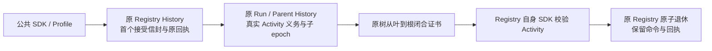

# dev119：公共普通 Temporal 部署与安全退休

日期：2026-10-15。范围：原 Registry／Run／Parent History 下的普通非 Coding 部署。本批有限普通部署范围已完成冻结源码、独立安装和实际服务验收；不据此关闭[第三阶段批次 2](../../docs/phase3-support-matrix.md)。依据为[公共契约](../specs/temporal-deployment-public-contract.md)与[实施计划](../../docs/superpowers/plans/2026-10-15-temporal-deployment-public.md)。

## 实现与权威

公共 `TemporalRuntime(admission_policy=...)` 与 Profile／JSON／TOML 使用原 `DeploymentAdmissionPolicy`、`admission_policy/bounded` 和同步／异步工厂，发布协议 v2。Builder 宿主策略与 Profile 策略不能同时指定。公共 Engine 根据固定发布接入原提交协议，无第二套请求或持久化权威。内部 worker-only v1 保留占位且不释放的语义；公共 Engine 拒绝 v1，同地址的旧 v1 Registry 不会被替换或自动升级。

首个完整逻辑请求、Manifest、Activity timeout 和 task queue 与 root claim 在原 Registry Update 中原子接受。重复提交先查 Scope／命令／请求摘要对应的原记录，再进行新接受所需的发布检查；别名、队列与 timeout 改变不能重建原信封。SDK 使用 `REJECT_DUPLICATE`、冲突 `FAIL`、无 Workflow retry，并核对实际 namespace UUID、原始／当前 epoch、实际 queue 与原接受 timeout。丢失 reserve／start 回复保留占位与原身份；已记录原业务回执的重复提交可直接恢复 RunHandle，不依赖原业务 poller。

原 Run／Parent History 在业务 I/O 前登记真实 Activity invocation；实际 owner 结束后才发送固定 epoch 的持久 end ACK。取消观察、业务 response、财务结算或人工效果证明均不能替代真实 handler 结束。零金额保留、未知效果、待 ACK／reconciliation、辅助阶段、未结束 handler 与子孙义务都阻止闭合。end ACK 失败保留 owner 重试责任，Assembly 在释放组件之前排空原调用与提交。

原树按固定 child epoch 和实际 SDK parent 关系从叶到根封存。封存后拒绝新的派发／选择／子 pin／变更控制，已记录重复回执和只读查询仍可用。Registry 的 `release_deployment_root` Update 在首个业务队列调度自身固定校验 Activity，读取原 root／tree History 后才原子退休 active 占用；调用者 hash／closed 标志不能授权释放。重复或丢失释放回复沿同一证书重试，不重复减额；退役命令、原信封及业务回执保留。没有 TTL、强制驱逐或仅按预算释放。

公共 `drive` 也负责已 seal 但退休未确认的原恢复。它读原 Registry 接受信封与退休记录，核对原 Scope／namespace UUID／SDK epoch 和当前原 History 的证书；退休未完成时，向固定 epoch 的原 root 发送原 scope＋seal.children 的精确重复 seal Update。新的 SDK Update ID 确保执行原 handler 的 wake，而不是只重放首次回复；证书与业务终态保持，Facade 不直接释放 Registry，不发新业务命令。已有退休记录只读返回。返回 succeeded／failed／cancelled 仍不证明占位退休，当前部署诊断分别观察。

Parent `cancel` 的已接受回执可能先返回 `remote_stop_confirmed=False`，实际后代继续停止与回传；不得把异步接收当作物理闭合。已完成 Action 的 deferred effect ACK 使用原 `drive` 恢复，`reconcile(query=True)` 不承担该 ACK 重试，更不能重发业务工具。

## 已发现问题与修复

- Worker sandbox 的原纯模块晚导入问题通过启动前预加载修复，不屏蔽严格警告。实际 graph-sequential SDK History 进一步定位到 ParentWorkflow 对纯 `release_state` 的晚导入 UserWarning，已显式 passed-through 预加载；该目标场景与最终普通编排服务矩阵通过。
- 首次实际 SDK 提交在接受 root 后因 Python tuple／JSON list 的直接比较失败。新增测试先复现同一 `_record` 拒绝，使用真实 `DataConverter.default` 在真实公共 Registry 状态两侧编码／解码，覆盖默认及非空 tools、嵌套输入 tuples。所选公共逻辑请求在 SDK 前转换为 canonical JSON 表示；canonical SHA 不变，调用者值及全局／默认 codec 不改。该失败保留原 claim，没有启动另一 root 或释放原占位。
- 独立检查发现 `abuild_catalog` 未转交宿主准入策略，及新 Registry 接受时未完整校验 Manifest；已分别补齐转交和新接受验证。原重复记录仍先返回，不被当前别名抢占。
- P2：实际静止 History 用例证明两次持久 `deployment_retirement_deferred` 后，恢复 Registry 通路并调用旧 `drive` 虽返回 succeeded，额度仍未释放。`source-sealed-retirement-stationary-red.xml` 记录 1 failed／26 deselected，35.32 秒，原 `sealed-held-proof.json` 与 History 保留真实已 seal／仍占位证据。修复原 `drive` 的精确重复 seal wake 后，`source-sealed-retirement-green.xml` 目标重试为 1 passed／26 deselected，4.93 秒；目标通过不与此前拆分的矩阵成绩合计，不替代最终冻结验收。
- lifecycle 夹具绕过构造器，缺少初始化失败 flag；读取改为兼容缺省属性。最终冻结源码和独立安装受影响回归均通过。

## 冻结验收登记

| 验证 | 源码 | 独立安装 |
| --- | --- | --- |
| 受影响检查 | 953 passed，零失败／错误／跳过，32.45 秒 | 同一 953 passed，零失败／错误／跳过，32.91 秒 |
| 公共 v2 实际 Temporal Service | 27 passed，零失败／错误／跳过，109.01 秒 | 同一 27 passed，零失败／错误／跳过，128.45 秒 |
| 私有 v1 实际 Temporal Service | 17 passed，零失败／错误／跳过，65.26 秒 | 同一 17 passed，零失败／错误／跳过，66.81 秒 |
| 原默认 History 兼容 | 新建 dev118 原业务 History，经 dev119 Worker 重放并续接；原 epoch／回执／结果相等，新增 Provider 调用 0 | 从不可变 dev118 安装另建原 History，由 dev119 独立安装重放／续接，同样通过，新增 Provider 调用 0 |
| 公共实际清理／History | 57 个业务执行关闭，40 份业务 History 保存并重放，26 个 Registry 清理文件；另 1 个真实 v1 拒绝 Registry／Worker 场景通过 | 同一 57／40／26 与另 1 个 v1 拒绝场景，各自独立验证 |
| 私有 v1 实际清理／History | 30 个业务执行关闭，25 份 History 保存并重放，17 个 Registry 清理文件 | 同一 30／25／17，各自独立验证 |

953 来自 46 个受影响模块；另 2 个实际服务模块共同构成 48 份冻结测试文件。不称为阶段全量回归。初始 26 项服务矩阵及拆分修复结果保留，不与最终冻结 27 项相加。恢复 P2 的 stationary RED 与目标 GREEN 同样保留；最终矩阵独立重跑。最初 sandbox localhost socket `EPERM` 在业务启动前阻断，环境授权重跑后的结果列于上表，不把环境阻断解释为产品失败。

无 SDK 模拟最终为 53 passed／68 skipped、零失败／错误；公共 Registry／配置／纯 release state 不依赖 SDK，SDK 传输与实际服务测试显式跳过。它是 import 阻断下的可选依赖边界检查，不是一套额外无 SDK wheel 安装。

源码、wheel 与独立安装的 410 个产品文件字节一致，48 个测试模块在冻结后保持相同。独立安装从自身 site-packages 导入。wheel SHA256 为 `29e8556049298300b47d75c9322555861727e69051e256a7e695ecd8f9bac851`。最终 sdist 字节／SHA 记录于私有 `final-acceptance.json`，由 root 最后核对；随本地提交交付，无推送。

不可变 dev118 安装与源码／安装的完整默认 Profile、Manifest 和 orchestration canonical JSON 均等值，共同 SHA256 为 `89e0faf7672eaffe8c37b1d7401e696c7e6aceb7e4836f25f1111476979bc82d`。源码与安装使用各自新建的真实 dev118 原业务 History，不以静态发布比较代替重放／续接。旧所选发布仍要求匹配其原 Worker。

上述公共服务覆盖 SDK／Profile／JSON／TOML 与策略工厂替换，Agent／顺序／图／Team／Dynamic／嵌套树周转，审批及 Worker 重启，接受后 reserve／start／release 回复丢失，别名变化和原队列恢复，async Provider 与零费用 sync write 的实际停止、人工效果先于 end ACK、退役重复无业务 poller、Registry／History 恢复以及已 seal 静止根的公共 `drive` 恢复。Parent 取消先接受、后确认后代停止；完成 Action 的 effect ACK 通过原 `drive` 恢复。不得将这些语义改写为同步取消或工具重试。

真实零费用写／ACK 恢复窗口使用测试专用 SQLite 效果证据适配器，其他确定性用例使用默认组件；这不交付通用 SQLite Journal 产品。框架依然由原 Registry／Run／Parent History 推进；本批没有 PostgreSQL、Docker 或模型调用，不宣称 PG 实测、新模型质量或完整 Temporal＋PG 阶段验收。确定性 Provider／协议组件不新增 dev99／dev109 质量结论。

源码和安装的全部 owned 业务、测试 Registry 和 Worker 已结束，兼容检查的原／新 Worker 及 Run／Registry 也按原身份清理。专用服务 Running Workflow 数为 0；控制进程 42009 已结束，执行会话 46811 终态 exit 0，专用端口 49925／49932 无监听，实际进程／端口最终核对已保存。测试 Registry 的终止属于清理，不作为产品退休的证明。

私有非密证据目录为 `/private/tmp/ralf-agent-dev119-root`：`affected-source.xml`、`affected-installed.xml`、`source-public-final.xml`／`installed-public-final.xml`、`source-private-final.xml`／`installed-private-final.xml`、`no-sdk-final.xml`、`package-provenance.json`、`actual-cleanup-audit.json`、`service-cleanup-final.json`、源码与 `installed-default-compat/` 的发布及原 History 兼容证据。早期失败、独立复现与最终成功分别保留，不合并计分。报告没有凭证；随本地提交交付，不推送远端。

## 保留的必需能力

公共所选部署模式仍明确拒绝 Coding 与 SDK Session-coordinator Turns；Coding 的原物理关闭与 coordinator 的原准入权威尚未整合，均保留为批次 2 必需后续项。普通非 Coding 受管理 Session 写入沿原阶段契约，不意味着 SDK coordinator 获得支持。第三阶段还有 hosted 观察／控制、身份 ACL、保留和框架备份恢复。批次 2、第三阶段、完整 R01–R26 与独立采用均保持开放；本批随本地提交交付，不推送远端。
