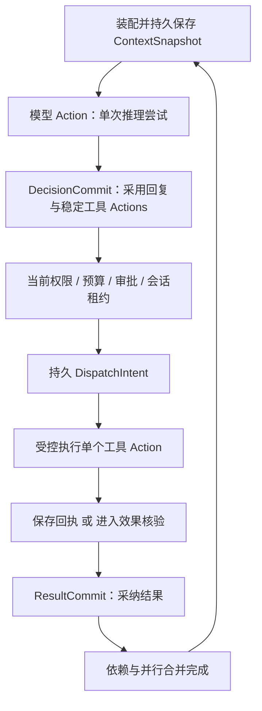

# RALF 动作恢复契约

版本：0.1（设计契约）  
日期：2026-10-05  
作者：RALF 架构设计  
状态：设计，尚未实现。本文中的记录、接口及验收场景是实现要求。  
关联：[架构总设计](../design.md)的领域状态、原生 Harness、执行引擎、治理及恢复章节。

## 1. 范围与核心约束

本文规定原生 Agent 从上下文装配、模型决策、工具派发到结果采纳的持久提交边界，以及 LocalEngine 与 TemporalEngine 应共同满足的恢复语义。外部完整 Harness 的内部循环不属于原生循环；其启动、观察、恢复及未知效果另按第 10 节处理。

原生 Agent 不得把“模型思考 → 任意多个工具 → 下一轮模型”包装成一个只能从头重跑的大 Activity。每个可影响后续执行的决策、动作、外部效果与结果都有明确的保存及采纳位置。Temporal 官方说明 Activity 的重试可能从函数初始位置开始，并建议拆分较大的功能；这也是本契约选择较小恢复边界的依据。[Temporal Activities](https://docs.temporal.io/activities)

必须同时满足以下约束：

- 已提交的决策只采纳一次；恢复不能重新询问模型替换它，也不能重新检索替换该决策已采用的输入。
- 只有引擎正式采纳的工具 Action 才能进入治理与派发路径。模型回复、流式片段和未采纳的候选不能执行业务效果。
- 已提交的结果只合并一次；回执重复、Worker 重试和 History 重放不能重复推动下一轮决策。
- 未知外部效果不能被当作失败后自动重跑；未知用量不能被当作零消耗后释放预算。
- 恢复固定已采用的数据和定义版本，但不冻结当前授权。新的上下文注入和外部调用仍需验证当前权限。
- 执行状态由当前运行的 ExecutionEngine 负责。效果、预算、审批存储提供可去重事实，不能成为第二个调度器。

## 2. 身份、记录及所有者

### 2.1 稳定身份

| 字段 | 契约 |
| --- | --- |
| `run_id` | 逻辑 Run 身份；恢复、Worker 更换、Temporal Continue-As-New 不改变它 |
| `decision_id` | 一轮决策的稳定身份，由引擎分配并持久保存，不由模型自报 |
| `action_id` | 一个逻辑模型、检索、工具或外部启动动作的稳定身份；重试不生成新 Action |
| `attempt_id` | 单次实际尝试身份，包含所属 Action 和尝试序号；用于诊断、执行归属及逐次用量 |
| `effect_key` | 由可信范围与 `run_id/action_id` 形成的业务幂等身份；所有执行重试保持不变 |
| `receipt_id` | 外部回执或核验事实的稳定去重身份，关联 Action、Attempt 及请求摘要 |
| `state_revision` | 与 Run 命令规格相同的引擎控制状态版本；决定计划修改、取消、决策采纳及派发的先后顺序 |
| `execution_epoch` | 当前执行资格版本；限制旧执行者提交状态、发布产物及发起后续受控动作 |

模型供应商的 tool-call ID、Temporal Activity attempt、线程 ID、进程 PID 都不能替代 `action_id` 或 `effect_key`。工具候选的身份及顺序随 DecisionCommit 保存；恢复使用保存值，不重新解析回复产生另一套身份。

`effect_key` 不包含重试次数、Worker ID、当前 PlanRevision 号或新的 Temporal Run ID。它的去重作用取决于目标工具明确支持的范围、参数约束及保留期限；仅在本地生成键不会令第三方调用自动具备幂等性。

### 2.2 最少记录

| 记录 | 必须保存的内容 | 所有者 |
| --- | --- | --- |
| `ContextSnapshot` | 实际采用的消息和内容引用、来源版本、授权范围、模型/工具配置摘要、Manifest、内容摘要 | 内容存储保存不可变数据；引擎采纳快照引用 |
| `ModelAttempt` | Action/Attempt、快照引用、供应商请求 ID、开始/结束或未知状态、回复引用、用量事实 | 执行适配器提供事实；引擎与 UsageLedger 去重接收 |
| `DecisionCommit` | 决策身份、采用的回复/快照、模型 Action、稳定候选工具 Actions、参数与操作摘要、PlanRevision、控制版本 | ExecutionEngine |
| `ApprovalDecision` | 审批人、操作指纹、范围、有效期、允许/拒绝决定及稳定决定 ID | 控制存储；引擎消费已验证决定 |
| `BudgetReservation` | 预留身份、Run/Action/Attempt、成本维度、金额或上限、状态、账本版本 | Budget/UsageLedger |
| `DispatchIntent` | Action/Attempt、固定操作摘要、目标、幂等键、审批/策略/预算引用、截止时间、epoch、会话租约 | 引擎拥有派发决定；EffectJournal 保存外部效果意图 |
| `EffectReceipt` | 请求/操作关联、外部事务或任务 ID、明确的执行状态、结果引用、核验来源及时间 | EffectJournal；模型文本不能充当写效果回执 |
| `ResultCommit` | Action、采纳的结果/回执、输出 Schema 版本、合并位置、控制版本 | ExecutionEngine |

以上记录表达职责，不要求新增独立服务。Local 模式可在 Coordinator 的 SQLite 事务中合并相关控制记录；Temporal 模式由 Workflow/History 采纳状态，PostgreSQL 保存审批、预算及效果记录。两者之间不存在默认的共同事务。

Local 的 DecisionCommit 可将回复引用、候选清单与控制版本写入同一个执行日志事务。Temporal 的模型 Activity 返回完整、可验证的回复/候选 envelope，History 保存其完成事实；Workflow 从该事实确定性采纳整份决策，再形成后续调度命令。候选身份须由已持久身份及固定规则形成，或随 envelope 一起保存，不能在重放时重新随机分配。若回复内容先写在内容存储，必须耐久后才返回其引用。数据库中的 DecisionCommit 展示副本不能提前驱动工具执行。

## 3. 原生循环的提交顺序

| 步骤 | 提交前允许发生的工作 | 持久提交边界 | 恢复行为 |
| --- | --- | --- | --- |
| 1. 上下文 | 验证当前读取/注入权限；通过受管理的读取或检索动作选择内容 | 内容已耐久保存，且引擎记录 `snapshot_ref + digest` | 已采用快照不被同轮重新检索替换；未采用快照允许重新装配并记录原因 |
| 2. 模型 Action | 为本次模型尝试预留预算，记录请求意图；仅允许推理及生成候选 | 保存完整回复或明确失败/未知事实；再交给引擎采纳 | 优先恢复已有完整回复；没有可用回复且没有 DecisionCommit 时，按单一重试策略处理 |
| 3. 决策采纳 | 验证回复 Schema；归一化并分配候选 Action 身份、参数与依赖 | `DecisionCommit` 在一次引擎状态提交中包含回复引用及完整候选清单 | 禁止“已采纳回复但丢失工具清单”的半提交；已有提交不重问模型 |
| 4. 治理 | 检查当前权限、工具版本、操作摘要、审批、预算及状态会话占用 | 引擎保存等待对象或已验证治理事实的引用 | 等待恢复不默认允许；过期审批或撤权需重新处理 |
| 5. 派发 | 引擎确认计划版本、取消状态、epoch 及可用执行资格 | 先保存派发决定和效果意图；跨存储时取得可去重的耐久意图确认 | 未拿到确认不能执行；意图存在而结果未知，先按效果类别判断 |
| 6. 工具执行 | 适配器按固定操作、相同幂等键及单次尝试执行 | 回执先进入 EffectJournal；结果/产物以不可变引用保存 | 回复丢失不代表外部未执行；先查询回执或核验 |
| 7. 结果采纳 | 验证回执关联、Schema、当前提交资格及依赖位置 | 引擎以 Action 身份和预期控制版本采纳 `ResultCommit` | 重复回执只返回已有提交；旧 epoch 不覆盖当前状态 |
| 8. 下一轮 | 所需结果和明确部分失败均已提交，依赖合并完成 | 分配下一轮决策身份并采纳其快照 | 并行完成通知去重，不能各自触发一轮重复模型调用 |

模型 Action 的原生适配器不自动执行 SDK 的工具循环。供应商或 SDK 内置业务工具若无法经过以上边界，必须按外部 Harness 的能力限制处理，不能宣称具备原生逐动作恢复。

## 4. 决策采纳与模型调用不确定性

### 4.1 采纳规则

`DecisionCommit` 使用 `decision_id + expected_state_revision` 的条件提交，校验本轮仍是当前待决策轮次。只有一个有效回复可以被采纳；并行返回或旧 Attempt 的回复只能留作候选和审计事实。已采纳回复、候选 Action 清单和原快照引用不可就地改写。

流式 Token、尚未完成的 JSON、模型“已执行”说明不构成 DecisionCommit。工具的真实业务执行始终在 DecisionCommit 后。回复保存成功但尚未采纳时，恢复优先使用该完整回复；不为获得更好的答案自动再发模型请求。

完成语义在公共采纳边界验证，不能仅依赖内置 Provider：没有工具提案时，缺少输出或空白文本不能作为最终决策；配置输出 Schema 时先解析 JSON 再检查文本与 Schema，显式允许 null 的 Schema 可以采纳 null。False、0、空对象／数组是合法 JSON 值，工具提案本身不要求最终输出。Local dev3 已实现公共最终校验，完整回复先保存的独立阶段仍待实现。

已采用检索结果、工具结果或模型回复不可因恢复时数据变化而替换。需要新信息时，以显式的新读取动作、新快照或新 PlanRevision 表达；保留原决策事实。历史诊断重放只消费这些记录。

### 4.2 网络调用可能重复成本

模型请求已发出但回复未持久保存时，供应商可能已完成推理并计费。此时记录该 Attempt 的回复/用量为未知，不能因为本地没有回复就记为零。

无 DecisionCommit 时，允许在以下条件下重试：本轮没有执行业务工具；原尝试不会绕过采纳竞争规则；截止时间、当前数据注入权限、模型能力及剩余预算均允许。重试继续使用同一逻辑模型 Action，创建新的 Attempt，并单独预留和记录可能再次发生的成本。

若可通过供应商请求 ID 恢复回复或账单，应先恢复。供应商未保证请求幂等时，同一请求标识也不代表成本只发生一次。旧 Attempt 后续返回可以补全用量事实，但不能替换已经提交的决策。

### 4.3 快照与实时权限

重放已有 DecisionCommit 不重新调用模型，也不重新读取来源替换原输入。任何下一次模型注入、模型重试或工具调用都必须重新验证当前主体、来源、数据释放目标及资源权限；历史快照不是授权凭据。

来源已撤权时，不能静默重检索或删改旧快照后继续冒充同一次决策。已有决策是否允许执行由当前操作策略及证据有效性要求决定；不满足则停泊、失败或形成显式修订。尚未采纳的模型轮次若需更换输入，必须记录原轮次废止与新快照，不采纳旧请求随后返回的回复。

## 5. Action 状态、尝试与单一重试所有者

### 5.1 内部阶段与公开状态

内部阶段至少区分 `proposed`、`waiting_gate`、`ready`、`dispatch_committed`、`executing`、`receipt_known`、`result_committed`、`outcome_unknown` 以及失败/取消。内部阶段可映射至总设计的公开 Action 状态，不要求 API 暴露所有存储阶段。

`executing` 表示执行已交接，不证明目标已提交效果；`receipt_known` 也不自动代表成功，回执可能确认拒绝、失败或仍在处理中。业务效果结论和输出验收分别记录。只有 ResultCommit 才能推动依赖和原生下一轮决策。

### 5.2 重试所有者

每个 Action 必须声明一个 `retry_owner`，由 ExecutionEngine 的效果分类、错误策略和截止时间决定。Local 由 Coordinator 决定；Temporal 由 Workflow 中的 Action 策略决定，可明确委托一个 Activity RetryPolicy 承载安全重试，但不能同时再加一层业务重试循环。

适配器、供应商 SDK、工具进程和 MessageBus 不自行从头重跑业务请求。必须暴露并关闭或约束其隐藏重试；单次协议协商不允许偷偷重复业务写。无法做到的适配器声明限制，严格治理场景拒绝使用。

所有尝试使用相同 `action_id/effect_key`，但 `attempt_id` 不同。采用 Temporal 自动重试时，也需记录每次真实尝试的用量和效果窗口。未知写默认不交给自动 RetryPolicy；引擎先核验，再决定安全续执行、失败或人工处理。

新 Run 的显式重试不免除旧 Run 的未知效果核验。旧操作不能通过换 Run、Action 或幂等键重新提交；确属新的业务操作时，必须有明确的新意图及授权。

## 6. 权限、审批指纹与计划派发竞争

### 6.1 操作指纹

审批指纹使用版本化的规范化规则，至少覆盖：`run_id/action_id`、工具来源与身份、工具版本及 Schema 摘要、规范化参数、目标资源身份、效果类别、授权范围、该操作相关的计划语义摘要。审批记录同时保存 PlanRevision 号、审批人、有效期及适用约束。

计划语义摘要覆盖该动作、相关前置条件、必要依赖及审批所依据的条件。完整 PlanRevision 号用于追溯，但不能仅因无关节点变化就令全部审批失效。引擎比较受影响操作摘要：摘要改变的操作重批；未受影响且权限、有效期及约束仍满足的审批可以继续使用。

Hook 修改参数、工具、目标或相关条件后，必须重新校验 Schema、操作摘要、权限、预算和审批。实际执行使用经验证的固定操作；不能在审批后通过 Hook 换目标再执行。ToolRegistry 后续更新不替换当前 Action 固定的工具版本。

### 6.2 PlanPatch 与 DispatchIntent

PlanPatch、取消和派发决定由同一个 ExecutionEngine 权威按 `state_revision` 条件提交或串行消费。取消按当前非终态串行应用，不要求客户端提供预期版本；其他操作按各自条件校验。不能由 Planner 修改一张计划表，同时 Worker 依据旧副本自行派发。

| 竞争结果 | 必须发生的行为 |
| --- | --- |
| 计划修改先被接受 | 派发原操作的预期版本不匹配，重新读取当前计划及操作摘要；受影响审批重新判断 |
| 派发决定先被接受 | 原操作已经冻结；PlanPatch 不得修改该已派发操作，也不能换 Action ID 再提交同一效果 |
| 无关计划节点被修改 | 可重新取得当前控制版本；操作摘要一致时不无条件废除该动作审批 |
| 取消先被接受 | 拒绝新的派发决定；已有派发动作按取消及核验路径处理 |

未派发候选的变更以显式替代记录表达，关联原候选和修订原因，不改写旧 DecisionCommit。替代操作重新接受治理；原审批不会自动迁移到不同操作。已保存派发决定但尚未收到跨存储意图确认，也属于已冻结窗口，不能当作随意可改的草稿。

在 Temporal 模式中，计划/派发顺序由 Workflow/History 确定，实时授权和预算检查通过 Activities 返回可去重事实。PostgreSQL 投影和 Worker 的本地缓存无权赢得该竞争。

## 7. 预算预留、未知用量及跨存储交接

并行动作在外部调用前，以账本版本/CAS 或等价事务条件预留预算。唯一 `reservation_id` 绑定真实调用 Attempt 及成本维度；重复预留请求返回同一结果。只有预留已确认且引擎已记录可派发条件，动作才可进入外部调用。

预算预留和审批可先后进行，等待期间按策略管理尚未调用的预留。尚未发出调用、且已证明不会执行的预留可以按策略释放；一旦可能产生模型或工具消耗，就按实际回执结算，未知部分继续占用。

财务预算预留与执行并发槽分开：等待审批、等待核验或调用已结束时，可以释放实际已不再运行的执行槽；这不释放未知消耗的财务占用。旧进程或远程请求可能仍在运行时，不能只因调度超时就释放其执行归属并允许并行接管；孤儿资源与在途供应商调用仍单独计入实际容量或隔离状态。

| 用量事实 | 账本处理 |
| --- | --- |
| 已确认用量 | 按 Attempt/回执 ID 去重结算，释放已证明未消耗的余额 |
| 已证明未执行或未计费 | 保存证据后释放对应预留 |
| 请求可能已执行，账单未知 | 保留未知用量及其预算占用；重试另外预留，不能复用为零成本机会 |
| Run 已取消或超时 | 结束调度不清零已经可能发生的消耗；继续接收晚到结算事实 |

TTL、Worker 丢失及取消状态不能证明零消耗。严格预算要求执行器提供可证明的调用上限/限额能力；未知消耗没有可信上界时，拒绝继续声称严格预算，而不是把预估数作为保证。

跨存储步骤通过稳定请求 ID、确认事实和恢复核验衔接。EffectJournal 保存意图或回执后，引擎尚未采纳的通知可重发；引擎重复接收只补全同一事实。孤立预算预留只有在确定没有派发、没有外部调用且没有旧执行者继续工作时才能释放；不能根据投影里暂时没有 Action 就推断安全。

## 8. 按效果类别恢复

| 类别 | DispatchIntent 后结果未知时 | 自动再执行的最低条件 | 禁止行为 |
| --- | --- | --- | --- |
| 只读 | 先查已保存结果；没有可用结果时可进行新的读取 Attempt | 当前权限/截止时间允许，目标确认没有业务写效果，且旧结果未被正式采纳 | 已采纳读取结果被重新检索结果替换；把“GET”或工具自报当作只读保证 |
| 原生幂等写 | 优先查回执/请求状态；允许同键续执行或再次调用 | 下游明确保证该键、相同操作摘要及有效期限内去重；当前权限/审批仍满足 | 更换幂等键、不同参数沿用已用键、去重期已过后仍盲重试 |
| 可核验写 | 进入 `outcome_unknown`，执行独立核验 Action | 有权威证据证明原效果未发生，且旧执行者/在途提交窗口已被处理，才允许原逻辑动作安全续执行 | 用最终一致查询的暂时“未找到”证明未执行；把模型推断当作核验 |
| 不可核验写 | 停泊于 `waiting_reconciliation`，转人工或明确失败处置 | 仅在取得足以证明可安全继续的业务证据和明确授权后处理 | 自动重跑、自动生成替代 Action、因业务超时认定未提交 |

“原生幂等”要求目标系统实际实现去重，而非 RALF 仅有 Inbox/Outbox。可核验写的查询应能关联稳定业务键、事务 ID 或操作证据；核验结果至少区分已发生、确定未发生、仍在处理与未知。

如果确认写效果已发生但结果不满足业务输出 Schema，不得重跑写操作修复输出；应通过只读恢复结果、标记输出验收失败或独立补救操作处理。补偿是带自身授权、效果记录及幂等身份的新动作，不删除原回执。

## 9. Stateful 会话与取消边界

浏览器、Workspace 及其他持有可变状态的执行器，默认通过独占 `SessionLease` 使用。租约至少包含会话身份、Owner Run/Action、Worker/执行器句柄、状态版本或 checkpoint 引用、epoch、到期时间与续租信息。不同 Worker 不因取得相同 Session ID 就能并行操作。

会话接管必须同时满足：旧执行者已停止，或执行器能证明旧 Owner 不能再访问/修改该会话；执行器声明可恢复；存在已验证的 checkpoint/状态归属；新执行者重新取得当前授权和执行资格。只限制 RALF 状态提交的 fencing 不足以满足会话访问隔离。否则停泊或明确失败，不能仅因租约过期就在第二个 Worker 重放浏览器点击或 Workspace 修改。

只有执行器声明并验证相互隔离的会话／Workspace 副本时才允许并行，每个副本仍持有自己的独占租约；浏览器切换页签、登录状态变化和工作目录写入不能默认为无状态读取。Checkpoint 保存执行状态不证明外部业务效果是否发生，点击提交等操作仍按第 8 节核验。

取消先在引擎记录控制决定，阻止新调度和后续受控调用，再要求执行器终止或停泊；状态分别记录取消请求、执行停止事实与外部效果结论。`execution_epoch` 校验用于拒绝旧 Worker 的 ResultCommit、产物发布及后续派发，但不能撤销已发送的网络请求或已发生业务效果。

旧 Worker 的晚到回执仍可进入关联审计与效果核验，不能覆盖当前执行状态，也不能丢弃成没有发生。下游不接受 fencing 或撤销的操作保留其未知窗口，不能承诺取消之后外部绝无效果。

## 10. 外部 Harness 与远程 Agent

外部 Harness 是受管理执行单元。适配器分别声明启动幂等、启动查询、会话恢复、逐步拦截、取消、checkpoint、用量及状态会话绑定能力，不能从“有统一接口”推导具备这些能力。

启动遵循 `launch Action → durable launch intent → 启动 → launch receipt/handle → 观察 → 结果采纳`。句柄包含适配器身份、目标、外部会话/线程/任务/运行 ID 及恢复所需引用；本地进程另需进程创建身份，不能仅凭可能复用的 PID 判断仍是同一执行者。

| 情况 | 恢复规则 |
| --- | --- |
| 已有耐久外部句柄 | 查询现有运行并恢复观察；只有明确支持时才能继续同一会话 |
| 启动可能成功但句柄未保存 | 先使用客户端关联键、启动查询或受控进程监督恢复句柄；不能盲目再启动 |
| 目标无启动查询/幂等能力 | 进入未知启动及效果核验；内部可能已执行工具，禁止把 SDK 重启当作安全恢复 |
| 一次性 Harness 无恢复能力 | 保留能力限制；已开始的调用丢失不能许诺迁移到新 Worker 接续 |
| 取消超时或流断开 | 查询实际状态并记录取消意图；断流、进程通信失败不证明业务回滚 |

A2A 的 Send Message 幂等属于可选能力，不能只因保存了 `messageId` 就自动重发；Cancel Task 表示请求尝试取消，成功并不保证。[A2A 幂等与取消规范](https://a2a-protocol.org/latest/specification/)

外部 Harness 内部工具若不能接管 RALF 的策略/审批/效果路径，只能运行在经声明的有限工具、凭据和沙箱能力范围内；不满足部署要求则拒绝该模式。它的内部 Session 恢复不替代 RALF 的 DispatchIntent、未知效果核验或 Run 状态。

## 11. 恢复窗口表

| 崩溃/断线窗口 | 已知耐久事实 | 恢复动作 | 不得发生的行为 |
| --- | --- | --- | --- |
| 内容已保存，快照未被引擎采纳 | 孤立内容引用 | 根据原轮次状态采纳完整快照或清理孤立内容 | 将缺失内容的 Manifest 当作可恢复快照 |
| 快照已采纳，模型请求尚未发出 | 快照、模型 Action、预留/请求状态 | 当前注入权限复核后启动原模型 Action | 静默重新检索替换该快照 |
| 模型请求已发出，回复/用量未确认 | ModelAttempt、请求意图、预算预留 | 恢复供应商事实；没有已采纳决策时才考虑新 Attempt，未知成本保留 | 把无回复解释为未计费；未采纳回复中的工具被执行 |
| 完整模型回复已保存，DecisionCommit 未完成 | 回复引用及原快照 | 通过控制版本采纳一次回复及稳定候选清单 | 恢复时重问模型或仅提交半份工具清单 |
| DecisionCommit 已完成，工具尚未治理/派发 | 已采用回复、候选 Actions | 从治理阶段继续；等待对象按原 ID 恢复 | 重问模型产生另一批工具或新 Action ID |
| 审批/预算已保存，交接通知未到或重复 | 稳定决定/预留 ID | 重发确认，引擎去重消费并复核当前适用性 | 重扣预算、重复审批或默认放行 |
| 引擎已冻结派发，效果意图确认尚未返回 | 冻结操作、跨存储请求 ID | 查询/重交同一意图并取得耐久确认；此前不执行 | 把该操作当可编辑草稿或绕过意图直接调用 |
| DispatchIntent 已确认，目标执行状态未知 | 固定操作、Attempt、effect_key、执行资格 | 按只读/幂等/核验/不可核验契约处理 | 以“没有结果”直接重跑写操作 |
| 外部已提交，回执尚未保存 | 本地只有意图，外部可能有业务事实 | 同键查询/续执行或效果核验；保留未知窗口 | 换幂等键或新 Action 重发 |
| 回执已保存，Activity 回复或 ResultCommit 未完成 | EffectReceipt 与结果引用 | 重新交接同一回执并采纳结果；不重执工具 | 仅因 Activity 未完成而重复已确认写 |
| ResultCommit 已完成，下一轮未启动 | 已采纳结果、依赖位置 | 完成去重合并并分配下一决策 | 重复通知触发多次模型调用 |
| 取消/接管后旧 Worker 晚到 | 新 epoch、旧 Attempt、可能真实回执 | 拒绝旧状态覆盖；保存晚到效果/用量事实并核验 | 丢弃真实效果或允许旧 Worker 发起后续动作 |
| 外部 Harness 已启动但启动回复丢失 | launch intent，可能没有句柄 | 启动查询/监督恢复或停泊核验 | 自动创建新的外部运行替代未知旧运行 |

## 12. 验收场景与可检查断言

以下是设计验收示例，不是已实现的测试。Local 单进程、多进程与 Temporal 应对同一事实序列给出相同业务结果；模式差异只能来自显式能力限制。

| 场景 | 故障注入 | 必须检查的断言 |
| --- | --- | --- |
| T1：采纳后恢复 | 模型回复提出两个工具，在 DecisionCommit 后重启引擎 | 模型调用不增加；两个 `action_id` 及参数不变；只继续未完成动作 |
| T2：模型网络未知 | 请求可能已计费，完整回复尚未保存时中断 | 原 Attempt 用量未知且预留保留；新尝试单独计费；仅一个 DecisionCommit；未采纳候选没有业务写 |
| T3：半提交与竞争回复 | 回复保存后崩溃；旧/新 Attempt 同时返回 | 采用完整回复和完整工具清单；只一个版本胜出；其他回复保留诊断/用量，不派发工具 |
| T4：原生幂等写 | 目标已按键提交，保存回执前崩溃 | 重试使用相同键和摘要；目标仅一次业务写；ResultCommit 仅一次；去重期不足时停泊 |
| T5：核验与不可核验写 | 写调用超时，查询暂时未找到或工具无查询能力 | 未找到不直接重写；进入未知状态；确定未发生需排除旧执行/在途提交；无证据时停泊 |
| T6：结果回复丢失 | 回执耐久保存后，Activity 返回前崩溃 | 从已有回执恢复结果，工具执行次数不因恢复增加；重复回执不重复推动下一轮 |
| T7：审批与计划竞争 | 修改目标资源的 PlanPatch 与派发同时到达 | 同一引擎确定唯一顺序；修改先赢则旧指纹不能派发；派发先赢则原操作不可改写 |
| T8：无关计划变更 | 审批后仅添加不影响原操作条件的节点 | 操作 digest 不变时审批可复用；当前权限/有效期仍复核；不全量废除审批 |
| T9：预算并发与未知用量 | 两个并行动作争夺最后额度；其中一项调用后超时 | CAS 不超额预留；重复请求不重复扣账；未知用量不释放；取消后晚到结算去重 |
| T10：状态会话接管 | Worker 失联但浏览器进程仍在运行 | 默认独占租约；新 Worker 不并行重放点击；不能安全接管则停泊；checkpoint 不替代效果核验 |
| T11：取消 fencing | 取消或换 epoch 后旧 Worker 返回成功并请求下一工具 | 旧结果不覆盖状态；下一受控调用被拒；真实回执/用量仍入审计；不声称已撤销外部效果 |
| T12：撤权与快照 | 快照采纳后撤销来源或目标权限，再恢复 | 不改写旧快照；新的模型注入/调用被阻断或按显式策略处置；不凭旧审批绕过当前权限 |
| T13：外部启动未知 | Harness/远程 Agent 已开始运行，启动回复丢失 | 有查询能力则找回原句柄；无能力则停泊；不产生第二个启动请求或默认为无效果 |
| T14：重试层叠 | SDK 默认重试开启，Activity 与应用重试也同时配置 | 能力预检拒绝冲突配置或关闭隐藏业务重试；每个实际 Attempt 可追溯；单一业务重试所有者可验证 |

验收证据至少包含引擎事件、决策/动作身份、外部真实调用次数、效果回执、预算/用量记录、审批摘要以及状态会话归属。仅观察最终答案相同不足以证明恢复正确。

## 13. 权威边界与参考

RALF 的稳定身份、提交顺序、审批指纹、预算规则和会话租约是本项目设计决定，不是下列协议默认提供的能力。

- [架构总设计](../design.md)：公共状态与所有权的上层约束。
- [Temporal Activities](https://docs.temporal.io/activities)：Activity 重试、幂等及较小执行边界。
- [Temporal Workflow Definition](https://docs.temporal.io/workflow-definition)：Workflow 确定性重放；模型、数据库和外部 API I/O 应位于 Activities，重放消费历史事实。
- [A2A 规范](https://a2a-protocol.org/latest/specification/)：远程任务、可选发送幂等及取消请求语义；不提供 RALF 的内部效果事务。
