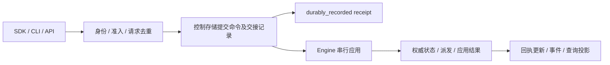

# RALF Run 命令与执行一致性规格

版本：0.1  
日期：2026-10-05（Asia/Shanghai）  
作者：RALF 架构设计讨论  
状态：设计规格；接口与验收场景尚未实现。

本文细化[架构设计](../design.md)第4、5、8、9、10及13节的运行契约，供 SDK、CLI、API、控制台和 Engine 实现共同使用。它不改变企业首版交付目标，也不把预览版本的接口预留当作企业能力已实现。

## 1. 职责与唯一状态权威

| 组件 | 本规格中的职责 | 恢复边界 |
| --- | --- | --- |
| Agent／AgentSpec | 定义目标、输入输出、模型、指令、工具、记忆策略及执行限制 | 定义随 Release 固定；不自行采纳决策或推进状态 |
| Harness | 装配上下文、解释模型响应并提出 Action，管理工具目录、Workspace、Skills 和产物 | Engine 采纳决策和快照；重放不重新生成已采纳决策；外部 Harness 按能力声明恢复其执行单元 |
| Workflow／IR | 表达依赖、分支、等待、并行和受控计划修改 | 确定性解释已记录输入、计划与结果；外部 I/O 经 Action 执行 |
| ExecutionEngine | 串行应用运行命令，推进状态、派发 Action、决定重试与终态 | Local 从 Coordinator 的 SQLite 执行日志恢复；Temporal 从 Workflow／History 恢复 |
| RunService／控制存储 | 验证入口请求，保存命令回执、审批决定和可靠交接 | 记录命令不代表命令已应用；不能据此推进执行状态 |
| Worker／ActionExecutor | 按授权和效果契约执行一次被派发的尝试 | 不自行改变 Run、重启整个任务或获得业务重试权 |

Local Coordinator 是本地唯一状态写入者。Temporal Workflow／History 是服务端唯一推进、调度和终态权威；PG 中的 Run 查询投影不参与 CAS、任务派发或恢复。审批决定、工具效果等分别遵循[第9.2节](../design.md#92-每类记录的唯一权威)的权威划分。

Engine 为每个逻辑 Run 保存单调增加的 state_revision。它在真正改变执行状态、待处理对象、计划或派发记录时递增；重复命令、无操作结果和拒绝不重复改变状态。事件序号独立于 state_revision，同一状态提交可以形成多个业务事件。

## 2. 命令回执与幂等

### 2.1 最低命令和回执字段

命令包含 command_id、命令类型、逻辑 run_id、业务参数、可信调用身份与工作区。submit 尚无 Run 时由服务端分配逻辑 run_id，并与该请求可靠绑定。命令按类型携带待处理对象引用或预期版本。

| 回执字段 | 含义 |
| --- | --- |
| command_id、run_id、command_kind | 稳定请求身份与目标 |
| request_digest | 规范化请求摘要，覆盖类型、目标、业务参数及条件 |
| recorded_at | 可靠记录时间，仅用于展示和诊断，不决定竞态胜负 |
| record_state | 成功接受后为 durably_recorded |
| apply_state | pending、applied 或 rejected |
| applied_state_revision | 已应用命令对应的 Engine 状态版本；无操作可以保持原版本 |
| outcome | 命令应用或拒绝的结果，含可识别原因；不等于任务结果 |

入口校验、认证或准入失败返回明确错误，不能返回 durably_recorded。成功响应的最低保证是命令已可靠保存且可查询；同步完成应用时可以同时返回 applied，但所有后端都必须支持 pending 回执。传输超时只表示客户端没有取得确定回执，客户端用原 command_id 和原请求查询或重提。

apply_state 的终态是 applied 或 rejected。applied 表示 Engine 已接受并提交该命令对运行的影响；approve 已应用不表示工具已经执行，cancel 已应用也不表示外部效果已经撤销。

applied_noop 是 outcome，表示 apply_state=applied 但无需再次改变状态，不是第四种应用状态。取消已 cancelled 的 Run 返回 applied／already_terminal；取消已 succeeded 或 failed 的 Run 返回 rejected／too_late。

### 2.2 去重与冲突

- 幂等范围为工作区、调用身份和 command_id。命令类型属于 request_digest，同一个 ID 不能用于另一个命令。
- 同 ID、同摘要返回同一回执及其最新应用结果，不生成第二个 Run、审批消费、输入消费或取消动作。
- 同 ID、不同摘要返回 idempotency_conflict。修改条件或参数必须使用新 command_id，不能覆盖原命令。
- 身份与权限由平台重新验证；知道 command_id 不等于有权读取回执或提交新操作。
- 已可靠记录但尚未应用的命令不能因 HTTP 重试而重新执行；重复交接由 Engine 的已消费命令身份去重。
- 去重保留、有效期和过期交接遵循[数据保留策略](../design.md#122-生命周期和清理)。命令记录与应用结果需要覆盖允许重投递期限及活跃 Run 的恢复需求。

## 3. 状态与命令表

### 3.1 Run 状态

| Run 状态 | 含义 | 允许的主要推进 |
| --- | --- | --- |
| queued | Engine 已创建 Run，尚未开始有效执行 | 派发后 running；取消生效后 cancelling／cancelled；不可执行时 failed |
| running | 原生循环、Workflow 或外部执行单元正在推进 | 等待、继续派发、验证结果后 succeeded、明确失败后 failed、取消生效后 cancelling |
| waiting_input | 有持久化的补充输入对象 | 匹配输入应用后继续；截止时间到达后按模板失败；取消 |
| waiting_approval | 有绑定具体操作的审批对象 | 匹配决定应用后继续或执行拒绝分支；截止时间处理；取消 |
| waiting_auth | 等待符合范围的授权 | 授权满足后继续；截止时间处理；取消 |
| waiting_reconciliation | 外部结果不确定，需要核验 | 记录核验结果后按效果契约继续或失败；取消不能抹掉核验记录 |
| cancelling | Engine 已提交取消生效，停止新业务推进并处理执行器 | 记录受控停止、过期执行防护和必要效果状态后 cancelled；不能再提交 succeeded |
| cancelled | 业务运行已取消的终态 | 不再推进；外部效果记录仍可独立核验 |
| succeeded | 验收通过且 Engine 已提交成功终态 | 不再推进；后到取消不覆盖成功 |
| failed | Engine 已提交失败终态 | 不再推进；显式重试创建新 Run |

等待对象至少保存 pending_id、对象类型、目标摘要和截止时间。并行分支可以存在多个待处理对象，命令必须指向具体对象；单个公开等待状态不能替代对象列表。

submit 的 PG 注册／Outbox 已提交、Temporal Workflow 尚未创建时，回执是 pending。查询可以显示“提交交接中”，但该描述是命令交接事实，不是伪造的 Engine queued 状态。Engine 创建 Run 后才拥有 queued 及其状态版本。

cancelled 不证明外部系统已回滚，也不证明无法拦截的远程 Harness 已停止所有内部操作。未确认写效果保留在 EffectJournal／核验案件中，不能因为 Run 终态而删除或允许盲目重新执行。

### 3.2 命令

| 命令 | 应用条件 | applied 的含义 | 拒绝或无操作结果 |
| --- | --- | --- | --- |
| submit | 准入通过，固定 ReleaseManifest，可靠交接未创建重复 Run | Engine 为该逻辑身份创建 Run | 同请求返回原 Run；同 ID 不同请求冲突；准入失败不接受 |
| send_input | pending_id 与目标摘要匹配；提供预期版本时也须匹配 | 该输入对象只消费一次，并进入声明的继续路径 | stale_pending_target、version_conflict、target_closed、无效输入 |
| approve／reject | 审批决定可靠保存，匹配审批对象、Action 版本、参数／资源摘要及有效期 | Engine 只消费对应决定，选择声明的继续或拒绝路径 | 已失效、已消费不同决定、目标变化、版本冲突或终态 |
| patch_plan | expected_plan_revision 匹配；所有被修改节点尚未提交派发；变更通过校验 | 同一 Engine 提交 PlanRevision 和节点变更 | plan_conflict、already_dispatched、能力／授权／预算不满足 |
| cancel | 针对当前逻辑 Run 的停止意图，不要求 expected_revision | Engine 提交取消生效，进入取消路径并禁止后续成功提交 | 已 succeeded／failed 为 rejected／too_late；已 cancelled 为 applied／already_terminal；已 cancelling 为 applied／applied_noop |
| recover | 由同一后端恢复非终态 Run，使用已有权威历史、原 Release 和逻辑身份 | 恢复观察与推进资格，不重新创建 Run | 无恢复能力、状态不可恢复或存在必须先核验的效果 |

approve、reject、send_input 使用待处理对象的 pending_id 与 target_digest 做条件检查；可同时携带 expected_state_revision，提供时必须在应用点匹配。patch_plan 必须携带 expected_plan_revision，并在同一应用点校验节点状态。入口对查询投影做的预检查不能代替这些 Engine 检查。

取消是预期版本规则的明确例外。客户端即使观察到旧版本，也可用新 command_id 请求停止当前非终态 Run；胜负由 Engine 的串行提交决定。针对已知终态提交的取消同样返回可靠回执和 too_late／already_terminal 结果，不改写终态。

recover 是后台／运维恢复动作，不是重新执行业务的捷径。终态重试使用新的 submit 和新逻辑 Run，并保留原 Run 关联；存在未知写效果时先核验，不能用新身份绕过效果检查。

## 4. Local 与 Temporal 的可靠交接

| 行为 | LocalEngine | TemporalEngine |
| --- | --- | --- |
| 可靠接受 | Coordinator 在 SQLite 提交命令及交接；可与应用在同事务完成 | PG 提交命令及 Outbox；审批决定与其 Outbox 同事务 |
| 应用串行化 | 单 Coordinator 处理每个 Run 的命令、派发和状态提交；Process Worker 不写状态 | Workflow 按已记录输入顺序处理命令与派发；非确定性校验和 I/O 经 Activities |
| 通知与去重 | 内存通知只作唤醒；重启读取未处理交接，按 command_id 去重 | Dispatcher 重试 Start／Signal／Update 的交接；Workflow 按 command_id 去重 |
| 回执 pending | SQLite 记录已提交但尚未应用时合法 | PG／Outbox 提交后必须返回 pending，除非已另行确认 Engine 的应用结果 |
| 回执 applied | 来自 Coordinator 已提交的应用结果 | 来自 Workflow／History 的已提交应用结果，不能依据 Signal 已接受或 Outbox 已发送推断 |
| 已关闭 Run | 从本地权威终态决定命令结果 | Engine adapter 从权威终态／历史决定命令结果，不能通过 Signal-with-Start 复活运行 |

Outbox 是跨存储命令交接机制，不是另一套工作流重试队列。Dispatcher 可以重复投递同一控制命令，但不能决定 Action 重试或修改 Run 状态。PG Outbox 发出成功而确认失败时，重投递仍消费同一 command_id。

应用结果写回回执／投影可能延迟。此时回执可以继续显示 pending；通过权威查询或重试结果同步取得 applied／rejected。查询服务不能为了消除延迟假造结果。

## 5. 串行化、取消与计划竞态

### 5.1 唯一判定点

Engine 的命令应用、Action 派发提交和终态提交在同一 Run 状态权威中串行化。Local 以 SQLite 事务和 Coordinator 顺序为准；Temporal 以 Workflow 提交到 History 的状态和命令为准。HTTP 到达时间、客户端 timestamp、PG receipt 时间和 Worker 返回时间均不单独决定胜负。

Actor／异步 handler 可以并发等待 I/O，但改变运行状态前必须重新校验当前条件并串行提交。不能读取旧状态，跨 await 等待后直接覆盖新计划或终态。

### 5.2 取消与成功

| Engine 的提交顺序 | 确定结果 |
| --- | --- |
| 成功终态先提交，取消后应用 | Run 保持 succeeded；取消回执为 rejected／too_late |
| 取消生效先提交，成功结果后到 | Run 进入 cancelling，不能再提交 succeeded；晚到结果记录审计及效果核验，取消流程结束后 cancelled |
| 取消在 PG 已记录，但 Workflow 先提交成功 | Run 保持 succeeded；取消记录最终得到 too_late；不能按 recorded_at 改成 cancelled |
| 同取消重复投递 | 返回原命令结果，不再次停止执行器或推进版本 |
| 不同取消命令到达已 cancelling Run | applied_noop，附当前取消状态；不重新启动取消流程 |

取消生效记录先禁止新业务派发，并使过期执行失去后续受控调用和平台状态提交资格；执行器停止与效果处理可以继续。晚到结果可以补充效果事实，不能改变终态或重新获得派发资格。控制命令的 applied 和 Run 的 cancelled 分别可查询。

### 5.3 计划修改与派发

| Engine 的提交顺序 | 确定结果 |
| --- | --- |
| patch_plan 校验并提交先完成 | 后续派发只读取新计划；被移除或修改节点不能按旧缓存派发 |
| Action 派发记录先提交 | 修改该节点的 patch_plan 被拒绝为 already_dispatched，即使 Worker 尚未开始实际 I/O |
| 两个 patch_plan 使用同一 expected_plan_revision | 最多一个应用；另一个得到 plan_conflict |
| 计划修改使审批目标发生变化 | 旧 pending_id／target_digest 失效，后到审批不能授权新操作 |

派发提交是“尚未调度”的边界：Local 在执行日志提交身份和派发意图后才能发送 IPC；Temporal 在同一 Workflow 提交中固定 Action 和 Activity／子 Workflow 派发。参数变化不得复用旧操作审批，也不能通过改变 Action ID 重做已发出的写操作。

## 6. 查询与持久事件

### 6.1 查询一致性

| 查询类型 | 返回的最低标记 | 可以承诺的事实 |
| --- | --- | --- |
| projection | consistency=projection、投影 state_revision、as_of／可见事件水位 | 可重建展示；可能落后于命令或 Engine，不能用于 CAS 和恢复 |
| authoritative | consistency=authoritative、Engine state_revision、对应事件水位 | 该 Engine 已提交的 Run 状态、待处理对象和命令应用结果 |
| command_receipt | recorded 与 apply 两阶段、命令身份、应用结果来源 | 控制存储确已记录；applied／rejected 必须关联 Engine 的确认结果 |

权威查询不意味着所有已记录命令已应用；必须同时返回或允许查询其 pending 回执。Engine 或所需 Worker 不可用时，权威查询明确返回 unavailable，不能悄悄用 PG 投影代替。投影可以继续显示，但保留 consistency 标记。

### 6.2 游标与续传

- 持久 RunEvent 使用逻辑 run_id 与运行内单调 event_seq。相同事件重复交付保持同一身份；序号跨 Continue-As-New 延续，不使用 Temporal 新 Run ID 重置。
- 游标表示最后已消费的持久事件。订阅与分页从该序号之后读取；断线和重放允许重复，客户端按 run_id／event_seq 去重。
- 状态事件可靠保留并可重建展示。Token 流与诊断遥测是独立流，不把 Token 完整重放作为状态恢复条件。
- 不同 Run 的事件不承诺全局顺序。过载时限制页大小、暂停读取或断开并提供续传游标，不丢弃状态事件后继续假装完整。
- 游标已过期时返回 cursor_expired、一个带 state_revision／snapshot_event_seq 的一致快照，以及从该快照水位继续的游标；显式说明历史缺口。
- 快照及续订水位必须对应同一权威状态边界，保留该水位之后的事件。不能把新状态快照与旧投影游标拼接，造成事件遗漏。
- 游标绑定目标 Run 和授权范围，读取仍校验当前权限。无效或越权游标不触发新 Run，也不返回其他工作区事件。

## 7. 固定发布与单一重试所有者

submit 首次接受时解析并保存不可变 ReleaseManifest。重复同一请求返回原 Run 和原 Release，即使配置别名已移动。恢复、等待唤醒、重投递与 Continue-As-New 继续使用固定兼容版本；升级与后端替换遵循[发布与兼容](../design.md#13-发布兼容与开发体验)，不能在恢复时静默解析最新版本。

| 重试类型 | 唯一所有者 | 边界 |
| --- | --- | --- |
| 请求传输重试 | 调用端 | 同 command_id、同请求，取得原回执，不产生新业务操作 |
| Outbox／消息交接重试 | Dispatcher／Bridge | 重复交接同一命令，Engine 去重；不决定工作流下一步 |
| Action 业务尝试重试 | ExecutionEngine | Local 由 Coordinator 决定；Temporal 由运行时配置的 Activity Retry Policy 执行 |
| Engine Worker 恢复与历史重放 | 所选 Engine 后端 | 继续原逻辑 Run，重用已记录结果，不从头重新做业务 |
| 终态业务重试 | 明确的新 submit | 新 Run、原 Run 关联及明确效果策略；未知写效果先核验 |

Adapter 和 Worker 每次执行被派发的尝试，不再隐式从头重跑业务请求。提供商 SDK 的业务重试须关闭或显式并入 Engine 管理的尝试契约，不能与 Engine 叠加。Temporal 不默认通过整个 Workflow 重试重启逻辑 Run。

Action 效果身份跨尝试稳定，Attempt 身份区分实际执行。UsageLedger 对同一次实际调用的重复回执去重，不把不同尝试产生的真实用量合并为一次。超时或崩溃后先遵循效果契约；已有结果重用，未知写效果进入核验，不由 retryable 网络错误直接推断可重做。

## 8. Local／Temporal 一致性验收场景

以下场景是设计目标，应在 Local 单进程、Local Coordinator＋Process Workers 与 Temporal 后端运行同一套语义测试；不要求内部存储格式或吞吐相同。

| 场景 | 必须观察到的结果 |
| --- | --- |
| submit 响应丢失后同 ID 重提 | 只有一个逻辑 Run，回执对应原请求和固定 Release |
| 同 ID 改参数、命令类型或预期版本 | idempotency_conflict，不覆盖原请求 |
| 可靠记录后、Engine 应用前崩溃 | 原回执可查询为 pending；恢复后最多应用一次 |
| 审批记录与 Outbox 同事务提交，发送确认丢失 | 重复交接只消费对应审批一次；不能把 Outbox 已发送标成工具已执行 |
| Engine 已应用，应用结果写回投影前崩溃 | 权威状态正确；投影可落后，后续同步恢复原应用结果 |
| success 提交后到达 cancel | succeeded 保持；cancel 为 too_late |
| cancel 生效后 Worker 返回成功 | 不产生 succeeded；晚到效果可审计／核验，不能恢复派发资格 |
| cancel 先在控制存储记录，success 先在 Engine 提交 | succeeded 保持；客户端时间不改变胜负 |
| patch_plan 与 dispatch 竞争 | 同一权威提交顺序决定应用或 already_dispatched；旧计划不得晚派发 |
| 同 revision 的计划竞争、旧审批／输入到达 | 至多一个计划应用；失效待处理对象不得影响新操作 |
| Coordinator 重启或 Activity 超时，旧 Worker 继续执行 | 旧执行不能覆盖当前状态或发起新的受控动作；未知效果先核验 |
| 事件断线、重复、分页与慢消费 | 持久事件按游标续传、去重，不能因断线再次 submit |
| 事件保留到期 | 明确 cursor_expired、一致快照和续订水位，不隐瞒历史缺口 |
| 等待审批或存在历史效果时 Continue-As-New／Local 恢复 | 逻辑 Run、Action、命令去重、事件序号和预算不重置 |
| 新 Release 或新 Worker 上线后恢复旧 Run | 使用固定兼容版本；不支持旧版本时明确停泊／不可用，不静默升级 |
| 权威查询不可用但投影仍可读 | projection 标记保留；authoritative 返回 unavailable，不冒充已应用 |
| Adapter 和 Engine 同时具备重试配置 | 只有 Engine 拥有业务重试；真实调用次数、效果与用量可核对 |

完成上述验收表示运行命令契约成立，不替代[企业正式版的全部验收](../design.md#16-验收与故障场景)。
