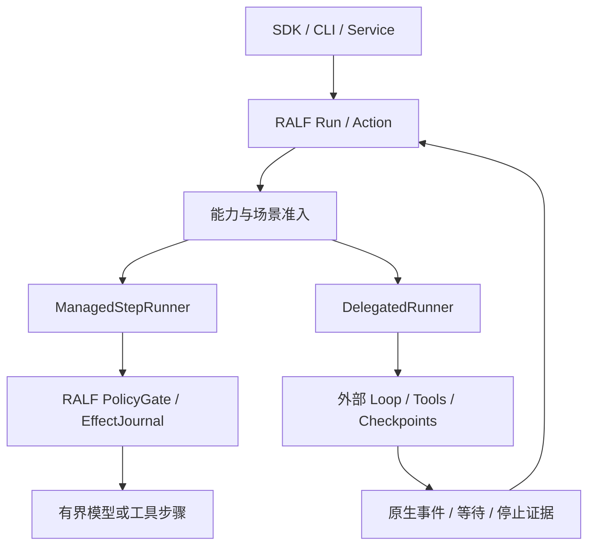

# RALF Runner 能力契约

| 项目 | 内容 |
| --- | --- |
| 版本 | 0.1 |
| 日期 | 2026-10-05 |
| 状态 | 设计规范；适配能力尚待实现与验证 |
| 读者 | SDK、Engine、RunnerAdapter、治理与兼容测试实现者 |
| 上位设计 | [RALF 架构设计](../design.md)，尤其是 Run／Action、Adapters、治理、预算和发布门禁 |

## 1. 范围与发布边界

本契约规定原生执行步骤与外部 Agent／Harness 的责任边界、能力声明、输入输出及验收规则。统一接口用于接入和观测，不能把外部执行器未提供的恢复、治理或停止能力补写成平台保证。

v0.1 工程预览只交付原生 Runner；首次外部适配验证放在 v0.2，只验证一个外部 Runner：以 **Codex App Server** 为参考的 DelegatedRunner，先覆盖受限的隔离 Coding 场景。原生 ManagedStepRunner 仍承担通用 Agent 与 Workflow 的执行基础。AgentScope、LangGraph、Claude Agent SDK 和 DeepSeek Harness 保留在企业正式 v1 的适配路线图中；preview 验证范围不撤销上位设计的企业 v1 目标。本文矩阵均为验证目标，不是已支持清单。

本文只定义契约，不实现适配器，不启动外部任务，也不声明已通过 AdapterContractSuite。外部项目名称不能作为依赖身份；每个实现必须锁定具体仓库／产品、发行版本、协议 Schema 和许可。

## 2. 两种执行责任

| 责任 | ManagedStepRunner | DelegatedRunner |
| --- | --- | --- |
| 执行单位 | 一个有界的模型、工具或其他类型化步骤 | 一个由外部框架解释的任务／Turn／Graph invocation |
| 决策循环 | RALF Harness 解释循环并生成 Action | 外部 Agent／Harness 决定内部循环与调用顺序 |
| 检查点 | RALF 保存已确认 Action 和上下文引用 | 外部运行时拥有内部检查点；RALF 只保存真实可取得的句柄与快照 |
| 工具门禁 | RALF ActionExecutor 在实际效果前执行 PolicyGate | 只对已证明可拦截的路径接管；其他路径受显式限制或拒绝 |
| 重试 | RALF 按步骤的效果契约决定业务重试 | 外部内部重试由外部拥有；RALF 不因包装层超时重跑整个任务 |
| 恢复 | Engine 恢复领域 Action，再调用步骤执行器 | 依能力选择查询、会话续接、检查点恢复或节点重入 |
| 可观测性 | 原生 Action 与 ToolSpec 具有完整领域身份 | 原生外部事件关联到外层 Action；没有事件的内部步骤保持未知 |

传输连接的重连与查询可以由适配器处理，但不等于重发可能产生效果的业务请求。DelegatedRunner 的内部工具事件可以成为观测记录；只有经 RALF 实际派发并持久化的调用，才具有 RALF 管理步骤的效果保证。不能在事后收到日志时补造“调用前已审批”的记录。

同一外部项目可以有不同适配方式。只导出模型或工具步骤的实现可以成为 ManagedStepRunner；调用其完整 Agent／Graph 循环的实现属于 DelegatedRunner。二者必须使用不同的能力 Profile 与测试结果，不能继承对方的治理结论。

## 3. CapabilityDescriptor

能力描述是版本化数据，绑定 `adapter_id/version`、`runner_kind`、外部版本、协议／Schema digest、有效配置 digest、启用路径清单和 `profile_id/version`。每项声明携带 `evidence = unverified | verified | unavailable | conditional`，以及约束与验证报告引用。`conditional` 必须列出机器可判定的前置条件；未知能力按不满足该要求处理，不据此断言外部产品永远不支持。

能力不是单个 `can_resume`、`supports_tools` 或 `can_cancel` 布尔值。最低字段如下。

### 3.1 恢复与重入

`recovery_modes` 声明可执行的操作集合。`none` 只能单独出现；其他值可以组合，但它们没有从弱到强的总排序。

| 模式 | 含义 | 不得推导的保证 |
| --- | --- | --- |
| `none` | 没有可承诺的自动续接；可保留历史与人工核对证据 | 重新提交任务是恢复 |
| `session_continue` | 复用原生会话历史，开始后续任务／Turn | 原来运行中的任务、待审批或程序计数器已恢复 |
| `checkpoint_recovery` | 从标识明确、真实存在的持久检查点恢复 | 从暂停语句的下一行执行，或任意 worker 都可恢复 |
| `node_restart` | 从指定节点／任务入口重入，入口至等待点之间可能重跑 | 重入区间内的副作用恰好执行一次 |

同时声明 `checkpoint_owner`、存储引用与版本、`reentry_scope`、重跑区间、检查点耐久条件、恢复所需身份／环境、可恢复的 pending interaction 类型。存在持久检查点但恢复时节点重入的执行器，需同时说明检查点恢复与 `node_restart` 语义；不能只宣称“支持 resume”。

恢复前必须判定此前效果是已确认、可幂等核验还是未知。节点重入中的已确认 RALF 工具结果按稳定逻辑身份复用；未通过 RALF 工具路径产生的副作用，不能获得这一保证。代码版本、节点顺序或检查点 Schema 不兼容时拒绝恢复，按上位设计走显式迁移或人工处理。

### 3.2 原生等待、输入与认证

`interaction_types` 分别声明 `approval`、`input`、`auth` 及每种原生请求的 Schema、原生请求身份、回复协议、失效规则和等待耐久级别：`connection_bound | process_bound | persisted_restorable`。只有 `persisted_restorable` 且通过重启测试的等待，才能宣称可在运行时重启后恢复。

原生 input 是回答问题，approval 是许可特定操作，auth 是认证挑战；三者不可互换。MCP elicitation 等结构化请求按实际 Schema 映射。适配器不支持某种请求时，必须提供类型化的不可处理结果与原始证据，不能把“需要输入／登录／审批”的文本作为普通成功结果。

原生审批可能覆盖操作、网络目的地或会话权限；RALF 不得把其中一种扩大为另一种。发送回复前重验当前授权、待处理请求和审批绑定；原生协议不能表达所需粒度时拒绝该批准，或仅使用事先验证的更窄 Profile。认证凭据通过受控引用注入，不进入事件正文或可迁移快照。

### 3.3 可见性与效果拦截

`visibility = opaque | lifecycle_events | step_events` 与 `interception = none | declared_paths | all_enabled_paths` 独立声明。`step_events` 只表示看见步骤；完成后通知、trace、日志或一般 hook 不证明能在效果发生前阻断调用。

`interception_paths` 列出具体工具、原生内建执行、MCP、文件写入、子 Agent 与后台任务路径，逐项说明效果前 gate、可信调用参数、审批绑定、EffectJournal、重试身份和绕过入口。`all_enabled_paths` 只针对已冻结的启用路径集合；发现或启用新路径即需重新准入。无法拦截的路径要在执行环境中实际禁用，或属于显式许可的受限场景。

外部运行时隐藏的模型上下文、工具参数或内部转发保持未知。`ContextManifest` 可记录 RALF 已交付的内容，不能证明外部实际模型请求与该内容完全一致。

### 3.4 取消与停止证据

`cancellation` 分别描述请求方式、确认方式、原生终止证据、受控子任务停止证据、可能继续存在的远端效果及超时策略。操作返回“已受理”只更新原生取消请求记录；只有 Engine 已应用取消命令时，Run 才处于 `cancelling`，不由原生 ack 直接生成 `cancelled`。

Engine 应用取消命令后进入 `cancelling`，这表示停止新推进的控制决定已生效；达到 Profile 规定的受控停止、过期执行防护及效果状态记录条件后，才提交 `cancelled` 终态。已提交的外部效果不因取消而回滚；未知效果保留为独立核验案件，不要求所有远端未知效果已闭合，也不把 Run 从 `cancelling` 改回 `waiting_reconciliation`。外部实际终态保留为证据，RALF 的取消／成功竞争按 [Run 命令契约](run-command-contract.md)的 Engine 提交顺序裁定，不能用原生完成时间替代该顺序。适配器进程退出不自动证明后台进程、子 Agent 或远端任务停止。

### 3.5 用量与预算

`usage_observation = none | estimated | reported` 记录用量来源、作用域、结算水位和重复／迟到处理。`usage_bound = unknown | soft | hard` 按 token、金额、步骤数、时间分别声明范围、执行方和可能超额量；一种维度的上限不能替代其他维度。

外层调用超时不构成外部循环的 token／金额硬限额。严格预算仅接受已验证的对应硬限额与用量归属，能力不足时拒绝该模式。报告缺失为未知，不计为零；线程累计用量要依据独占执行、起始基线与原生任务身份归属，不能直接记成当前 Run 用量。

### 3.6 产物、上下文与执行亲和性

`artifact_portability` 与 `context_portability` 各自声明 `external_bound | exportable | reconstructable`，并说明内容、引用、依赖与恢复语义。外部文件路径、Thread ID 和 ContextManifest 是定位证据，单独存在不构成可迁移状态。

产物进入 RALF ArtifactStore 前校验命名空间、内容 digest、来源、权限和保留规则；跨环境路径必须有明确映射。外部私有会话、检查点与隐藏压缩历史可以保持 `external_bound`。导出文本历史不自动等于可恢复原始执行上下文，也不能导出凭据。

`execution_affinity` 声明外部实例、用户身份、会话存储、workspace／挂载和 worker 要求。需要这些依赖的任务使用 sticky session／指定恢复环境；依赖消失后显式报告不可恢复，不自动换 worker 重跑。跨 worker 或跨部署恢复必须有对应测试证据。

### 3.7 启动核验

`start_reconciliation` 声明外部是否支持幂等启动、可信稳定键查找、已知原生句柄查询，以及无法确认启动结果的处理方式。JSON-RPC request ID、连接 ID 或本地请求幂等，不自动成为外部任务启动的幂等保证。

## 4. 请求、句柄与观察结果

以下为逻辑数据契约，具体 Python 类型与序列化 Schema 在实现阶段定义；所有跨进程载荷须可序列化，不传递闭包、Python 对象或裸凭据。

| 对象 | 最低字段与约束 |
| --- | --- |
| `RunnerStartRequest` | 逻辑 `run_id/action_id`、启动意图身份、Release／依赖 digest、能力 Profile、可信 InvocationContext、类型化输入、ContextSnapshot／Manifest 引用、workspace／沙箱约束、工具路径白名单、deadline、预算维度与凭据引用；外部原始配置须经过 Schema 和准入校验 |
| `RunnerHandle` | RALF Run／Action 身份、adapter／protocol 版本、外部实例与身份范围、native session/task/thread/turn/checkpoint 定位信息、worker affinity、租约与 execution epoch；定位信息是外部引用，不能替代 RALF 权限检查 |
| `RunnerStatus` | 原生状态及类型化投影、观测时间、事件水位、pending interactions、终止证据、效果核验状态、恢复约束与错误原因；未知状态保留原值并标记未知，不按成功处理 |
| `RunnerEvent` | 外部实例与原生关联 ID、可取得的 native event ID／序号、RALF 持久化序号、类型与 Schema 版本、时间、payload／artifact 引用、来源与完整性；无法取得原生序号时明确声明重放与去重边界 |
| `PendingInteraction` | RALF interaction ID、native request ID 与 connection／process epoch、kind、payload Schema、原始请求引用、目标与参数绑定摘要、截止时间、回复状态及控制请求幂等身份 |
| `RunnerSnapshot` | snapshot ID、Schema／外部运行时版本、内容 digest 或外部状态引用、native checkpoint／session 定位、关联 Action／事件水位、ContextManifest、pending interactions 耐久信息、affinity／portability 与依赖引用 |
| `RunnerResult` | 终态证据、类型化输出、产物引用、结构化输出验证结果、用量及其未知项、残留效果／核验引用；自然语言完成消息不能单独作为成功或停止证据 |

`RunnerStatus` 是观察结果，ExecutionEngine 按上位设计采纳 Action 结果，再聚合 Run；Local 由 Coordinator 处理，Temporal 由 Workflow 处理。一个子 Action 等待不意味着并行 Workflow 的全部 Action 已停止。外部“正常返回”但尚有原生等待时保持该等待，不能按外层函数返回推导成功。

PendingInteraction 生命周期至少区分 `recorded`、`reply_forwarded`、`native_resolved`、`consumed` 和 `expired/cancelled`。外部 request 已回答或被清理的通知不证明操作已执行，也不证明用户回答被模型消费。证据不足时保留未知的阶段，不补造确认。

快照明确区分 **RALF 交付上下文记录** 与 **外部可恢复执行状态**。内部上下文不可读时，快照记录 `opaque` 与 locator，不能把 ContextManifest 当作外部检查点。恢复校验版本、租约、环境、授权及保留状态；后续的新读取和新上下文注入仍须执行 SourceCatalog 当前有效性检查，历史快照不授予当前知识访问权。

## 5. 操作契约

| 操作 | 契约 |
| --- | --- |
| `describe / preflight` | 解析版本与 Profile、核对所需能力；安装声明先检验，再在无任务启动的握手阶段核对有效配置与协议。准入通过前不得开始外部 Agent 循环 |
| `start` | 先持久化 StartIntent，再提交外部启动。返回已确认 Handle 或类型化的 `start_unknown`；不确定响应不能自动再次启动 |
| `status / events` | 查询并导入原生证据；连接恢复优先查询状态与水位，不通过重发业务请求“找回事件” |
| `respond` | 类型化提交 input／approval／auth，绑定当前 pending request、权限、操作摘要与 epoch；记录发送和原生确认，重复或过期控制请求不扩大授权 |
| `cancel` | 持久化取消意图、发送原生请求、等待所需停止证据；ack 与实际终态分开返回 |
| `snapshot` | 按实际能力导出状态或返回 external-bound 引用；列明不可读、不可导出及不耐久部分 |
| `recover` | 必须显式指定 recovery mode、原 Handle／Snapshot 与预期 epoch；返回实际恢复边界。请求的模式不满足时返回 CapabilityMismatch，不静默改成新任务 |
| `reconcile` | 只通过查询、可信幂等键核验或人工证据确认启动／效果；产生新的效果需独立授权和 Action，不由核验隐式触发 |

原生 server request 无法在断线后重新获得时，RALF 保留其已记录请求，但不能对旧 connection request ID 重新发送批准。先核验是否仍存在同一请求及对应操作；无法核验则进入 reconciliation 或按原生协议失效处理。

## 6. 场景准入与启动不确定性

### 6.1 启动前的能力门禁

Release 声明所需治理、恢复、等待耐久、预算、产物和 affinity 要求。Plugin 安装／激活检查在 import 或 spawn 前完成；需要外部握手才能确认的配置在受限启动阶段检查，并在 `start` 外部任务前完成。启动握手不允许触发业务工具或 Agent 任务。

`strict_governance` 要求所有已启用且需要策略控制的效果路径均在实际执行前受约束，具备该场景要求的审批粒度、可信参数、EffectJournal 和权限检查。只有部分回调、输出事件或原生审批时，不得宣称满足此模式。不满足要求返回 `CapabilityMismatch`，并列出未满足路径与条件。

允许预先定义较窄的场景 Profile，但 Profile 必须显式选择、版本化并证明限制可执行；不能在严格场景启动失败后自动降低治理标准。外部运行时有效配置改变，须重新核验，不得继续沿用旧能力结论。

Codex preview 的目标 Profile 是隔离 Coding workspace：允许明确的工作区读写与测试，限制出站网络和执行环境，不提供生产凭据、企业写工具或任意 MCP 接入。原生审批只承担已验证范围内的控制。外层记录 delegated Action 和产物，不承诺所有内部文件／命令都有 RALF ToolSpec 或逐步骤效果日志。

该 Profile 不暴露 App Server 的管理／任意执行接口给模型或一般业务调用者；`thread/shellCommand`、`process/spawn` 等须排除。实验协议默认不启用；确需启用时锁定版本、枚举新增路径并单独验证。OS／容器与网络限制负责执行隔离，不能仅靠提示词或“不会调用”的约定。严格企业工具治理和硬预算未验证时拒绝对应场景，保留原生 Runner 作为可满足要求的执行路径。

### 6.2 外部启动结果未知

StartIntent 在外部提交前保存 RALF 逻辑 Action、外部稳定键能力、版本、输入摘要和 epoch。收到原生回执后保存 Handle，再确认启动。存在“外部已经启动，回执或 Handle 尚未落盘”的故障窗口。

1. 有已知 Handle 时查询同一外部任务；有经过验证的稳定键查找或幂等启动时按该能力核验。只有 Thread／Session 定位、相似输入或时间接近，不能证明未知 Turn／任务就是此次启动，必须有可靠关联证据。
2. 确认外部已经启动后接回该任务，不创建第二个 Thread／Turn／invocation。
3. 不能确认已启动或未启动时，Action 记录 `outcome_unknown`；尚未应用取消的 Run 按聚合规则进入 `waiting_reconciliation`，取消后的 Run 保持取消路径并关联独立核验案件。传输超时、worker 丢失、Temporal Activity 重试均不能触发盲重跑。
4. 只有证明未启动且不存在旧效果，或下游提供经过验证的安全幂等续执行能力，才进入原 Action 的新尝试。恢复原有任务保留原 Run 与逻辑 Action 身份。普通用户主动重试按上位设计创建新 Run，但同样必须先核验旧未知效果，不能用新身份绕过它。

人工决定本身不构成原操作可安全重试的证据。确属新的业务操作时，需要明确的新意图、授权和新 Run／Action，关联并保留旧未知案件，不得标记为原任务恢复或据此关闭旧案件。execution epoch 只阻止过期 worker 发布新状态／控制请求，不保证先前已经送出的外部动作未发生。

## 7. 首个外部 Runner 的参考映射

本节区分官方协议事实与 RALF 待验证的适配目标。官方页面核对日期为 2026-10-05；实际实现以锁定的发行版本与生成 Schema 为准。

Codex App Server 要求每个连接进行 initialize／initialized 握手；`thread/resume` 重新打开已有 Thread，后续 `turn/start` 追加新 Turn。`turn/interrupt` 的空响应表示受理，原生 Turn 终态为 interrupted。协议提供审批、用户输入、item 事件与线程用量通知；审批请求 resolved 不等于操作完成。`thread/shellCommand` 不继承 Thread 沙箱，`process/spawn` 属于沙箱外实验接口。以上事实不能证明完整内部拦截、Turn 检查点恢复或所有子进程停止。[Codex App Server 官方文档](https://learn.chatgpt.com/docs/app-server)

| RALF 操作／能力 | Codex preview 验证目标 | 不作出的承诺 |
| --- | --- | --- |
| 握手与版本 | 锁定 binary／protocol Schema，按官方握手顺序初始化；默认稳定协议子集 | 未知版本或实验字段自动兼容 |
| 启动与句柄 | 一个 delegated Action 对应一个原生 Turn；记录 Thread／Turn 与外部实例范围，Thread 创建和 Turn 启动分别核验 | JSON-RPC ID 能去重 Thread 或 Turn 启动 |
| 会话续接 | 验证 `session_continue`；后续任务可以复用授权的 Thread | 恢复运行中 Turn、原生等待或 exact-line 执行 |
| 原生等待 | 逐一验证 command／file／permission approval、user input 与启用的 elicitation；认证按实际挑战另验 | 任意 native wait 均可跨断线或进程重启恢复 |
| 状态与事件 | 关联 native IDs，查询 Thread／Turn 历史，导入终态与可取得的 item 事件 | 可完整重放 token 流或看见所有模型上下文 |
| 内部治理 | 验证受限 Profile 的启用路径与原生审批，禁用未经准入的接口／配置 | 已实现 all-path RALF PolicyGate 或内部逐步骤 EffectJournal |
| 取消 | 等待 interrupted／其他实际终态并核验受控后继任务；分别记录 ack 与 stop evidence | `{}` 是停止证明，取消撤销远端已提交效果 |
| 用量 | 保留原生线程作用域，验证独占执行与基线归属；未知项进入 UsageLedger | 线程累计值等于本 Run，缺失值为零或天然硬金额限额 |
| 状态与产物 | 默认 external-bound 会话＋sticky workspace；只将校验后的文件产物导入 ArtifactStore | Thread locator／文本历史等于可迁移 checkpoint |

LangGraph 官方说明：使用持久 checkpointer 和同一 Thread ID 恢复 interrupt；`Command(resume=...)` 提供恢复值，但节点从开头执行，interrupt 之前的代码再次运行，函数调用的子图也涉及父节点重入。RALF 的未来适配必须显式描述检查点与 `node_restart`，为重入区间副作用提供幂等／核验路径。[LangGraph Interrupts 官方文档](https://docs.langchain.com/oss/python/langgraph/interrupts)

## 8. 待验证的适配目标矩阵

所有行均待实现与测试，表中“候选”不代表已确认能力。外部完整循环默认按 DelegatedRunner 接入；改为托管步骤时需独立 Profile。其他项目的能力须由其版本对应官方协议／代码及验证报告确认，不能从本表推导已有产品缺少某种功能。

| Runner 目标 | 发布范围 | 所有权与恢复候选 | 必须形成的验证结果 |
| --- | --- | --- | --- |
| RALF 原生步骤 | preview 基础 | ManagedStepRunner；领域 Action 恢复，由 Engine 管理 | 步骤 gate、效果幂等／核验、共享预算、状态与事件；不把进程重启当作未知写重跑 |
| Codex App Server | v0.2 preview 唯一外部 Runner | DelegatedRunner；优先 `session_continue`，内部 checkpoint 恢复不默认声明 | 受限 Coding Profile、原生等待、Thread／Turn 核验、取消证据、用量归属、sticky workspace／产物 |
| AgentScope | 企业 v1 路线图保留 | 完整 Agent 循环为 DelegatedRunner；恢复方式逐版本确定 | 等待映射、启用工具路径与拦截范围、并发／子任务停止、usage／state portability |
| LangGraph | 企业 v1 路线图保留 | Graph 为 DelegatedRunner；候选 checkpoint recovery＋node restart | checkpointer 耐久、interrupt 重入区间、已确认效果复用、图版本兼容与等待恢复 |
| Claude Agent SDK | 企业 v1 路线图保留 | 完整循环为 DelegatedRunner；具体恢复语义待验证 | session／checkpoint 边界、原生输入与认证、内建／MCP 路径、取消、预算与产物 |
| DeepSeek Harness | 企业 v1 路线图保留 | 先锁定具体官方仓库与版本；完整 Harness 为 DelegatedRunner | 不以模型供应商身份代替运行时能力；逐项验证恢复、等待、工具治理、停止、用量与 portability |

v0.2 不增加其他外部适配器。企业 v1 每个已交付适配器提供真实可用的 Profile 与能力报告；不能把能力矩阵预留字段当作已完成集成。

## 9. AdapterContractSuite 与发布门禁

每个 `adapter version × external version × profile` 生成 ConformanceReport：记录启用路径、Schema／配置 digest、测试环境、用例与证据引用，以及逐项 `verified/unavailable/unverified/conditional` 结果。只读官方文档核对是设计依据，不能替代运行测试。Profile 声称必需的能力测试失败时不发布该 Profile；声明不可用且准入已拒绝的能力可以形成合法的受限适配器。

| 测试组 | 必须覆盖的行为与失败注入 |
| --- | --- |
| 协议与配置 | 握手顺序、未知方法／版本、Schema 不兼容、实验能力关闭、环境配置变化；拒绝隐式打开新增执行路径 |
| 启动门禁 | strict_governance 缺少要求的 gate／可信参数时拒绝，严格预算缺少对应硬限额时拒绝；限制 Profile 显式选择，验证路径确实禁用；不能以观测日志代替门禁 |
| 启动核验 | 外部启动前、启动后回执前、Handle 落盘前、Activity 回执前崩溃；丢失／延迟回执、重复 worker。无法核验进入 unknown，不产生第二个原生任务 |
| 等待与控制 | approval／input／auth 不映射成功；多 pending requests、过期或重复回复、权限撤回、参数改变、connection epoch 变化；原生 resolved 与实际 consumed／executed 分开验证 |
| 恢复方式 | `session_continue` 不冒充在途恢复；checkpoint 错误版本或丢失显式失败；node restart 验证重入计数及重入前效果不重复。LangGraph 适配时加入 interrupt 前写操作的专门用例 |
| 工具覆盖 | 枚举启用路径并测试绕过入口、内建命令／文件、MCP、子 Agent 与后台任务；all_enabled_paths 必须有覆盖证据，部分 hook 不获得完整声明 |
| 取消与竞态 | ack 后任务仍运行、终态晚到、取消与成功竞态、子进程存活、远端提交后取消、kill 后 unknown；Engine 已应用取消且受控停止条件不足时保持 cancelling，远端未知效果独立核验，不改回 waiting_reconciliation |
| 事件与重连 | 断线、重复／乱序／迟到事件、缺口、终态通知丢失；通过查询补证据，不能通过新 Turn 补事件。不可重放诊断 token 明确标注 |
| 用量与限额 | 同线程多任务、基线变化、重复／迟到用量、报告缺失；未知不为零，无硬限额时拒绝对应严格预算；核对外部内部重试的归属 |
| 快照与产物 | 外部引用失效、digest 不匹配、workspace 消失、跨用户 namespace、版本不兼容、凭据混入导出；拒绝未经验证的迁移与恢复 |
| 上下文与来源 | opaque 外部上下文不能伪造完整 Snapshot；新增注入遇到撤权／删除重新检验；历史快照访问使用独立权限，不重复执行记录过的效果 |
| 过期执行者 | stale epoch 不得提交回复、发起新任务或覆盖终态；已有外部效果仍需核验，不能以租约失效宣称效果不存在 |

v0.1 发布要求原生基础契约通过；v0.2 外部 Runner 发布门禁要求 Codex 受限 Profile 按以上适用项通过，未验证能力明确列出并由准入拒绝相应需求。企业 v1 继续按上位设计交付其他适配器及企业场景；本契约不会用 preview 的受限 Profile 替代企业正式可用的验收标准。

## 10. 设计决策与自查

| 决策 | 原因 |
| --- | --- |
| Runner 分为托管步骤和委托循环 | 循环、检查点和工具门禁的所有权不同，统一调用形式不能消除差异 |
| 恢复方式、等待耐久、可见性和拦截分别声明 | 继续会话、节点重入与接管全部效果是不同保证，需要独立测试 |
| 取消 ack 与 stop evidence 分开 | 原生受理、循环终止、后继任务停止与外部效果核验发生在不同时间 |
| startup unknown 优先核验 | 包装层重试可能重复创建任务及产生副作用，稳定 Action 身份本身不能防止外部重复 |
| v0.2 只验证 Codex 受限场景 | 先让一个真实外部 Runner 的契约可验证，同时保留完整企业 v1 路线图 |

文档自查：覆盖输入、句柄、状态、事件、快照、原生等待、四类恢复方式、拦截范围、取消证据、未知用量、状态／产物可迁移性、sticky session、启动准入、未知启动核验与兼容测试。本文没有适配实现、实际运行测试或能力通过声明；完成实施后，只有 ConformanceReport 能将目标能力改为已验证。
