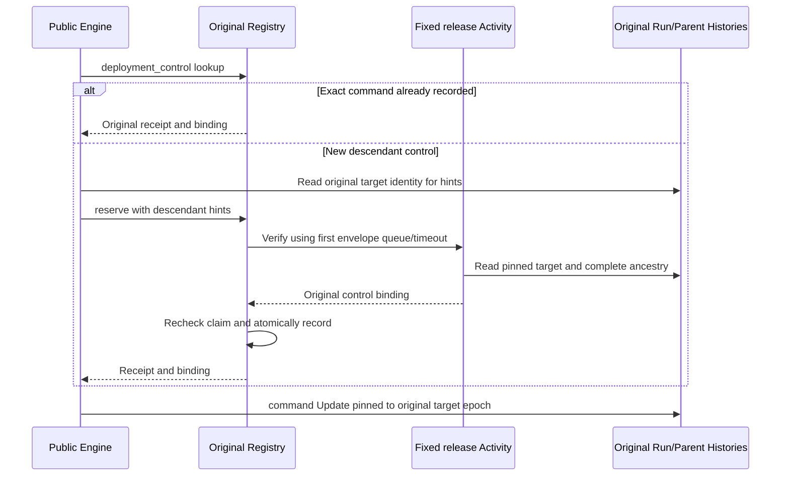

# Original public deployment descendant controls

Version 1 · 2026-10-15 · Codex implementation team

This contract repairs public controls of an already accepted descendant under current ordinary deployment publication2 and Coding publication3. It preserves native Agent/sequence, graph, Team/Dynamic, hidden planner/verifier children and bounded recursive composition. Private v1, unselected/default commands and historical immutable Workers keep their existing contracts. It does not close phase-three batch2 or add SDK Session-coordinator admission.

## Authority

The same deployment Registry owns scoped public command identity. Original Run/Parent Histories own intent, actual child epochs, business application and effects. A descendant control consumes no root slot and creates no child submission, scoped Registry or scheduler. A caller's parent/root/epoch fields are lookup hints; only a Registry-owned SDK verification result can authorize first command registration.



## Exact request and response DTOs

The existing base reservation request remains exactly `{scope, command_id, kind, target, payload_digest, admission_policy, namespace}`. Supported controls remain `approve`, `cancel`, `reconcile`, `drive`, `send_input` and `patch`. `payload_digest` remains the digest of the original detached business command payload; transport hints are not injected into that payload.

A descendant reservation may add exactly one field:

```python
descendant = {
    "root_command_id": original_root_submission_command_id,
    "execution_epoch": original_target_sdk_epoch,
}
```

Both values are nonempty bounded strings. A new descendant reservation must target a different Run ID from its selected root. The hint identifies one existing scoped root record; it does not prove that the target is its descendant. Raw `control_binding`, physical proofs, ancestry attestations or verification results are not accepted in a public reservation request.

The original receipt remains exactly `{command_id, target, record_state:"durably_recorded", apply_state:"not_applied"}` for the existing root/default path. A verified descendant receipt adds exactly `control_binding`:

```python
control_binding = {
    "version": 1,
    "scope": original_scope,
    "namespace": {"name": original_namespace_name, "id": original_namespace_uuid},
    "target": original_target_run_id,
    "target_execution_epoch": original_target_sdk_epoch,
    "root_run_id": original_accepted_root_run_id,
    "root_execution_epoch": original_accepted_root_sdk_epoch,
}
```

Version must be an exact integer; Scope and namespace retain their existing strict validators. This binding fixes transport routing. It does not claim that the business command was applied or that any effect/fee completed.

## Pure Registry interfaces

`PublicDeploymentAdmissionState` exposes these methods, delegated unchanged by `TemporalCommandRegistryState`. `CodingDeploymentAdmissionState` inherits the same control behavior; its index and quota are not duplicated.

`deployment_control(request)` accepts exactly `{kind:"deployment_control", scope, command_id, command_kind, target, payload_digest, admission_policy, namespace}`. `command_kind` is the business control kind, avoiding collision with the query's `kind`. It validates authority and the existing scoped identity `{kind:command_kind, target, payload_digest}` at key `digest([scope, command_id])`. Return None for an absent command, the original receipt for an exact command, or `IdempotencyConflict` for changed kind/target/payload or a submit/control collision. Exact lookup does not require the root to remain held and does not validate current aliases or current target History.

`prepare_deployment_control(request)` permits outer fields equal to the base request or base request plus `descendant`. Validate base authority, kind, strings, SHA and permitted outer keys first, then perform the same command lookup. If recorded, return exactly `{"receipt": original_receipt}` including its original binding when present, before inspecting hint contents, current root or capacity. Changed/malformed hints are not command identity and cannot change a saved binding. For a fresh command, require exact valid `descendant`; a fresh request without hints refuses here. Preparation never calls the mutating root `_control` path. Otherwise return exactly:

```python
{
    "request": base_reservation_request,  # exact seven fields; hints removed
    "root": original_held_bound_root,
    "submission": original_first_submission_envelope,
    "target_execution_epoch": descendant["execution_epoch"],
}
```

The root comes from `self.roots[digest([scope, descendant.root_command_id])]`, never caller metadata or a retired-root inference. It must be held-bound with a fixed epoch, same Scope/policy/namespace and its unchanged first submission. The envelope retains exact `{version:1, request, manifest, activity_timeout, task_queue}`. Validate the root, envelope identity, supported publication and bounded command capacity before returning. Preparation writes no command, root, Coding index, quota or binding.

`commit_deployment_control(request, verification)` accepts the same original descendant reservation and, for a fresh command, an exact seven-field `control_binding` from the SDK verifier. Re-run preparation after the Activity await. An exact command recorded concurrently returns its original receipt/binding before inspecting verifier/hints or current root; a conflicting command rejects. A fresh command requires the root still be held-bound and every binding field to equal the prepared Scope/namespace/target/target epoch/root ID/root epoch. A root released, replaced or changed while verification ran rejects fresh registration. Recheck capacity before both writes.

Store the binding in `self.control_bindings` at the same scoped command key, beside `self.commands`. Preserve the existing command record `{identity, receipt}` and four-field stored receipt; merge the binding into descendant replies. Commit both command and binding together after all checks. The existing `reserve` root-control path stays synchronous and retains its old receipt shape. Its duplicate path must return an already recorded descendant binding as well, even when the retry omits hints. Direct pure reservation with hints cannot bypass SDK verification or register a new descendant command.

## Registry-owned SDK verification

The public Registry `reserve` Update handles a descendant request by preparation, fixed Activity dispatch, and commit. It checks its original SDK epoch before preparation and again after await. Existing exact duplicates return without Activity dispatch or current-target inspection.

Reuse `RELEASE_ACTIVITY = "ralf.temporal.deployment-release.v2"`, its fixed registration marker and existing response wrapper. Add mode `control`; do not add an execution authority or business Activity. Its input is exactly:

```python
{
    "mode": "control",
    "scope": prepared["request"]["scope"],
    "root": prepared["root"],
    "target": prepared["request"]["target"],
    "target_execution_epoch": prepared["target_execution_epoch"],
    "manifest": prepared["submission"]["manifest"],
    "registry_execution_epoch": actual_original_registry_sdk_epoch,
}
```

Schedule it on `prepared.submission.task_queue`, with the first `activity_timeout`, the existing verification schedule allowance `activity_timeout * 2 + 5`, and `RetryPolicy(maximum_attempts=1)`. Never use the current facade/Host Profile queue or moved alias Manifest. A mixed ordinary2/Coding3 Host uses the accepted root's own first envelope and matching Worker. Current ordinary2 accepts Registry2/3; Coding3 requires Registry3. Historical immutable Workers are not promised to understand the new mode.

`temporal_deployment_release.execute(runtime, client, value, info)` verifies actual SDK Activity info belongs to the stable Registry address and supplied original Registry epoch. Read its pinned SDK description and require RUNNING, actual namespace name, first=current epoch, no SDK parent and the original public configuration/policy/namespace UUID. Validate the original envelope Manifest against this Worker, not a caller's current alias.

Read the target through required original deployment `_proof` at `target_execution_epoch`, then `_ancestry(..., read_only=True)`. The read-only path never binds a root, pins a missing child epoch, emits a command or mutates any History. Missing original Parent epoch pins refuse. Validate each original Parent intent, unique call ID, request/Manifest/admission digests, dispatch flag, recorded child epoch and actual SDK parent description through the full bounded lineage. SDK first/current/original epochs must equal each original proof's epoch. The target's required admission receipt, target root metadata and the final ancestry root must all match the Registry-prepared held-bound root, including its first request/Manifest and namespace UUID.

Recheck Runtime/source release, actual Registry SDK info and namespace after awaits. The Activity returns exactly the seven-field binding; the registered wrapper returns `{ok:True, result:control_binding}` or `{ok:False, code:sanitized_code}`. The Registry alone feeds that result to commit. No public Update accepts a raw attestation from its caller. A verification failure registers no new command or binding and releases no root.

## Public transport and close semantics

`temporal_deployment_submissions.guard(engine, kind, command_id, target, payload)` first queries `deployment_control` under its fixed Scope/policy/actual namespace UUID. An exact existing receipt/binding is recovered before current alias or target inspection. For a new descendant, read the original target SDK description and deployment query only to derive root-command and epoch hints; the Registry-owned Activity performs authorization. Validate the returned receipt and binding strictly and recheck fixed client/Scope/namespace/policy after awaits.

The guard returns the validated binding for a descendant or None for the unchanged root receipt path. `TemporalEngine._command` sends the final business `command` Update with `get_workflow_handle(target, run_id=control_binding.target_execution_epoch)` when a binding is present. It does not send transport hints/binding into the original business payload. A reset or epoch change between verification and dispatch cannot redirect that Update. Keep original public command ID and payload digest semantics; do not generate another business command or root submission.

While its root remains held, a descendant may still require original cancel/drive/reconciliation and ACK recovery after scoped Coding close. Registry registration never grants native/model/tool permission or revives a sealed History: original stop intents, Activity gates, Coding grant fences and irreversible guards remain authoritative. Fresh control registration after root retirement refuses; an exact previously registered control still returns its original receipt/binding. Existing sealed-root retirement wake remains its separate exact duplicate-seal path. Missing Registry/target/ancestor proof, timeouts and unknown work stay fail-closed; they are not no-start or release evidence.

## Focused acceptance

Preserve the actual graph child-approval failure as RED and add ordinary v2 child-approval Service RED. Pure/transport tests must cover ordinary2 on Registry2/3 and Coding3 on Registry3; nested graph/Team/Dynamic and hidden/old-revision intents; one root/one effect/one command; rogue same-Scope raw SDK targets and forged hints; changed Scope/UUID/first/current/ancestor epoch, actual parent, request/Manifest/carrier or call ID; missing pins without mutations; original queue/timeout after alias/Host movement; exact duplicates after retirement and changed command identity; capacity/retirement/close races after await; no caller attestation path; and epoch-pinned final command delivery across reset. Do not claim a completed stage or full R01–R26 gate from this focused repair.

Related contracts: [public first acceptance and retirement](temporal-deployment-public-contract.md), [original dispatch and ancestry](temporal-deployment-dispatch-contract.md), and [Coding ownership and physical close](temporal-deployment-coding-contract.md).

2026-10-16 experimental release addendum: [bounded original-root recovery](temporal-recovery-capacity-contract.md)
adds root-only cancel/drive protection and repeatable mechanical wake. It does not
exempt this contract's fresh descendant preparation/commit from command capacity
or ancestry verification. Matching old selected Workers remain required; the new
release's source fingerprints do not promise in-place upgrade of old Histories.
