# 智能数据链路组件设计

版本：设计与交付状态 3；日期：2026-10-08；维护者：Ralf-Agent maintainers。
面向框架实现者、数据适配器作者及应用开发者。当前基线为 dev25。
D1 Parser／Chunker／原子摄取已实现，具体 API 见[摄取指南](../../docs/document-ingestion.md)；D2 的显式 HTTP Embedding／Hybrid／融合重排已实现，见[混合检索指南](../../docs/hybrid-retrieval.md)；D3a 的纯上下文与显式 Artifact 默认已实现，见[上下文指南](../../docs/context-artifacts.md)；D3b 的 opt-in 来源提炼、受管理模型摘要及 Temporal 纯自定义上下文已在 dev21 交付，见[记忆指南](../../docs/managed-memory.md)。运行内自动阶段、语义冲突／撤回及 D4 质量仍待完成；分层缺口见[dev25 清单](../../docs/remaining-work.md)。

## 范围与当前基础

目前已有 KnowledgeStore、KnowledgeRetriever、EmbeddingProvider、VectorIndex、
KnowledgeContextPort、ContextBuilder、Session/Facts 端口，以及 SQLite、Redis、
PostgreSQL、Qdrant 实现。默认词法检索和 HashEmbedding 可离线运行。
dev18 已交付独立解析／分块和原子知识摄取。dev19 提供显式 HTTP Embedding 协议与混合召回／重排默认；dev21 提供显式模型摘要与来源约束记忆提炼。
运行内自动压缩、语义记忆修订及完整真实质量仍待验收。CompleteVerifier 只选择最后结果，没有业务正确性验证语义。

目标是在现有执行与来源契约上补默认链路，让开发者能够逐个替换组件。
数据链路不拥有 Run 执行权，不直接控制业务工具，也不隐式启动付费调用。

```mermaid
flowchart LR
    Source[显式提供的来源] --> Parser[DocumentParser]
    Parser --> Chunker[Chunker]
    Chunker --> Ingest[IngestionCoordinator]
    Ingest --> Knowledge[KnowledgeStore 来源权威]
    Knowledge --> Indexer[显式索引任务]
    Indexer --> Embedding[EmbeddingProvider]
    Embedding --> Vector[VectorIndex]
    Knowledge --> Lexical[LexicalRetriever]
    Vector --> Semantic[VectorRetriever 权威回读]
    Lexical --> Hybrid[HybridRetriever]
    Semantic --> Hybrid
    Hybrid --> Reranker[Reranker]
    Reranker --> Context[ContextBuilder 与固定引用]
    Context --> Agent[Agent 执行权威]
    Agent --> Summary[受管理摘要／记忆提案]
    Summary --> Commit[校验与 CAS 采纳]
    Commit --> Facts[FactsStore]
```

## 端口与默认实现

| 组件 | 输入／输出契约 | 首批默认实现 | 自定义与依赖 |
| --- | --- | --- | --- |
| DocumentParser（D1 已交付） | SourceDocument（有界字节／媒体类型／来源）→ ParsedDocument（正文与源摘要） | UTF-8 文本、Markdown | PDF／HTML／Office 插件后续提供；宿主显式读取文件，不由解析器任意抓取 URL |
| Chunker（D1 已交付） | ParsedDocument → 有界 ChunkSpan（解析后字符范围／可选块元数据） | 保持现有字符分块结果的兼容适配；段落分块可显式选择 | token／语义分块替换，算法 identity 纳入摄取配置 |
| IngestionCoordinator（D1 已交付） | Scope、namespace、SourceDocument、command_id、expected_version → 不可变摄取回执 | 默认知识库原子 CAS 文档／块／词项／回执 | knowledge_committed 不代表向量就绪；索引单独显式调用，无分布式事务／后台索引调度 |
| EmbeddingProvider | 有界文本批次 → 按输入顺序排列的有限向量 | 保留 HashEmbedding；增加显式 HTTP 适配入口 | 模型／端点／维度由用户指定；借用或 owned 客户端声明清楚 |
| HybridRetriever | RetrievalQuery → 有界、去重且已校验的来源证据 | 词法与向量排名融合，默认 RRF | 不比较不同后端未经标定的原始分数；融合权重可替换 |
| Reranker | 查询与已确认候选 → 候选子集／顺序 | 保序或词项评分的离线默认 | 模型重排为显式可选组件，不能替换候选正文或伪造来源 |
| ContextBudgeter | 完整消息组、引用及预算 → 消息快照和计量证据 | 保留字符计量；增加可替换 token 计量器 | 声明模型／tokenizer identity；估算不能声称供应商精确计费 |
| ArtifactStore | 有界大结果 → Scope 隔离的内容摘要与引用 | 显式内存／SQLite JSON 内容存储 | 文件／S3／对象存储后续适配；引用授权、过期、读取限额独立验证 |
| ContextSummarizer | 历史完整消息组 → 摘要提案及覆盖范围 | 确定性摘录默认；受管理模型摘要可选 | 不覆盖执行事件和效果回执，摘要在新消息快照中显式标记 |
| MemoryExtractor | 允许的输入／已完成证据 → 带来源的事实提案 | 显式规则提炼；模型提炼需 opt-in | Facts CAS 采纳、冲突处理和撤回由宿主策略决定 |
| BusinessVerifier | 任务、证据及业务验收规则 → Verification | 现有 CompleteVerifier 保持；增加显式规则校验入口 | 业务正确性必须配置 oracle／检查规则；模型评审独立计费和报告 |

这些组件优先使用结构化 Protocol 与 immutable DTO，不要求继承默认实现。
自定义组件必须声明 identity、配置与同步／异步方法模式。返回惰性对象、非有限
JSON、超限数据、错误向量维度或错误候选身份时，在采纳前拒绝。

## 兼容和一致性决策

1. 原 KnowledgeStore.put、Chunk／Document DTO、默认字符分块、local-4 和原生
   Temporal release 保持行为。新分块器首先通过兼容适配器接入；若现有存储契约
   无法原子替换完整 chunk 集合，新增有版本的写入端口，不能把多次写伪装成原子操作。
2. D1 摄取回执固定 parser／chunker identity；Embedding 在显式索引器中独立固定。变化后使用新命令和期望版本重新摄取／索引。原请求重放返回历史回执，不重新解析。
   文档版本与内容摘要是来源权威；索引命中必须回读现存来源。解析定位不得超过
   解析后文本范围（D1 为 parsed_character，不代表原文件字节偏移），删除、过期、跨 Scope、旧版本命中不得进入上下文。
3. 知识库和向量库之间不假设分布式事务。索引失败保留摄取记录和重建所需信息；
   重放使用原文档／版本／配置，不能静默切换模型或分块算法。
4. 并行混合检索以各自候选限额和总候选限额约束内存。失败策略明确选择全部失败
   或允许降级；返回 mode／缺失分支，不静默声称完成语义检索。取消后停止新请求，
   保留真实后台任务的生命周期直至退出。
5. 融合／重排不得通过重新排序绕过来源校验。采纳后保存固定引用和上下文摘要；
   Local／Temporal 在下一次模型派发前复核来源，恢复使用原快照。
6. 摘要、提炼与模型重排是显式工作，模型调用通过受管理 Agent／Action 或独立
   计量接口执行。默认调用次数为零。额度和 usage 保持可追踪；不能把 embedding
   或摘要费用隐含算入已有 execution credits 的美元含义。
7. 自动记忆默认关闭。模型输出先成为提案，再按 Scope、来源、Schema、可信级别
   与 CAS 校验后采纳。工具文本不能借提炼升级成系统指令、权限或已确认业务事实。
   Session／Facts／Knowledge／执行日志保持职责分离。
8. 配置选择发生在任务接受前。适配器和模型 identity 固定到声明／发布中；运行中
   替换不会影响历史任务恢复。连接默认 borrowed；owned 资源通过现有生命周期逆序
   关闭，失败保留重试句柄。不自动下载模型、安装解析库或寻找宿主密钥。

Local 与 Temporal 共享数据端口和证据 DTO，但由各自执行权威采纳。纯 ContextBuilder
保持同步、无 I/O；模型摘要／提炼在 Local 受管理调用或 Temporal 独立 Activity 中
接收证据，再保存快照。Temporal 的自定义 Context／Session 能力需逐项增加真实服务
与旧 History 测试，通过前保留当前明确拒绝行为。

## 分阶段交付与验收

| 增量 | 可审查交付物 | 必需行为证据 |
| --- | --- | --- |
| D1：解析／分块／摄取（dev18 已实现） | 独立端口、兼容默认、来源定位、显式摄取回执 | 旧默认 chunk 字节／标识保持；替换算法、CAS、失败重放、来源范围校验 |
| D2：语义协议／混合检索（dev19 已实现；质量待验证） | HTTP Embedding 适配、融合／重排、配置／starter | HTTP 协议乱序索引、缺项、维度、超限和关闭；真实 PG/Qdrant 组合、过期／跨 Scope／旧命中拒绝 |
| D3：上下文／记忆 | token 预算、大结果引用、摘要／事实提案采纳 | 完整 tool group、不丢审批和待核验状态、引用访问限制、取消／重启、事实冲突和撤回 |
| D4：质量／采用 | 固定语义检索与答案／引用任务集、业务 Verifier、独立接入教程 | 实际模型、调用配置、usage／延迟、逐例报告；外部开发者按安装包完成接入和恢复 |

每个增量都有无需外部服务的离线默认示例，以及替换一个组件的独立示例。
协议 fixture 只证明接入／恢复；真实语义召回、答案质量和引用正确性分别报告。
任何“对齐 AgentScope”或“超过 LangGraph”的结论都需要同任务、同模型、同下游
服务、明确配置与版本的对等实验；当前没有这份证据。

企业 OIDC／资源 ACL、全局容量、History／Inbox 保留清理、迁移、沙箱和恢复控制台
另做治理增量，与这条数据链路并行规划，不因增加端口而宣称已交付。

## 决策与依据

本草案沿用[框架分层设计](framework-capabilities.md)、
[命令契约](../specs/run-command-contract.md)与
[效果恢复契约](../specs/action-recovery-contract.md)的权威划分。
已交付事实见[实现清单](../../docs/implementation-status.md)、
[远程数据](../../docs/remote-data.md)、
[dev17 审查](../reviews/2026-10-07-temporal-composites.md)及
[M1 验收协议](../../docs/m1-acceptance.md)。

## dev20 D3a 交付边界

已实现 MessageCounter、ContextBudgeter、ContextSummarizer 和不可变测量／摘要提案，BudgetedContextAssembler 采用完整消息组，保护原系统／任务与最新证据，并在 Harness 后校验实际请求。默认字符计量、可选 UTF-8 token 估算和确定性历史摘录均无模型调用；摘录只进入新的请求快照，不改写执行或记忆权威。

ArtifactStore／AsyncArtifactStore 有内存／SQLite 显式 JSON 默认，包含 Scope／来源身份／摘要／TTL／字节与事务容量。第十七个 context 模板展示应用选择的大工具结果引用和有界读取。这里采用独立 SQLite 内容寻址默认，以复用本地事务容量及安装依赖；文件／S3／远程适配仍待实现。不是自动卸载、GC 或企业 IAM。

以上为 dev20 D3a 历史边界。当时 MemoryExtractor、模型摘要与 Temporal 自定义 Context 尚未交付；dev21 D3b 已实现其显式子集，见下节。当前 D3 仍缺运行内自动阶段、语义事实冲突／撤回和完整真实质量验收。见 [D3a 指南](../../docs/context-artifacts.md)和 [历史审查](../reviews/2026-10-07-context-artifacts.md)。

## dev21 D3b 交付边界

MemoryPipeline 显式开启成功任务后的规则／受管理模型字段选择和来源约束采纳，兼容现有同步／异步 CAS、召回和事实校验。只追加来源观察，不实现语义真值、全局原子事实批次或信念修订。模型摘要经过独立 Run 保存证据，再交给冻结纯构建器；没有隐藏的模型 I/O 或自动运行中压缩。Temporal 自定义纯 ContextBuilder 已有原生 History 快照和实际 Worker 重启证据。真实 DeepSeek 小范围结果见[质量报告](../../docs/live-model-quality.md)，完整 D3／M1 仍未验收。
