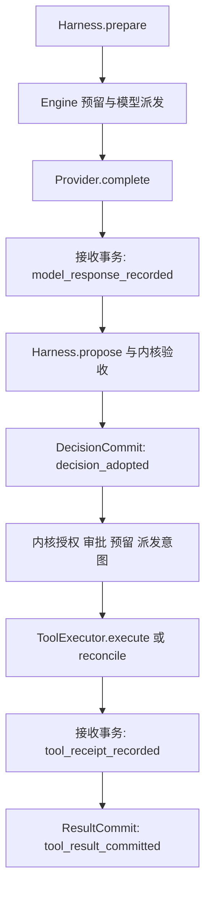

# Harness、工具执行器与接收阶段

版本：0.1.0.dev7；内核：local-4；日期：2026-10-06。公开组件与两个独立接收窗口已有本地回归证据：10 项真实进程／取消窗口测试通过。本地可选召回与知识接入见 [RAG 教程](recall-and-rag.md)。M1 成组验收、真实模型质量与 Temporal 仍未交付。

## 1. 默认入口不增加装配负担

原来的 `LocalEngine(SQLiteStore(path), providers=..., tools=...)` 继续使用原生默认组件：`NativeHarness()` 和 `PythonToolExecutor(tools)`。只有需要改变决策策略或派发方式时，才显式传入 `harness=`／`tool_executor=`。

| 组件 | 职责 | 不持有的权威 |
| --- | --- | --- |
| ContextBuilder | 从历史与参考选择消息，返回上下文 Manifest | 工具许可与 Run 提交 |
| Harness | 同步准备模型请求，从模型响应提出最终输出／工具提案 | 模型／工具执行、Action ID、审批、预算和状态提交 |
| ModelProvider | 对一次请求返回 ModelResponse | 业务工具执行与重试调度 |
| ToolExecutor | 执行一个已派发的工具 Attempt，或查询它的效果 | 审批决定、预算预留、Run 推进和结果采纳 |
| LocalEngine | 验证固定身份与提案，拥有命令、调度、审批、派发意图、接收和采纳 | 不能代替业务系统提供 exactly-once |

这些组件属于可信宿主代码。接口限制职责并提供公共校验边界，没有将任意 Python 实现隔离在沙箱中。

## 2. Harness：同步、确定且可独立验证

公开接口从 `ralf_agent` 导入：`Harness`、`NativeHarness`、`ModelRequest`、`DecisionProposal`。

```python
from ralf_agent import ModelRequest, NativeHarness


class EvidenceHarness(NativeHarness):
    identity = {"kind": "evidence-harness", "version": "1"}

    def prepare(self, spec, messages, tools):
        reminder = {
            "role": "user",
            "content": "依据工具结果回答；缺少证据时明确说明，不猜测业务已完成。",
        }
        return ModelRequest([*messages, reminder], tools)

    # 默认 propose 返回响应中的最终输出和工具提案，仍由 Engine 验收。
```

| 方法／值 | 契约 |
| --- | --- |
| `prepare(spec, messages, tools) -> ModelRequest` | 同步；spec 为 AgentSpec，messages／tools 为与内核状态分离的数据 |
| `propose(spec, response) -> DecisionProposal` | 同步；response 为已收到的 ModelResponse，返回 output 与 ToolCall 序列 |
| `identity` | 非空有限 JSON，包含会影响行为的版本及非秘密配置；恢复时必须与原 Manifest 一致 |

prepare／propose 必须纯粹地变换数据：不得调用模型或工具、读取外部服务、创建 Action ID、提交执行状态或隐藏重试。不同 Agent 可以依据 `spec.name` 选择领域策略；模型、工具目录和工具参数仍由 Engine 控制。

ModelRequest／DecisionProposal 会复制并验证 JSON；frozen 字段不代表内部列表／字典深度不可变。使用者可以构造自己的数据，但不能把修改副本当成修改 Registry、原审批或已保存执行事实。返回 coroutine、上下文管理器或其他非约定对象不是异步扩展方式，会拒绝。

Engine 再次检查允许工具、参数 Schema、最终输出、调用身份、额度、取消与固定发布。Harness 提出一个写提案不表示它已获批准。

Provider 与 Executor 都固定实际调用对象：派发意图事务后、调用前复核身份，收到响应／观察后先保存证据，再复核实际组件。把注册表项换成另一个同身份实例，不能掩盖原调用对象已改变身份。

## 3. ToolExecutor：执行与核验返回证据

公开接口：`ToolExecutor`、`PythonToolExecutor`、`DispatchEnvelope`、`EffectObservation`。

| 方法／值 | 契约 |
| --- | --- |
| `async execute(envelope) -> EffectObservation` | 执行这一个 Attempt，不自行提交 Run 或追加调度 |
| `async reconcile(envelope) -> EffectObservation \| None` | 查询原 effect_key；无法确认时返回 None，不把查询变成重新写入 |
| `DispatchEnvelope` | 固定 InvocationContext、tool_manifest、arguments、operation_digest |
| `EffectObservation(result, source="tool-handler")` | 已确认结果的有限 JSON 与非秘密来源标记，等待内核接收和采纳 |

Envelope／Observation 在内部保存 canonical JSON；arguments、tool_manifest、result 属性每次返回独立数据。修改这些视图不会修改原派发或回执，Context 中的 Scope 和标识也固定。Envelope 本身不是权限令牌，拥有一个对象不授予业务授权。

`PythonToolExecutor` 检查 Registry 与固定工具 Manifest，使用原 InvocationContext 调用可信 handler／reconciler。同步调用使用框架管理的线程，异步调用直接等待。自定义执行器也必须保留原 effect_key、操作参数和单次 Attempt；不得绕过审批、隐藏业务重试或把不确定结果报告为已确认。

```python
from ralf_agent import EffectObservation, PythonToolExecutor


class TaggedExecutor:
    def __init__(self, tools):
        self.delegate = PythonToolExecutor(tools)

    @property
    def identity(self):
        return {"kind": "tagged-python", "version": "1", "delegate": self.delegate.identity}

    async def execute(self, envelope):
        observed = await self.delegate.execute(envelope)
        return EffectObservation(observed.result, source="tagged-python")

    async def reconcile(self, envelope):
        observed = await self.delegate.reconcile(envelope)
        return (
            None
            if observed is None
            else EffectObservation(observed.result, source="tagged-reconciler")
        )


# LocalEngine(..., tools=tools, harness=EvidenceHarness(), tool_executor=TaggedExecutor(tools))
```

source 是审计标记，不代替原业务回执。`None` 表示没有确认观察；确认的 JSON null 可以用 `EffectObservation(None)` 表达。注入执行器及其客户端由调用者管理资源；内部自行创建线程或异步后台工作时，要自行满足真实完成与关闭契约。

## 4. 接收和采纳是两个事务



| 阶段 | 耐久事实 | 恢复动作 |
| --- | --- | --- |
| 模型接收 | Action.status=response_received；received_response 保存 output／tool_calls／usage，事件 model_response_recorded | 以原响应提出并验收决策，不再次调用模型 |
| 模型采纳 | 原 Action 的已接受 response、工具提案及稳定 Action ID；事件 decision_adopted | 使用原决策推进，不重新生成工具提案 |
| 工具接收 | Action.status=receipt_received；effect_observation 保存确认的 result／receipt，事件 tool_receipt_recorded | 以原观察提交结果，不再次调用 handler 或 reconciler |
| 工具采纳 | 原 Action 的 result／receipt、工具消息、Attempt 结算；handler 结果事件 tool_result_committed | 已接受结果只合并一次，晚到证据不能覆盖原提交 |

模型完整响应的已知 execution credits 在接收阶段结算；工具 credits 在 ResultCommit 结算。Token 使用量未知仍标未知，不能把缺失用量视作零。未保存回复／回执的外部调用仍可能是 outcome_unknown，必须保留相应证据和额度。

派发意图保存后，若取消或固定配置校验在实际组件调用前阻止派发，本次 Attempt 标记 not_dispatched，预留以零实际 credits 结算；事件为 model_dispatch_rejected／tool_dispatch_rejected。这项证据只适用于本次未开始的调用。历史 Attempt 的未知效果与额度仍保留、仍阻断新的同操作写入；核验结算最后真正派发的 Attempt，不把未派发重试的零结算覆盖为工具费用。

取消在两个事务之间应用时，已经收到的证据仍可采纳与结算；模型标记 decision_skipped，decision_adopted 的 proposed_actions 为空，不创建新工具 Action、不发起后续模型、不把 cancelled 改为 succeeded。已收到的工具回执仍保存实际效果，不通过取消抹去业务结果。

CLI inspect 的 recorded_evidence 列出等待采纳的 Action、阶段与证据摘要，保持只读，不调用模型、handler 或 query。恢复这些证据无需重新请求外部组件；仍在运行的流程在证据采纳后可以继续新步骤。已取消／失败 Run 的证据也能通过 resume 采纳，终态不会重新打开。

人工 `engine.reconcile()` 的操作员结果是命令 payload 的证据，仍与命令去重及 ResultCommit 在同一原子事务中提交；它没有额外的 executor 接收窗口。独立 tool_receipt_recorded 阶段针对 handler 与执行器自动 reconcile 的观察。

实际模型已发出但响应未耐久收到时，resume 目前仍可能发起新 Attempt；旧未知额度保留。显式可配置的未知模型重试策略尚未交付。

验证在接收事务真正 commit 后、采纳事务之前让真实进程退出，分别检查模型调用、handler、查询、业务效果、Action／Attempt、事件顺序与预算。[test_receipt_process_recovery.py](../tests/test_receipt_process_recovery.py) 的 10 项回归已经通过，覆盖最终响应／工具提案、可核验／不可核验写、崩溃后取消及同进程接收／采纳间取消。M1 协议的成组 20 次报告仍待跑；无故障通过不能替代窗口证据。

## 5. 接入例子与升级

源码示例 [execution_components.py](../examples/execution_components.py) 展示按 Agent 选择 Harness 策略与替换工具执行器。使用源码开发安装，在仓库根目录运行：

```bash
python -m examples.execution_components --db .ralf/components.sqlite --ticket INC-COMPONENTS
ralf --db .ralf/components.sqlite --factory examples.execution_components:create_engine --format text inspect RUN_ID
```

例子完全离线，入口自动推进至 waiting_approval。检查 inspect 中的写参数和摘要后，复制其 approve／resume 命令继续；`--workflow` 使用同一工厂运行顺序流程。它是源码示例，wheel 使用者仍可使用独立 starter，或自行把组件放进可导入项目包。

ReviewHarness 依据 spec.name 追加提示、规范化写入 plan；BusinessExecutor 使用独立 SQLite 保存效果和派发审计，Registry 中的 descriptor 不实际执行业务。审批前没有执行器业务写。这里验证可替换边界，不代表已经交付远程执行服务或成熟的多类 Agent 模板。

dev6 固定内核身份为 local-4，将 Harness／Executor 身份加入 Manifest，并改变阶段语义。local-3 的 dev3–dev5 Run 可以观察、取消和人工核验，继续执行需要原版本和原工厂；不静默改写 Manifest 迁移。SQLite Schema v1、dev3 起的调用方 submit 摘要保持不变，因此相同请求仍能找回原提交，但找回回执不表示新内核可以继续旧 Run。dev1／dev2 的旧 submit 摘要重放仍需要原版本。更多要求见 [扩展指南](extending.md) 与 [恢复指南](recovery-guide.md)。
